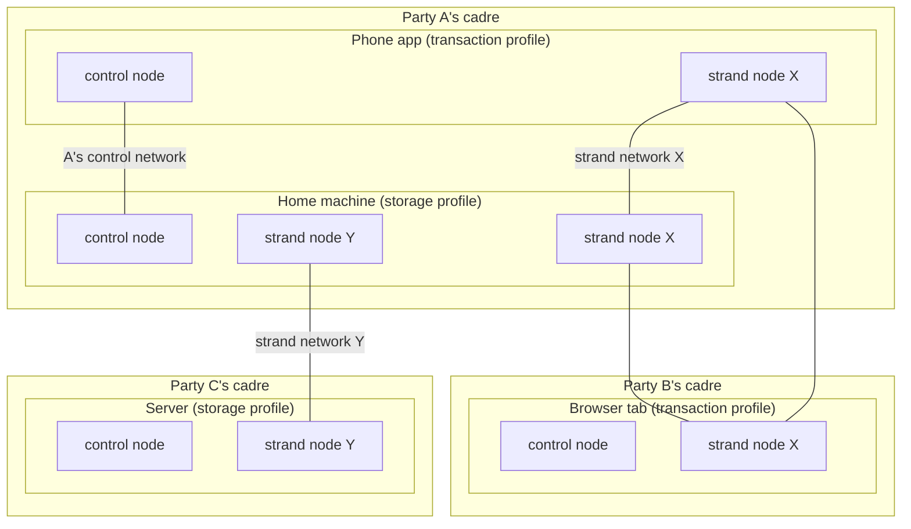
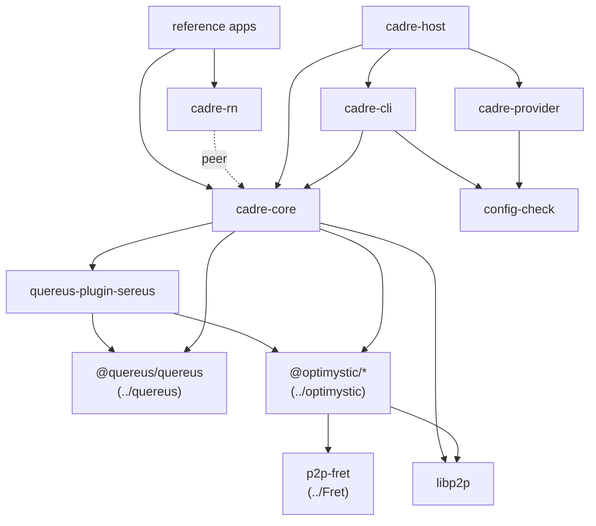

# Architecture

This document is an overview of Sereus: what the components are, how they fit together, and which document owns each one. Each section says what a subsystem does and why it exists, then links to the document that describes it. It is for anyone who needs orientation before working on one part. The terms used here are defined in [Concepts](concepts.md); read that first.

Related: [index of all documents](README.md) · [Getting started](getting-started.md) · [cadre-core API guide](api.md)

## The components

Sereus has three kinds of thing at run time: nodes, control networks and strand networks.

A **node** is one running instance of `@serfab/cadre-core` on one machine. A party's nodes form its cadre. Inside a node there is one libp2p node for the party's control network, the **control node**, and one more for each strand the machine serves, a **strand node**. Each has its own peer id, listening port and connections.

A **control network** connects the control nodes of one party and carries that party's control database. A **strand network** connects the strand nodes of every party in one strand and carries that strand's database. No network carries another network's traffic.

In the diagram, party A's home machine serves strand Y although A's phone app does not use it: an always-on node keeps a copy of every strand its party takes part in. Parties B and C each have a one-machine cadre, whose control network is that machine alone.

Every database in the system, control or strand, is the same stack. Quereus executes SQL and checks the schema's constraints. Optimystic stores the tables as blocks, replicates each block to a cluster of nodes and commits transactions across that cluster. FRET, Optimystic's distributed hash table, finds the nodes that hold a block. libp2p provides the connections.

## Packages and what depends on what

The repository is a Yarn workspace. Every directory under `packages/` is one package.

| Package | What it is | Sereus packages it depends on |
| --- | --- | --- |
| `@serfab/config-check` | Strict checking of a parsed config file. No dependencies. | none |
| `@serfab/quereus-plugin-sereus` | Quereus plugin that opens a strand as a SQL database and applies the `Strand` and `App` schemas. Holds the cluster-size policy. | none |
| `@serfab/cadre-core` | The node library: control network, strand lifecycle, membership, formation, the edge node, the provider client. | `quereus-plugin-sereus` |
| `@serfab/cadre-cli` | The `cadre` command: one headless always-on node from a config file, and the Docker image built from `packages/cadre-cli/docker`. | `cadre-core`, `config-check` |
| `@serfab/cadre-provider` | Reference service that rents out nodes as Docker containers of the cadre-cli image. | `config-check` |
| `@serfab/cadre-host` | Manager that runs cadre-cli nodes as child processes on a home machine, with a local web UI. | `cadre-cli`, `cadre-core`, `cadre-provider` |
| `@serfab/cadre-rn` | React Native kit: phone node, polyfills, Metro configuration, native crypto. | `cadre-core` (peer dependency) |
| `reference-app-rn`, `reference-app-ns`, `reference-app-web` | Sample chat apps for React Native, NativeScript and the browser. Not published. | `cadre-core`; the React Native app also `cadre-rn` |
| `@serfab/integration-tests` | Scenarios that run real nodes over real transports. Not published. | `cadre-core`, `cadre-cli`, `cadre-host`, `cadre-provider` |

Three facts in this graph are easy to get wrong:

- **cadre-provider does not depend on cadre-core.** It starts containers of the cadre-cli image and reads each node's `/status` endpoint. The app-side client for a provider's API is in cadre-core.
- **cadre-host uses cadre-provider only for its `Orchestrator` interface and types**, which it implements with child processes instead of Docker.
- **`cadre-core` opens every strand database through `quereus-plugin-sereus`**, so an app that runs a node does not use the plugin directly.

### Sibling repositories

Quereus, Optimystic and FRET are separate projects. The root `package.json` links `@quereus/quereus` and every `@optimystic/*` package to checkouts beside this repository, `../quereus` and `../optimystic`, through its `resolutions` block. `p2p-fret` is a dependency of `@optimystic/db-p2p`, not of any package here; a local Optimystic checkout links it from `../Fret`.

The Optimystic packages used are `db-core`, `db-p2p` (which builds each libp2p node and the network transactor), the two Quereus plugins `quereus-plugin-optimystic` and `quereus-plugin-crypto`, and one storage backend per platform: `db-p2p-storage-fs`, `-web`, `-rn` and `-ns`. The sibling checkouts are read-only from this repository; [Testing](contributing/testing.md) gives the rules.

### Schemas

`schemas/control.qsql` declares the control database and `schemas/strand.qsql` the membership tables every strand carries. Their comments own each constraint and its reason. `schemas/chat-simple.qsql` is the app schema the reference apps run, and `schemas/chat.qsql` is a fuller chat schema with signed writes.

## The control network

A party needs one place that says which machines are its own, which keys may change that, and which strands it takes part in. That place is the control database: schema `CadreControl`, stored as Optimystic collections on the network named `control-<party id>`. Every control write is a transaction committed by the party's own nodes, and every node of the party holds the whole database.

### What the tables record and how a row is authorized

The tables record owner keys, member machines and their signed address records, the party's strands and its keys for them, joins to other parties' strands, and the invitations and grants the party has issued. A row that admits something carries a proof: an owner key's signature, a redeemed invitation or grant that an owner signed, or the machine's own signature on its own record.

Approvals are single-use. Each carries a stamp, and removing a row files a tombstone that retires the stamp, so a captured approval cannot seat the row again. The schema keeps every past version, because a party's phones update one at a time and share the database meanwhile.

Owned by [The control schema](cadre/control-schema.md).

### Replication

The control cluster is the whole party, up to 16 machines, because every node reads the whole database and a node left out of a block's cluster might never learn a fact. A machine that was offline at write time catches up when it reconnects. A node serializes its own control writes and retries the reads and writes that fail while a connection is still forming.

Owned by [Control database replication](cadre/control-replication.md).

### Convergence

Replication happens only between connected nodes, and nothing below cadre-core connects a party's nodes to each other. Each node therefore dials its siblings from their address records, keeps retrying a peer it was told about and has not reached, and sends again the writes and deletes it committed while it could reach nobody. Code that reacts to a table change subscribes to it instead of polling.

Owned by [How a party's machines converge](cadre/control-convergence.md).

### Trust and admission

A control node decides five things about the outside world: which owner keys it believes, whether it accepts a seed, how long it keeps an inbound connection, whether it grants a relay reservation, and which protocols a peer may open. The first decision rests on the trusted-owner anchor, a record on the machine itself, because the replicated owner table is data a stranger might write. The connection gate admits when in doubt, so that a database error cannot split a legitimate cadre; that is safe because the per-stream protocol guard refuses every non-member on every protocol not declared open to strangers.

Owned by [Who a node trusts and admits](cadre/control-security.md) and [Owner keys](cadre/owner-keys.md).

## A node

A started node replicates the control database, stays connected to its siblings, publishes its own signed address record, watches the party's strands and starts or stops them, redeems invitations for newcomers, and answers other parties' requests to join a strand.

Four choices shape a node:

- **Profile.** `transaction` for an app that is connected some of the time, `storage` for an always-on node. The profile sets defaults: a storage node runs a relay server, runs strands no local app has claimed, and is the peer other nodes always dial.
- **Strand filter.** Which of the party's strands this node may run: all, one sApp's, one strand, or none.
- **Key material.** The node's identity key and the owner key live in a `KeyStore` the embedder supplies, which in a React Native app is the platform's secure store.
- **Storage.** The embedder supplies a block store for the control database and one per strand. A few records the node keeps for itself, such as the anchor, are stored separately and never replicated.

An app on a phone or in a browser does not build the node itself. It calls `createEdgeNode`, which builds the configuration, starts and stops the node in order, runs the owner-key step and can move the app into another cadre.

Owned by [The cadre node](cadre/node.md). The calls an app makes are in the [cadre-core API guide](api.md).

## How a machine joins a cadre

A new machine starts with an empty control database, the existing members refuse a stranger's database streams, and often one of the two sides cannot accept a connection. Every way of adding a machine therefore delivers three things: a membership row written by someone entitled to write it, an owner key for the newcomer to trust that arrives outside the replicated data, and an address at which one side can reach the other.

| Flow | How it works | Typical use |
| --- | --- | --- |
| Seed | An owner writes the machine's row and gives it a signed list of the cadre's addresses. The operator pins the owner's key on the new machine. | A server adding a server. |
| Claim | The new node starts belonging to nobody and shows a claim secret, usually as a QR code. An owner's device dials it and proves knowledge of the secret. | A phone adding the cadre's first always-on node. |
| Cadre invitation | An owner signs a credential ahead of time. The new machine presents it to any member, which writes the row. | Adding a device while the owner is offline. |

Either end may open the first connection, and which flow fits depends on which side can be dialled.

Removing a machine is one owner-signed transaction. Because the removed machine still holds the party's membership key for every closed strand, removal also starts the replacement of that key in each of them. A person who runs several Sereus apps joins each app's node to one cadre, and the joining app's strands move with it.

Owned by [Adding and removing machines](cadre/membership.md), [Removing a machine](cadre/removing-machines.md), [Owner keys](cadre/owner-keys.md) for owner grants, and [Several apps in one cadre](cadre/apps.md).

## Strands from founding to removal

A strand's database holds two schemas: `Strand`, the header and membership tables, and `App`, the sApp's own tables. Three layers decide who may do what. The party's control database says which strands the party takes part in and whom it invited. The `Strand` tables say who belongs to a closed strand. The `App` schema's constraints say what a member may write.

1. **Founding.** `foundStrand` publishes the strand's row in the founder's control database and starts the strand on that machine, which writes the strand's first rows. Exactly one machine founds.
2. **Running.** Each node of the party sees the row and starts the strand if its filter admits it, with the app's schema where an app has claimed it and as a storage replica otherwise. Commits go through one Optimystic transactor per strand, whether the node is alone or connected.
3. **Inviting and joining.** The founder's party publishes a formation invitation and hands its text to another party. The joiner's node redeems it over the formation protocol at any machine the invitation names, then starts the strand and waits for its first sync before it writes. A join can be left pending and retried while the inviter is offline.
4. **Membership.** In a closed strand, a manager issues a single-use invitation, the joiner seats itself under its own membership key, and each party records which of its machines act for it.
5. **Writing.** A commit can succeed while only the writing machine holds it; the node reports who holds each commit, and offline mode queues commits for later delivery. Members must run the same app schema version.
6. **Idling.** A node can hibernate a strand nobody is using and rebuild it on a wake. An always-on node can wake a suspended phone through the platform push service.
7. **Removal.** A manager removes a member from a closed strand, after which the other members' machines refuse the removed party's machines. A party leaves by unpublishing its own strand row or forgetting a joined strand; every node of the party then stops the strand.

Start with [Strands: model and lifecycle](strands/lifecycle.md). Then: [Inviting and joining](strands/formation.md), [Closed-strand membership](strands/membership.md), [Closed-strand keys](strands/keys.md), [Writing to a strand](strands/writes.md), [App schemas](strands/app-schema.md), [Strand hibernation and wake](strands/hibernation.md). Writing the schema itself is covered by [Writing an app schema](schema-guide.md).

## Networking

### Relays

A phone, a browser tab or a home machine without a forwarded port cannot accept connections. Such a node asks a relay for a reservation, and while it holds one, other machines dial it at an address on the relay. Each control node and each strand node holds its own reservation, because a relay identifies clients by peer id. A dedicated relay, which serves any node that reaches it, is deployed from `ops/`. A storage-profile node also runs a relay server by default, for the nodes of its own party.

Owned by [Relays](network/relay.md).

### Finding a strand's nodes

Sereus publishes strand addresses to no shared directory. Parties exchange addresses in the invitation and in the formation exchange. A machine learns its siblings' strand addresses by asking them over the control network. Once a strand runs, its nodes pass signed address records to each other, and each node saves its table of peers so that it can redial after a restart.

Owned by [How a strand's nodes find each other](network/strand-addressing.md).

### Deadlines

A relayed dial costs a fixed number of message exchanges, so a deadline written in milliseconds fails on any link slower than its author assumed, and the failure looks like an absent peer. A node therefore declares one figure, its link round trip (3,500 ms by default), and every deadline that waits on the network is that figure multiplied by the round trips the operation costs.

Owned by [Deadlines and the link budget](network/deadlines.md).

## Hosting

A cadre that lives on a phone needs an always-on node to keep its data available and to answer for it while the phone is asleep. Two programs provide one without giving up the phone's authority; neither ever holds an owner key.

- **cadre-host** runs on a home machine. It is a manager with a local web UI that starts cadre-cli nodes as child processes, maps their ports on the router and updates itself. A phone claims a node by scanning its code, or the node redeems a cadre invitation. See [cadre-host design](hosting/cadre-host.md).
- **A provider** rents nodes. The reference provider runs each as a Docker container of the cadre-cli image, and the node joins by claim or by invitation. The provider sees the node's traffic and status and is never sent an owner key, a seed or strand data, though whoever operates the host can read the container's disk. An app rents through cadre-core's `rentNode`. See [Provider-hosted nodes](hosting/provider.md).

A server the party operates itself runs [cadre-cli](../packages/cadre-cli/README.md) directly.

## Platforms

cadre-core runs on Node.js, React Native, NativeScript and in browsers. On the three app platforms the app runs the edge node over storage and key storage the platform supplies.

| Platform | Node state is kept in | Document |
| --- | --- | --- |
| React Native | The platform secure store and LevelDB, through `@serfab/cadre-rn` | [Running a node in a React Native app](platforms/react-native.md) |
| NativeScript (Android) | SQLite | [Running a node in a NativeScript app](platforms/nativescript.md) |
| Browser | IndexedDB | [Running a node in a browser](platforms/browser.md) |

Each platform document lists the globals the runtime lacks, the bundler settings the libp2p and Optimystic packages need, and how a device that cannot listen becomes reachable. [The reference apps](platforms/reference-apps.md) describes the three sample chat apps and the cadre-management screens they share.

## Deployment shapes

- **A single phone.** One transaction-profile node is the whole cadre. A commit made while no other member of a strand is connected is held by the phone alone, and other parties can reach the party only while the app runs and holds a relay reservation.
- **A phone and an always-on node.** The phone holds the owner key. A cadre-host node, a rented node or a cadre-cli server joins as a storage-profile member, keeps a replica of every strand the party takes part in, answers formation for the party and can wake the phone. This is the shape the hosting programs exist for.
- **Mixed.** Several apps and devices with several always-on nodes. The largest party the project plans for is about seven machines (for example a phone, a laptop, three rented nodes and two home machines); the control network's replication breadth of 16 is sized against that. The same rules apply at any size: every node holds the whole control database, the always-on nodes are the ones every other node dials, and a strand served by more nodes than its cluster size stores each block on a subset of them.

The limits of each shape are stated in the subsystem documents: [Writing to a strand](strands/writes.md) for a commit only one machine holds, [Relays](network/relay.md) for reachability, and [Control database replication](cadre/control-replication.md) for cluster sizes.
