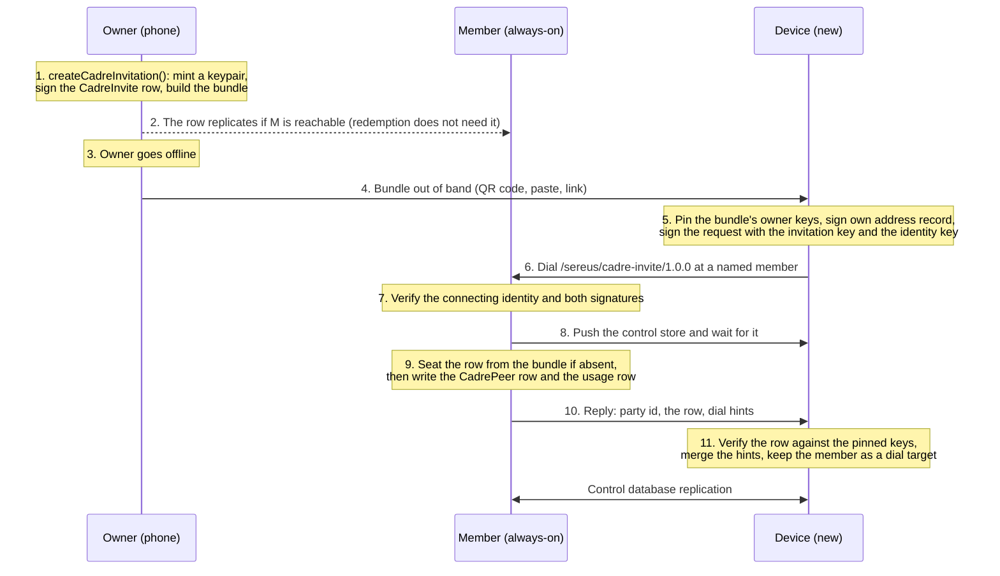

# Adding and removing machines

This document describes how a machine joins a party's cadre and how an owner takes one out: the seed, the three ways to add a machine (seed, claim, cadre invitation), the wire protocols behind them, and a summary of removal. It is for app developers choosing a flow, operators adding servers, and maintainers changing the protocols.

Related: [who a node trusts and admits](control-security.md) · [how a party's machines converge](control-convergence.md) · [removing a machine](removing-machines.md) · [owner keys](owner-keys.md) · [several apps in one cadre](apps.md) · [cadre-host](../hosting/cadre-host.md) · [provider-hosted nodes](../hosting/provider.md) · [glossary](../concepts.md#glossary)

## The cold start problem

A machine is a member of a cadre when the control database holds a live `CadrePeer` row for its peer id and that row carries a proof an owner key stands behind: an owner's signature, or a redeemed cadre invitation ([How a row proves it belongs](control-schema.md#how-a-row-proves-it-belongs)).

A new machine cannot reach that state alone, for three reasons:

1. **Its control database is empty.** It has no address to dial and no owner key against which to judge the rows it would receive.
2. **The existing machines refuse it.** Each member refuses control-database streams from a peer that is not an authorized member ([Per-stream protocol guard](control-security.md#per-stream-protocol-guard)), and the control schema rejects a write that no owner authorized. The new machine's row has to exist before the members replicate to it.
3. **One side often cannot be dialed.** A phone or a browser tab binds no socket, so every address it has comes from a relay reservation and it accepts a connection only while it holds one.

Every way of adding a machine therefore delivers three things: a `CadrePeer` row written by someone entitled to write it, an owner key for the new machine to trust that arrives outside the replicated data, and an address at which one side can reach the other.

- **Seed.** An owner writes the row and gives the new machine a signed list of the cadre's addresses. The operator pins the owner key on the new machine.
- **Claim.** An owner delivers a seed to a node that belongs to nobody, with proof that it knows the node's claim secret. The node then trusts that owner.
- **Cadre invitation.** An owner signs a credential ahead of time. The new machine presents it to any member, which writes the row. The invitation carries the owner keys.

## The seed

A seed (`ControlNetworkSeed` in `packages/cadre-core/src/types.ts`) is an owner-signed list of the cadre's machines and their addresses. It carries:

- `partyId`: the cadre the seed belongs to.
- `peers`: one entry per live `CadrePeer` row, with the peer id, its dial addresses (empty for a machine with no listen address) and a `preferred` flag.
- `signerKey` and `signature`: an owner key and its ed25519 signature over the SHA-256 digest of the canonical JSON of `{ partyId, peers }` (`seedDigest` in `seed-bootstrap.ts`).

`preferred` marks the peers the receiver dials first: the machine that minted the seed, because it is the one most likely to be reachable at that moment, and every machine whose `CadrePeer` row says it is always on. It is a dial hint and grants nothing.

### What a seed gives and does not give

A seed gives its receiver addresses. Applying one merges the peers' addresses into the libp2p peer store, dials the preferred peers, and keeps those peers as **dial targets**, a node-local record ([Node-local state](node.md#node-local-state)). While the node's control database lists no other machine, each pass of its control-cohort reconcile routine dials every dial target ([Cold-start retry](control-convergence.md#cold-start-retry)). Applying a seed writes nothing to the control database. Once a connection forms, the control tables replicate in the ordinary way and the signed `CadrePeer` rows replace the seed's hints.

A seed does not make its receiver a member. The owner writes the new machine's `CadrePeer` row separately ([Adding a machine by seed](#adding-a-machine-by-seed)).

A seed does not carry trust. Anyone can generate a key and sign a seed, so the receiver accepts one only when `signerKey` passes its seed trust policy, which consults owner keys the receiver learned out of band: its anchor, an operator pin or a claim ([Seed trust policies](control-security.md#seed-trust-policies)). A node with an empty anchor, no pin and no claim secret refuses every seed.

cadre-core does not compare the seed's `partyId` with the receiver's configured party, because trust rests on the signer key alone. `cadre start --seed` does, and fails the start on a mismatch.

A seed names its minter only through the minter's own `CadrePeer` row, so an owner node publishes its row before it mints seeds: `cadre start --owner` does so at startup, and an embedder calls `registerSelf`.

`applySeed` returns an `ApplySeedResult` that counts the preferred dials it attempted and those that failed. When every one failed, the seed was accepted and the node reached nobody. No failures does not prove a lasting connection, because the far side may close a connection it admitted only provisionally ([The connection gate](control-security.md#the-connection-gate)).

## Which side dials

In every flow either end may open the first connection, and one working direction is enough. The adder dials the new machine when it was given the new machine's addresses. The new machine dials the adder when its seed, its invitation, or its own configured bootstrap peers (`controlNetwork.bootstrapNodes`) carry an address of a member.

| Flow | Who dials | Who must be reachable |
| --- | --- | --- |
| Seed, new machine dials: `addDrone` with no addresses (`cadre enroll add`) | The new machine dials the addresses in the seed, the minting owner node's first. | The owner node: on the same LAN, at an announced public address, or through a relay reservation. |
| Seed, both dial: `addDrone` with the new machine's addresses (`cadre enroll add --addr`) | Both. The owner node also dials the new machine. | Either one. |
| Cadre invitation: `createCadreInvitation`, `redeemCadreInvitation` (`cadre enroll invite`, `cadre start --invitation`, `cadre-host join --invitation`) | The new device dials the members the invitation names, in order. | Any one named member. The minting owner may be offline, and the device need not be reachable. |
| Claim: `claimNode` on a node started with a claim secret (`cadre-host join`, `cadre init` and `cadre code`) | The owner's device dials the node's addresses from the code it scanned. | The new node, from where the owner's device is. |

A provider container joins by claim or by invitation, and `rentNode` chooses between them ([Provider flow](../hosting/provider.md#provider-flow)). Commands and flags are in the [cadre-cli README](../../packages/cadre-cli/README.md) and [cadre-host: Join a cadre](../hosting/cadre-host.md#join-a-cadre).

### Choosing a flow

The choice depends on which of the two machines can accept a connection.

- **A phone adding the cadre's first always-on node** claims it. The cadre has no member the node could dial, so the phone must reach the node: on the LAN, or from outside through a port the router maps.
- **A cadre that already has an always-on member** uses an invitation. A phone's own address list is empty, so the invitation names the always-on member and the new device joins there, with the phone closed.
- **A server adding a server** uses a seed or an invitation. When it is unclear which of the two is reachable, pass the new machine's addresses to `addDrone` so that both sides dial.
- **Another app on the same phone, or an app that brings its own strands,** uses the flows in [Several apps in one cadre](apps.md).

A relayed address (`/p2p-circuit`) reaches a machine only while that machine holds a relay reservation, which cadre-host nodes and provider containers cannot ([Which nodes can be reached through a relay](../network/relay.md#which-nodes-can-be-reached-through-a-relay)).

### When neither side can reach the other

A node never joins when neither side holds an address at which it can reach the other. The usual cause is that only one side was given addresses and it cannot reach them.

Nothing reports this as an error, because detecting it would need knowledge of the other side's network that neither has. The seed is accepted, `ApplySeedResult` counts every preferred dial as failed (or none attempted, when no preferred peer had an address), the new machine's `CadrePeer` table stays empty, and each side keeps redialing the addresses it holds. The symptoms resemble a NAT or trust fault, so check first that at least one side holds an address the other side listens on.

### Adding a machine by seed

`addDrone` is the owner-side call behind `cadre enroll add`. Under one owner approval it writes the new machine's `CadrePeer` row and mints a seed. It keeps the addresses it was given as a dial target, and the reconcile pass that the row insert starts dials them within about 50 ms. A failed dial is retried after 15 s, 30 s and 60 s, then at the reconcile interval.

```typescript
// On an owner node (owner signer wired). `droneMultiaddrs` may be empty
// when the new machine will dial this one.
const { seed, encodedSeed } = await ownerNode.addDrone({ dronePeerId, droneMultiaddrs });

// To wait for the connection instead of leaving it to the background pass:
await ownerNode.reconcileControlCohort();
```

The new machine applies the seed with the owner's key supplied out of band:

```typescript
import { pinnedKeyTrustPolicy } from '@serfab/cadre-core';

const seed = newNode.decodeSeed(encodedSeed);
const result = await newNode.applySeed(seed, { trustPolicy: pinnedKeyTrustPolicy([ownerKey]) });
```

With cadre-cli the same step is `cadre start --seed <encodedSeed> --pin-owner-key <owner key>`.

`addPhoneWithRelay(phonePeerId)` is `addDrone` with no addresses, for an owner phone that holds a relay reservation: the seed's entry for the minting phone carries its relayed address. A phone adding a phone normally uses a cadre invitation instead, which needs neither the owner phone online nor an owner key pinned by hand on the new phone.

## Seed delivery protocol

A seed reaches a new node in one of three ways. The receiver applies the same signature and trust checks to each.

- **Over libp2p**, when the sender can dial the new node: `deliverSeed(target, seed)` on the protocol `/sereus/seed/1.0.0`. The new node must run the seed listener (`enableSeedListener`, `cadre start --listen-for-seeds`, or a claim secret).
- **As encoded text** that an operator or the embedder carries: `encodeSeed` produces base64url JSON, and `applySeed` or `cadre start --seed` applies it.
- **Over HTTP**, for a container started by hand: `POST /seed` on cadre-cli's health port, registered only when `CADRE_SEED_TOKEN` is set and accepted only with that bearer token.

### The exchange

The libp2p protocol is one frame each way: a 4-byte big-endian length, then JSON, capped at 1 MiB.

1. The sender opens a stream on `/sereus/seed/1.0.0` and writes a `SeedMessage`: the seed's four fields, plus `claimProof` when it is claiming the node.
2. The receiver verifies the signature, evaluates its seed trust policy for `signerKey`, and merges the addresses into its peer store.
3. The receiver replies with a `SeedAckMessage` (`accepted`, and on refusal a `reason` and sometimes a `code`), closes the stream, emits `seed:applied`, and only then dials the seed's preferred peers.

The receiver acknowledges before it dials because an unreachable peer can hold a dial for the whole per-peer dial budget. That time must not count against the sender's deadline or delay a claimed node's restart.

`claimProof` travels beside the seed, not inside it, because it is not part of what the owner signs.

### Refusal codes

A refusal always carries a `reason`. It carries a `code` (`SeedRefusalCode`) only when the refusing policy supplies one, which is the claim policy. The codes let the owner's app tell "already claimed" from "wrong secret" without reading prose.

| Code | Meaning |
| --- | --- |
| `already-claimed` | The node's anchor holds an owner key other than the signer's. Final. |
| `claim-proof-invalid` | The node is unclaimed and the seed carried no proof, or one that does not verify. |
| `claim-rate-limited` | Too many failed proofs recently; this one was not verified. Retry after a minute. |
| `claim-not-persisted` | The proof verified and the node could not record the claim durably. Retry. |

### Bounds on each side

The receiver waits `seedReadTimeoutMs` (default 10 s) for the frame and handles at most `maxConcurrentSeeds` (default 100) deliveries at once. Over the cap it refuses and applies nothing.

The sender treats the target as untrusted, because the target has not joined. `deliverSeed` bounds the request by `seedDeliverTimeoutMs`, which defaults to one relayed dial plus one request on the node's declared link: 28.5 s at the default ([Deadlines and the link budget](../network/deadlines.md)).

Given a peer id with a list of addresses, `deliverSeed` connects before the request deadline starts, dialing each address in turn on its own limit, so an address that never answers (a home router's public address dialed from inside) cannot use up the deadline. When no address connects it throws `PeerUnreachableError` with nothing sent, which can take 114.5 s at the default link.

## Claiming a node

A node started with a claim secret (`CadreNodeConfig.claim`) belongs to nobody. Its configured party id is a placeholder, its anchor is empty, and it accepts its first seed from whoever proves knowledge of the secret. cadre-host nodes, provider containers and servers prepared with `cadre init` start this way.

### The waiting node

The secret is 32 random bytes in base64url. The host shows it with the node's peer id and addresses as a claim code, usually a QR code: `sereus-join:1.` followed by base64url JSON (`encodeNodeClaimPayload` in `node-claim-payload.ts`). The code carries no party id, because the claim supplies it. cadre-cli reads the secret from `CADRE_CLAIM_SECRET` or the file named by `claim.secretFile`, and `cadre code` prints the code.

While the node waits (`CadreNode.isAwaitingClaim()`) it admits a stranger's connection and serves the seed protocol, and refuses control-database streams and relay reservations ([The connection gate](control-security.md#the-connection-gate)).

### The claim proof

The owner's device sends, beside the seed:

```
claimProof = base64url(HMAC-SHA256(secret, utf8(canonicalJson({
	purpose: 'sereus-node-claim', v: 1, nodePeerId, signerKey, seedDigest
}))))
```

`seedDigest` is the digest the seed signature covers. Each bound field closes one misuse of a captured proof:

- `nodePeerId` binds the proof to one node. The receiver checks it against its own peer id, never one the message supplies.
- `signerKey` binds it to one owner, so it cannot anchor a different key.
- `seedDigest` binds it to one seed, so it cannot be attached to another.

The receiver compares in constant time. Someone who observes one delivery learns a proof that works nowhere else and that this node ignores once it is claimed.

### What the node does with a valid proof

The claim policy (`claimSecretTrustPolicy` in `seed-trust-policy.ts`) makes two durable writes and waits for both before it accepts the seed:

1. It hands the seed's party id and the signer's key to `claim.record`, which the embedder persists.
2. It adds the signer to the anchor with source `claim`. This entry is the durable mark that the node is claimed.

If either write fails, the policy leaves nothing anchored and refuses with `claim-not-persisted`, so the owner retries. The record is written first because it names the party, which the anchor does not. A crash between the two leaves a record and an empty anchor, from which the embedder starts up claimed by that owner; the other order could leave an anchored node with no record of its party.

The node emits `claim:accepted` and keeps serving the placeholder party, because everything it holds is keyed on the party it started with. Restarting into the claimed party is the embedder's job: cadre-cli keeps the record as `claim.json`, restarts in process when `seed:applied` fires, and carries the seed's preferred peers into the new party's dial targets.

### After the claim

A claimed node ignores every later proof. A seed from the claiming owner is accepted through the anchor with no proof, and any other signer is refused `already-claimed`.

When two owners send valid proofs at the same moment, exactly one wins. The policy sets an in-process latch for the first signer before it first yields, so the second evaluation sees it and is refused.

Failed proofs are counted across all peers, because peer ids cost nothing to create: after 10 in one minute, further proofs are refused without being verified. With a 256-bit secret the limit bounds CPU use and log volume, not guessing.

### The owner's side

```typescript
import { decodeNodeClaimPayload } from '@serfab/cadre-core';

const payload = decodeNodeClaimPayload(scannedText);   // { peerId, multiaddrs, secret }
await ownerNode.claimNode(payload);
```

`claimNode` runs under one owner approval and in this order: mint a seed, compute the proof, deliver both, and only on acceptance write the node's `CadrePeer` row and keep its addresses as a dial target. `addDrone` writes the row first; `claimNode` writes it last so that a wrong secret, or a node that someone else owns, leaves nothing behind on the owner's device.

It throws `ClaimRefusedError` when the node was reached and refused (`code` is the refusal code when the node gave one), and `PeerUnreachableError` when no connection formed and nothing was sent. Repeating the call with the same secret is safe: the node accepts the same owner again through its anchor, and the row and the dial target are not duplicated.

### Reconnecting after the restart

The node's restart closes the connection the claim used, and the restarted node refuses connections until its control database is built ([The connection gate](control-security.md#the-connection-gate)). An owner that cannot be dialed, such as a phone with no relay reservation, gets back to the node only by its own dials. `claimNode` therefore stores the dial target with the address the claim connected on first, and for 15 s after the acknowledgement redials the node once a second until the restarted node identifies as serving the party's control database.

## Cadre invitations

An owner mints a cadre invitation with `createCadreInvitation` and hands it to a device out of band, as a QR code, pasted text or a link. The device redeems it with `redeemCadreInvitation` at any member machine the invitation names, over the protocol `/sereus/cadre-invite/1.0.0` (`cadre-invite-protocol.ts`). The member writes the device's membership rows for the owner, so the owner need not be online.

An invitation admits a machine and grants nothing else, so it defaults to a 24-hour lifetime and one use. Ownership is a separate credential, the [owner grant](owner-keys.md#owner-grants).

```typescript
import { encodeCadreJoinRequest, decodeCadreJoinRequest, decodeCadreInvitation } from '@serfab/cadre-core';

// Optional targeted flow: the device's app shows a join request (no node needed to build one).
const request = encodeCadreJoinRequest({ v: 1, peerId: deviceNode.peerId!.toString(), appName: 'Chat' });

// The owner's app mints an invitation only that device can redeem. Omit `peerId` and
// whichever device redeems first is admitted.
const { peerId } = decodeCadreJoinRequest(request);
const { invitation, encoded, reach } = await ownerNode.createCadreInvitation({ peerId });

// The device decodes `encoded` (`sereus-invite:1.…`) and redeems it.
const bundle = decodeCadreInvitation(encoded);
const joined = await deviceNode.redeemCadreInvitation(bundle, { waitForMember: true, signal, onProgress });

// The owner can list and withdraw invitations.
await ownerNode.listCadreInvitations();
await ownerNode.withdrawCadreInvitation(invitation.invite.key);
```

The device's node must be started, must have a stable identity (`keyStore` or `privateKey`), and must be configured with the invitation's `partyId`; `redeemCadreInvitation` refuses an invitation for another party. `decodeCadreInvitation` works without a node, so an app can read the party id before it builds one. The join request and the app-to-app handoff are described in [Handing an invitation from app to app](apps.md#handing-an-invitation-from-app-to-app).

`withdrawCadreInvitation(key)` files an owner-signed tombstone over the row. The row itself stays, because it is the proof of membership for every device it admitted.

### Why the invitation is a keypair

The `CadreInvite` row holds the invitation's ed25519 public key and the bundle holds the private half, which the redeeming device signs with. The member that writes the rows can verify that signature and cannot produce it, so it can neither admit a machine of its own choosing nor spend the invitation's uses. Owner grants share this design, and [How a row proves it belongs](control-schema.md#how-a-row-proves-it-belongs) explains it for both.

### The bundle

The bundle (`CadreInvitation`) is encoded as `sereus-invite:1.` followed by base64url JSON. The decoder names the mistake when an owner key, an owner grant or a join request is pasted in its place. The bundle holds:

- **The party id** and **the invitation's private key**.
- **The owner-signed `CadreInvite` row**, exactly as issued. A member that has not received the row by replication seats it from the bundle. The row's signature covers every column, so an altered copy is accepted nowhere.
- **Owner keys** for the device to pin. They come from the issuer's anchor only, never from the replicated `OwnerKey` table, because the device anchors whatever arrives. An issuer with an empty anchor refuses to mint.
- **Member addresses**, each ending in `/p2p/<peerId>`: the issuer's and up to three other members', the member most likely to answer first ([The order of the machines](../strands/formation.md#the-order-of-the-machines)).

The address list is cut to six (`CADRE_INVITATION_MAX_ADDRS`) so that the encoded text fits one QR code: at most two for each other member, and for the issuer at most four, or one when it is a device named behind an always-on member. Each machine's addresses are ranked before the cut: relayed and public addresses, then private, then loopback, then plain TCP, which a phone cannot dial.

`createCadreInvitation` also returns `reach` (`anywhere`, `local-network` or `issuer-only`): where a device could redeem the invitation once the minting machine is gone. An app reads it to warn before it hands over an invitation only the minting machine could answer, and `invitationReach()` gives the same answer without minting. [Whether another machine could redeem it](apps.md#whether-another-machine-could-redeem-it) defines the three values.

### Redemption at any member



The exchange is one frame each way, capped at 64 KiB. The request (`CadreInviteRedeemRequest`) carries the row from the bundle, the device's public key, the device's self-signed address record, a usage stamp the device minted, and two signatures over the invitation key, the stamp and the device key: one by the invitation's private key and one by the device's identity key.

### What the member checks and writes

The member checks in order of cost, so that a stranger who can prove nothing causes no database work: the request's shape, the party id, that the device's key is the key behind the connecting peer id, both signatures, and for a targeted invitation that the device is the one named.

**The device receives the control store before the member writes.** A machine that holds no earlier revision of a block refuses a commit to that block, and a cluster of two commits only when both hold the write, so a member alone with the device could not commit rows the device has to hold. The member therefore counts the device as a cluster member for the exchange, pushes it the whole control store, and waits for the push. It does this only for an invitation still live on this member, so the holder of a withdrawn, expired, spent or forged invitation is sent nothing.

**The member then makes two writes.** When it does not hold the row, it seats the bundle's copy in a transaction of its own. Then it writes the device's `CadrePeer` row and a `CadreInviteUsage` row in one transaction. An invitation minted while the owner was alone is therefore redeemable at any member the device reaches.

**The device's address record is written with its admission.** When the device's signature over its addresses verifies, the member stores the signed record on the new row, so the row resolves to the device's addresses at once. Otherwise it stores the addresses alone and the device's first publish fills in the rest.

### Rejection codes

Every refusal carries a fixed code. `CADRE_INVITE_REJECTION_RETRYABLE` is the one table that says which codes the device retries at the next address.

| Code | Retried | Sent when |
| --- | --- | --- |
| `issuer-unknown` | Yes | The issuer's `OwnerKey` row is not on this member yet, or the issuer was removed. The member cannot tell which. |
| `invite-invalid` | No | A signature does not verify, the device key is not the connecting identity, the request or row is malformed or of another version, or the invitation names another device. |
| `invite-spent` | No | Expired, withdrawn, out of uses, or issued by a key that is no longer an owner here. |
| `party-mismatch` | No | This machine serves another cadre. |
| `busy` | Yes | The member is at its cap on concurrent redemptions (default 100). |
| `conflict` | Yes | The write failed transiently, or this member has not yet synced the invitation row the cadre holds. Nothing was recorded. |
| `internal` | Yes | An unexpected failure on the member, or a request frame it could not read. |

### What the device does

Before it dials, the device pins the bundle's owner keys into its anchor. The pin stays even if the redemption then fails.

The device tries the bundle's addresses one at a time, each under a deadline of one relayed dial plus one request. It stops at the first acceptance or the first final code; anything else moves it to the next address. When every address is exhausted it throws `CadreInviteUnreachableError`. With `waitForMember` it keeps making passes instead, until a member accepts, one refuses finally, the invitation expires, or `signal` aborts.

Every address and every pass receives the same signed request with the same usage stamp, which is the usage table's key. A member the device gave up on cannot admit it a second time, and a retry after a lost reply is answered as already a member, with no second use spent.

On acceptance the device checks the reply's party id, invitation key and row signature against the pinned keys. It then merges the reply's unsigned dial hints, keeps the answering member as a dial target, and replicates the control database over the connection it already holds.

### Membership without ownership

An invitation makes no owner. A device whose own owner key is already an owner of the party wires that key after joining, and on every later start, with `wireOwnKeyIfOwner(signer)`, which never inserts or anchors a key the party does not list ([The owner signer](owner-keys.md#the-owner-signer)). An app that must become an owner of the party it joins uses an owner grant ([An app joins an existing cadre](apps.md#an-app-joins-an-existing-cadre)).

## Removing a machine

`CadreNode.removeMachine(peerId)` takes a phone, an app or an always-on node out of the cadre, and needs this node's owner key. One transaction ends the machine's membership, deletes its push token, withdraws the invitations it could use to return, and starts replacing the party's membership key in every closed strand. Removal does not take back what the machine already holds, and it leaves in place any owner key the machine held. [Removing a machine](removing-machines.md) describes the calls, the transaction, how the removed machine learns of it ([The removed machine learns of it](removing-machines.md#the-removed-machine-learns-of-it)) and the limits.

## Limits and accepted tradeoffs

These limits concern adding a machine. The limits of removal are in [Removing a machine](removing-machines.md#limits-and-accepted-tradeoffs).

- **A seed carries only address hints.** The new node fetches the whole control database after it connects; pre-filling it from the seed is not built (ticket `seed-warm-cache-prepopulation`).
- **An untargeted invitation admits whoever holds the bundle**, for its lifetime. Target it at a peer id, keep the lifetime short, or withdraw it.
- **The device's reply check does not authenticate the member.** The request already carried the owner-signed row, so a machine that is not a member can return it; a forged bundle, or a real one with its addresses replaced, leads the device to such a machine. The device's anchor protects it afterwards: it judges every row it replicates against the pinned owner keys, so that machine can admit nobody the device will trust.
- **A device can keep a control store it was not admitted to.** If a write fails after the push (the last use taken by a concurrent redemption, the row expiring in between), the device holds a copy of the control database. It proved possession of a live owner-signed invitation. Revisit if a control table ever holds data a non-member must not see.
- **The address cap can cut a reachable address, or a whole machine.** Only the two best-ranked addresses of each other member are kept, and an issuer with four addresses of its own leaves room for one other member. Revisit if redemptions fail for want of an address the issuer held.
- **A member cannot write for an absent owner until its clusters have dropped the owner.** A redemption that arrives just after the owner vanished, while the member's FRET ring still counts it as present, waits out the commit deadline and is refused with a retryable code.
- **An invitation redeemed before its row replicated can fork the `CadreInvite` collection.** The owner and the member then each hold an insert of the same row, and after the owner returns its further invitation writes are refused (ticket `forked-control-collection-sync-livelocks`).
