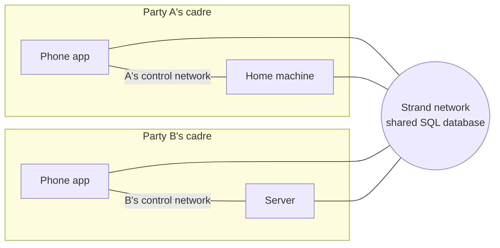

# Concepts

This document describes the model that every other Sereus document assumes, and holds the only glossary in the documentation. Read it first, whether you are evaluating Sereus for an app, running a node, or starting work on this repository.

Next: [Getting started](getting-started.md) builds a two-party program on this model · [Architecture](architecture.md) maps the components and the documents that own each one.

## The model

Sereus lets people and organisations share SQL databases without a server that holds them. Each participant runs the software on its own devices, and those devices store the shared data, replicate it to each other and enforce its rules.

### A party and its cadre

A **party** is a person or organisation that takes part in shared databases. A party's **cadre** is the set of nodes it runs. A **node** is one running instance of `@serfab/cadre-core`: an app on a phone, a browser tab, a process on a home machine or a server. Each app embeds its own node, so two Sereus apps on one phone are two nodes of the cadre. The documents call a node that belongs to a cadre a member machine, or a machine.

A node has a **class**, which says what kind of machine it runs on. A `device` node is an app on a phone, a laptop or a browser, connected some of the time. A `server` node is always on.

### The control network

The nodes of one cadre share a private database, the **control database**, over a network of their own, the party's **control network**. Every node of the party holds the whole database, and no other party's node may read or write it. It records the party's owner keys, its member machines and their addresses, the strands the party founded or joined, and the invitations it has issued.

A node keeps no separate list of what to do. It watches the control database and acts on it: when a row for a strand appears, each node of the party that is set to run that strand starts serving it.

### Owner keys

An **owner key** is a signing key that a person holds. Its signature authorizes the control-database writes that change who and what belongs to the party: admitting a machine, publishing a strand, adding or removing another owner key. A node rejects such a write unless an owner key signed it, or signed the invitation or grant it redeems.

An owner key is not a machine's identity. A machine is a member because an owner signed its row or because it redeemed an invitation an owner signed. Each machine also keeps, outside the replicated data, the owner keys it learned out of band, and judges replicated rows against that record. A stranger who manages to write to the replicated owner table therefore gains nothing.

### Strands

A **strand** is an invitation-only SQL database shared among parties. One party founds it. Another party joins by redeeming a formation invitation that the founding party gave it out of band, as a link, a QR code or pasted text. Each strand has its own network, separate from every control network and from every other strand.

A strand's type is fixed when it is founded.

- An **open** strand keeps no membership records. Any node that knows the strand's id and can reach a node serving it can read it, and the app's schema decides who may write what.
- A **closed** strand records its members in the strand's own database. Each party is seated under a key of its own, some members are managers who admit and remove others, and the members' nodes refuse connections from the machines of a removed party.

A closed strand also carries a shared key, the **read secret**, which every joining party receives. Nothing checks that key when a node connects or reads, so it does not restrict who can read the strand. A closed strand restricts reads only by refusing the recorded machines of removed members.

### sApps

The application a strand runs is its **sApp**: an app schema written in SQL, a version, and the public key of the author who signed the schema. Every member's app passes the same sApp to its node, and the node verifies the signature before it starts the strand. The constraints in the schema decide what each member may write. The writing node and the nodes that approve its commit check them.

### Cohorts

The nodes that serve one network's data are its **cohort**. The control cohort is the party's own nodes. A strand's cohort is the nodes, across all member parties, that serve that strand.

The storage engine, Optimystic, stores each block of a database on a group of nodes from the cohort, which it calls a **cluster**. A control cluster is the whole party, up to 16 machines. A strand's cluster has four nodes by default, so in a strand served by more nodes than that, each node stores part of the data.

### How a strand's data is served

Each member party serves a strand from its own cadre. A phone app runs the strands it uses. An always-on node runs every strand its party takes part in, including strands whose app it does not have, so the party's copy of the data stays available while the phone is asleep, and so another party can join through that node while the phone is offline.

A write is a transaction that the nodes holding the affected blocks approve and store. When the writing node can reach no other member, the write commits on that node alone and reaches the others once they connect. A phone or a browser tab cannot accept connections, so other nodes reach it through a **relay**.

## Glossary

- **Address record**: a node's dialable addresses, public key and always-on declaration, signed with its identity key and stored in its own `CadrePeer` row. The party's other nodes find the node from it. See [The node's address record](cadre/node.md#the-nodes-address-record).
- **Always on**: a machine's declaration that it stays running and reachable. A node whose `alwaysOn` node role is on publishes it in its address record, and the party's other machines dial the machines that declare it first. See [Node classes](cadre/node.md#node-classes).
- **Anchor** (trusted-owner anchor): the owner keys a machine trusts out of band, stored on that machine and never replicated. The machine verifies replicated control rows against it. See [The trusted-owner anchor](cadre/control-security.md#the-trusted-owner-anchor).
- **Arachnode**: Optimystic's subsystem for storage rings and for restoring blocks from other holders. It runs only on nodes that declare themselves always on. See [Node classes](cadre/node.md#node-classes).
- **Cadre**: the set of nodes one party runs. See [Adding and removing machines](cadre/membership.md).
- **Cadre invitation**: an owner-signed credential (a `CadreInvite` row and its bundle) that admits one machine to a cadre. Any member machine can redeem it for the newcomer. See [Cadre invitations](cadre/membership.md#cadre-invitations).
- **cadre-host**: the program that runs always-on nodes on a home machine, each started as a **hosted node** for a cadre whose owner is a phone. See [cadre-host design](hosting/cadre-host.md).
- **Claim (a node)**: an owner taking a node that belongs to nobody, by proving knowledge of the node's **claim secret**, usually read from a QR code. See [Claiming a node](cadre/membership.md#claiming-a-node).
- **Claim (a strand)**: an app telling its node to run a strand with the app's sApp, by calling `addStrand` or `foundStrand`. Until then the node only announces the strand, or runs it as a storage replica. See [Reactive strand management](strands/lifecycle.md#reactive-strand-management).
- **Closed strand**: a strand that records its membership in its own database: members, managers and single-use invitations. It also carries a read secret. See [Closed-strand membership](strands/membership.md).
- **Cluster**: the group of nodes on which Optimystic stores one block and which approves commits to it. Its target number is the **cluster size**. Some option names, such as `cohortQueryTimeoutMs`, say "cohort" for this group. See [Replication cluster size](cadre/control-replication.md#replication-cluster-size).
- **Cohort**: the set of nodes that serve one network's data: a party's own nodes for its control network, or the nodes of every member party for a strand. See [Cohort auto-connect](cadre/control-convergence.md#cohort-auto-connect).
- **Control database**: a cadre's private database (schema `CadreControl`, in `schemas/control.qsql`), replicated to every node of the party. See [The control schema](cadre/control-schema.md).
- **Control network**: the network, private to one party, that carries its control database. See [Control database replication](cadre/control-replication.md).
- **Control node**, **strand node**: the two kinds of libp2p node inside one cadre node. A machine runs one control node, and one strand node for each strand it serves, each with its own peer id. See [What a node does](cadre/node.md#what-a-node-does).
- **Drone**: a headless always-on node, normally `@serfab/cadre-cli` on a server, a home machine or in a provider's container. See the [cadre-cli README](../packages/cadre-cli/README.md).
- **Edge node**: the wrapper an app on a phone or in a browser uses to run its node, created with `createEdgeNode`. The name does not refer to FRET's `edge` profile. See [The edge node](cadre/node.md#the-edge-node).
- **First sync**: a joining machine's first receipt of a strand's tables from a member. The machine may not write to the strand before it. See [Joining: no writes before the first sync](strands/formation.md#joining-no-writes-before-the-first-sync).
- **Formation**: the protocol by which one party redeems another party's formation invitation and joins a strand. See [The formation protocol](strands/formation.md#the-formation-protocol).
- **Formation invitation**: a party's invitation for another party to join a strand the inviter founded, or a new strand created when the invitation is redeemed. It is a token the joiner holds and an owner-signed `FormationInvite` row that makes the token redeemable. See [Formation invitations](strands/formation.md#formation-invitations).
- **Founder**: the one machine that writes a strand's first rows. Every other machine receives them by replication. See [Founding a strand](strands/lifecycle.md#founding-a-strand).
- **FRET**: the distributed hash table Optimystic uses (`p2p-fret`) to find the nodes that hold a block and to keep each network's table of peers. See [How a strand's nodes find each other](network/strand-addressing.md).
- **Hibernation**: stopping a strand's network node and database on one machine while nobody uses the strand, and rebuilding them on a wake. See [Strand hibernation and wake](strands/hibernation.md).
- **Identity key**: a node's own private key. The control node's peer id is derived from it, and each strand node's key is derived from it and the strand id. Its private bytes are the **identity seed**. See [Node key material and the KeyStore](cadre/node.md#node-key-material-and-the-keystore).
- **Joined strand**: a strand a party joined from another party, recorded in the joiner's own control database as a `JoinedStrand` row. See [What a joiner's node remembers](strands/keys.md#what-a-joiners-node-remembers).
- **Link round trip**: one message and its reply between two machines, over the path they actually use. A node declares one figure for it, and network deadlines are multiples of that figure. See [Deadlines and the link budget](network/deadlines.md).
- **Manager**: a member of a closed strand that may issue invitations and admit or remove members. See [Who may administer a closed strand](strands/membership.md#who-may-administer-a-closed-strand).
- **Member**: a party seated in a closed strand's membership tables. For a cadre, a **member machine** is a node with a live `CadrePeer` row that carries an owner's signature or a redeemed cadre invitation. See [Closed-strand membership](strands/membership.md).
- **Membership key** (party key): one party's signing key for one closed strand, stored as a `StrandPartyKey` row. It seats the party's member rows and never leaves the party. See [Closed-strand member key handling](strands/keys.md#closed-strand-member-key-handling).
- **Node** (cadre node): one running instance of `@serfab/cadre-core`. See [The cadre node](cadre/node.md).
- **Node class**: what kind of machine a node runs on. `device` is a phone, a laptop or a browser running an app; `server` is an always-on node. The class only presets the node roles. See [Node classes](cadre/node.md#node-classes).
- **Node role**: one of four decisions that together settle what a node does, each settable on its own: whether the machine is always on, its overlay resource tier (FRET's `edge` or `core`), whether it carries other subscribers' change notifications, and whether it holds the data of the strands it runs. The node class is the preset that supplies the roles a deployment does not set. See [Node classes](cadre/node.md#node-classes).
- **Offline mode**: a strand setting under which a commit resolves once it is saved on the writing machine and is sent to the other members later. See [Offline mode](strands/writes.md#offline-mode).
- **Open strand**: a strand with no membership rows and no read secret. Any node that can reach its network can read it. See [What a strand is](strands/lifecycle.md#what-a-strand-is).
- **Optimystic**: the storage engine under every Sereus database: blocks, replication and transactions over libp2p. See [Architecture](architecture.md).
- **Owner grant**: an owner-signed credential (`OwnerGrant`) that lets its holder seat a new owner key. See [Owner grants](cadre/owner-keys.md#owner-grants).
- **Owner key**: a signing key a person holds, whose signature authorizes changes to the control database. See [Owner keys](cadre/owner-keys.md).
- **Party**: a person or organisation that takes part in strands. A party owns one cadre. See [The model](#the-model).
- **Provider**: a service that rents out always-on nodes, such as one built on `@serfab/cadre-provider`. See [Provider-hosted nodes](hosting/provider.md).
- **Quereus**: the SQL engine. Every Sereus schema is written in its declarative SQL. See [Writing an app schema](schema-guide.md).
- **Read secret**: a closed strand's shared key (`Strand.MemberPrivateKey`), which formation gives to every joining party. Nothing uses it to encrypt data or to authenticate a peer. See [Closed-strand keys](strands/keys.md).
- **Reap**: a node deleting its stale local copy of a row after the tombstone for that row has arrived. See [Deletes made while alone](cadre/control-convergence.md#deletes-made-while-alone).
- **Relay**: a libp2p circuit relay, which forwards connections to nodes that cannot be dialled directly. A node is reachable through a relay while it holds a **reservation** there. See [Relays](network/relay.md).
- **sApp**: the application a strand runs: an app schema (the body of `declare schema App { … }`), its version, and its author's public key and signature. See [Writing an app schema](schema-guide.md).
- **Seed** (control network seed): the owner-signed list of a cadre's machines and addresses that lets a new node find the control network. Every other use is qualified: the identity seed, a schema's `seed` rows ([Writing an app schema](schema-guide.md)), and a strand node's seed peers, which are the addresses it dials first. See [The seed](cadre/membership.md#the-seed).
- **Sibling**: another member machine of the same party. See [How a party's machines converge](cadre/control-convergence.md).
- **Stamp**: a one-off value (`StampId`) on a control or strand row that ties an approval signature to one incarnation of that row. See [Stamps and tombstones](cadre/control-schema.md#stamps-and-tombstones).
- **Storage replica**: a strand that a node runs with no app attached. The node stores and serves the strand's blocks and applies only the `Strand` schema. See [Strand filtering](cadre/node.md#strand-filtering).
- **Strand**: an invitation-only SQL database shared among parties, with its own network. See [Strands: model and lifecycle](strands/lifecycle.md).
- **Tombstone**: a `Revocation` row that retires a stamp, so the approval that seated a removed row cannot seat it again. See [Stamps and tombstones](cadre/control-schema.md#stamps-and-tombstones).
- **Transactor**: the Optimystic component that commits a transaction to the cluster holding the affected blocks. See [One transactor per strand](strands/lifecycle.md#one-transactor-per-strand).
