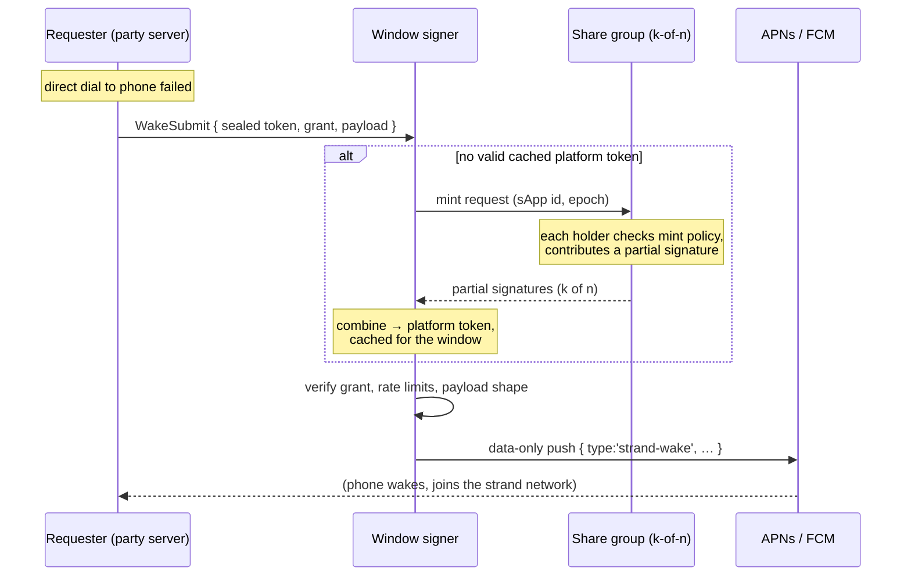

# Sereus Push Network

Design, not built. Nothing here is implemented.

A wake for a suspended phone must travel through Apple's or Google's push service. The shipped system sends it from the party's own always-on node, which therefore holds the app's raw push credentials ([Push wake](../strands/hibernation.md#push-wake)). That fits only while the node's operator is also the app's publisher, because the credential can push to every install of the app. This design replaces per-node credentials with a public network of independent operators in which no single machine holds a complete push credential. It would change who sends the platform push, what a `DeviceToken` row stores, and what a node must present to have a phone woken.

## Background: how mobile push notifications work

Apple and Google built their push systems in a way that decides most of this design.

A phone app that the operating system has suspended cannot keep a network connection open. The only way to reach it is the platform's push service: **APNs** (Apple Push Notification service) on iOS, and **FCM** (Firebase Cloud Messaging, a Google service) on Android.

Delivering a push involves three things:

1. **A device token.** When an app installation registers for push, the platform gives it an opaque string that identifies that installation. A sender presents the token to say which device to push to.
2. **A push credential.** The app's publisher holds a long-term secret issued by Apple or Google: an APNs auth key (a small ECDSA private key file, `.p8`) or an FCM service account key (an RSA private key in a JSON file). The credential is bound to the publisher's developer account and app id, and the platform delivers only pushes authorized by it.
3. **A short-lived access token.** A sender does not present the credential with each push. It uses the credential to sign a small proof, and the platform accepts pushes that carry the proof for a limited time.

The two platforms sign that proof differently:

- **APNs.** The sender signs a JWT (JSON Web Token, a compact signed claim) with the auth key using ES256, which is ECDSA over the P-256 curve. Apple requires a fresh one every 20 to 60 minutes.
- **FCM.** The sender signs a JWT with the service account key using RS256, which is an RSA signature, and exchanges it with Google for an OAuth2 access token valid for about an hour.

Two properties of this scheme shape the design:

- **The credential is all-or-nothing.** A credential cannot be issued that pushes only to some installs or sends only some kinds of message. Anyone who can produce one valid access token can wake, spam or drain the battery of every install of the app.
- **The access token is a bearer token.** Whoever holds it can use it for its whole validity window, with no further check.

## Terminology

sApp, party, cadre, control network, strand and hibernation have the meanings in the [glossary](../concepts.md#glossary). The cryptography terms are:

| Term | Meaning |
|---|---|
| **Threshold cryptography** | Splitting a secret key into *n* shares held by different machines so that any *k* of them (k-of-n) can use the key together and fewer than *k* learn nothing. Using the key does not reassemble it. |
| **Threshold signing** | Producing a signature cooperatively: each share-holder computes a partial signature with its share, and the partials are combined. The full private key exists nowhere during signing. |
| **Threshold encryption**, **sealing** | Encrypting data to a public key whose private key is split into shares. Decrypting (unsealing) needs k share-holders to cooperate. |
| **DKG** (distributed key generation) | A protocol in which n machines jointly generate a key pair that is in share form from the start. The full private key never exists, not even at creation. |
| **Dealer ceremony** | The weaker alternative to DKG: one trusted process briefly holds the full key, splits it into shares, distributes them and destroys the original. |
| **Mint** | In this document, the holders of one sApp's credential shares cooperatively producing one short-lived platform access token. |
| **TEE** (trusted execution environment) | A hardware-isolated enclave, such as AMD SEV-SNP, whose memory the machine's operator cannot read and which can prove (attest) what code it runs. |
| **DHT** (distributed hash table) | A peer-to-peer key and value lookup structure. It provides discovery, not authenticated shared state. |

## The problem

Push notification is centralized in two ways that the rest of Sereus is not:

1. **Credential issuance is centralized and cannot be changed.** Only Apple and Google issue push credentials, and only to the sApp's publisher. Decentralization can spread trust in the use of the credential, never in its issuance.
2. **The credential has the wrong shape for a multi-party system.** It is an app-wide bearer capability with no scoping by recipient. Whoever operates the push sender is trusted with reaching every user of the sApp.

### Why the shipped model doesn't scale to multi-party sApps

A party's always-on node is configured with the raw FCM and APNs credentials and sends wake pushes to that party's own phones directly. cadre-host stores the credentials in the operating system's keychain or a file, and cadre-provider and cadre-cli read them from configuration. They reach the node as `PushCredentials`, from which `createPushNotifier` builds the sender.

That is correct when the node's operator is the sApp's developer, as in the reference apps and single-developer deployments. For a multi-party sApp it discloses the credential by design: every self-hosted server that wants to wake its own party's phones would hold a credential that can wake every party's phones. Distributing the credential to all of them is equivalent to publishing it.

### Alternatives considered and rejected

- **The sApp developer hosts a push server** (the model XMTP uses). Every notification for every user flows through infrastructure the developer must run indefinitely. This centralizes on the developer.
- **The Sereus foundation hosts a push gateway** (the model Session, SimpleX and Berty use with their own foundations or companies). This centralizes on the foundation and makes it a mandatory dependency of every sApp.

### Goals

- **No single machine holds a complete long-term push credential** after a one-time onboarding. For FCM there is a path in which the full private key never exists anywhere ([Platform specifics](#platform-specifics-how-the-threshold-mint-actually-works)).
- **No mandatory service operated by the sApp developer or the foundation.** A public network of independent operators carries the role, and the foundation is at most one participant among several.
- **Every push request is checked against policy before delivery:** what the payload may contain, how often a device may be pushed, and proof that the requester is entitled to wake that recipient.
- **One network serves all sApps,** with a shared operator set and protocol and a separate group of credential-share holders for each sApp.
- **Delivery stays best-effort.** The periodic check-in wake ([Wake paths](../strands/hibernation.md#wake-paths)) remains the fallback for a lost push. Apple throttles and merges iOS silent pushes whoever sends them, and nothing here changes that.

### Non-goals

- **Replacing the platform channels.** On Android, a [UnifiedPush](https://unifiedpush.org)-style distributor removes the Google dependency entirely. It would be another `PushNotifier` implementation and needs none of this design, because there is no credential to protect. iOS forbids persistent background connections, so APNs and its app-bound credential cannot be avoided, and the network must handle platform credentials in any case.
- **Delivering notification content.** A Sereus push is a data-only wake signal: it tells the phone that a strand has activity, and the strand network carries the data once the phone is awake. No message content travels through the push channel. Session calls this "oblivious push".

## What others do

No surveyed project decentralizes custody of push credentials. Each peer-to-peer system decentralizes message transport and metadata and then sends the last hop through a server that someone runs with the vendor credential. The survey reflects each project's public documentation when this design was written; check it again before building on it.

| Project | Who holds the APNs or FCM credential | Notes |
|---|---|---|
| [Berty](https://github.com/berty/berty) | Berty Technologies. The relay can be self-hosted, which helps only an operator who also signs its own app build. | The closest architecture to this design. |
| [Session](https://github.com/oxen-io/session-push-notification-server) | OPTF, the project's foundation | Content-free pushes; opt-in, with polling as the fallback. |
| [SimpleX](https://github.com/simplex-chat/simplexmq/blob/stable/protocol/push-notifications.md) | SimpleX, the company; iOS only | Android avoids push with a persistent background service. |
| [Status/Waku](https://status.app/blog/status-app-notifications-on-ios) | Status, the company; the certificate is bound to its app id. Users may choose or run a push server. | Decentralizes the relay role, not the credential. |
| [XMTP](https://docs.xmtp.org/chat-apps/push-notifs/understand-push-notifs) | Each app developer, on its own notification server | The protocol leaves push to the app layer. |
| [Push Protocol](https://comms.push.org/docs/notifications/) | Push Inc., for mobile delivery | Decentralizes distribution of notification content, not delivery by the operating system. |
| [ntfy](https://ntfy.sh) / [UnifiedPush](https://unifiedpush.org) | Nobody on Android and desktop; ntfy.sh for the ntfy iOS app | Removes the credential instead of sharing custody. |
| [WalletConnect/Reown Echo](https://docs.reown.com/advanced/echo-server) | Reown in hosted mode, for many wallets; each operator when self-hosted | Same custody class as XMTP, with the wire protocol published as a specification. |

**Berty** publishes an open-source push relay (`bertypushrelay`) with no central token registry. The phone encrypts its device token to the public key of the relay it chose and shares the sealed token with contacts inside end-to-end-encrypted conversations. A sender contacts the recipient's relay directly, and the relay decrypts the token for each request and stores nothing. Payloads are end-to-end encrypted and capped at 4 KB.

**UnifiedPush** replaces the vendor channel on Android and desktop with a self-hosted distributor that keeps its own persistent connection. The specification has a client-to-distributor API and an app-server-to-push-server API, and the per-device endpoint URL is the capability, which is a shipped precedent for push capabilities scoped to a recipient. iOS allows no persistent background sockets, so a self-hosted ntfy server must relay through ntfy.sh, which alone holds the APNs key for the ntfy iOS app.

**Reown Echo** has three deployment modes: a hosted platform, a self-hosted server, and the wire specification for anyone to implement. The hosted mode concentrates many apps' credentials in one operator, which is the arrangement this design avoids.

Two existing networks could hold a credential on an app's behalf:

- **[Lit Protocol](https://developer.litprotocol.com/resources/how-it-works)** is the closest substrate. It is a threshold-cryptography network offering threshold ECDSA over P-256, the algorithm APNs JWTs use, and "Lit Actions": policy scripts pinned by content hash that can decrypt secrets inside a TEE and [make HTTP calls](https://developer.litprotocol.com/sdk/serverless-signing/fetch). A key imported into Lit, as an Apple-issued key would be, uses its "Wrapped Keys" path, where the full key is decrypted inside one node's TEE. That is threshold-gated access to the key, not threshold signing with it. The network is small and permissioned (about 7 operators) and costs about $0.01 per execution.
- **Nillion**'s multi-party-computation layer (nilDB) supports only store, match and sum operations and cannot produce signatures. Its confidential-compute product (nilCC) is a rented TEE container, with the trust of a confidential cloud VM and no threshold custody.

Neither has been used for push. This design takes two patterns from Lit, policy enforced by the quorum and signing inside a group of share-holders, and runs them on Sereus's own operator network instead of adopting Lit's trust model.

## The design, step by step

The steps describe the proposed network in the present tense. None of it exists; where a step relies on shipped behaviour it says so.

### Step 1: a shared public network takes over sending

A single public push network, operated by community and foundation nodes, would send the platform pushes for all sApps. No party's server would hold credentials or call APNs or FCM itself.

The roles:

- **Operator node.** An always-on server run by an independent operator and taking part in the push network. It runs on Node.js, with no mobile or browser constraint. Any operator can accept push requests for any sApp.
- **Share group** (one per sApp). The k-of-n subset of operators that hold that sApp's credential shares. The network's shared database records which operators and what k ([Step 5](#step-5-shared-state-lives-in-a-strand-the-hot-path-is-direct-rpc)).
- **Window signer** (one per sApp at a time, rotating). The operator that holds a valid short-lived platform token for that sApp. Push requests for the sApp are routed to it ([Step 3](#step-3-the-window-signer-caches-the-token-and-never-shares-it)).
- **Requester.** A party's own node, typically the always-on server that runs the shipped `PushFanoutService`. It would turn to the push network at the point where that service sends a platform push itself: after its wake over the control network fails to reach the phone.
- **Recipient.** A phone that registered a device token.

### Step 2: the credential exists only as threshold shares

At onboarding, the sApp's push credential is split into n shares across the share group, with threshold k. From then on, producing the short-lived platform token, the mint, is cooperative. Each share-holder computes a partial signature with its share, and combining k partials gives a validly signed token. The full credential is never reassembled. For RSA this is exactly how the mathematics works ([Platform specifics](#platform-specifics-how-the-threshold-mint-actually-works)).

Every mint needs k independent operators, and each checks **mint policy** before contributing: whether the requesting operator is the scheduled signer for this sApp and time slot, whether the audit record is in place, and whether the rotation is being followed. One compromised operator can neither mint nor leak anything.

### Step 3: the window signer caches the token and never shares it

A minted platform token is a bearer token valid for a bounded window: 20 to 60 minutes for APNs, about an hour for FCM. Passing it between operators would recreate the original problem, so it stays on one machine:

- The operator that combines the partials, the window signer, keeps the token in memory for its validity window and uses it for the HTTPS calls to APNs or FCM.
- All push requests for that sApp are routed to the current window signer for the length of the window. A requester finds the signer from the rotation schedule in the shared database, without querying operators.
- The signer role rotates each window by a deterministic draw over the operator roster, for example a hash of the sApp id and the epoch number. No operator can hold the role indefinitely, and anyone can verify whose turn it is.

The whole sequence:

### Step 4: device tokens and payloads are sealed

In the shipped system a `DeviceToken` row in a party's control database carries the raw FCM or APNs token, readable by any of the party's own nodes. That is acceptable while the party sends its own pushes. In the push-network model the party does not send, and the requester should not see the raw token at all, because a raw device token lets anyone who holds any push credential for the app target that device. Berty's sealed-token design has the same property.

The design changes four things:

- The phone seals its device token to the sApp's network public key. The private key is split across the same share group and established at onboarding.
- The `DeviceToken` row stores the sealed token. The row's shipped authorization, its increasing `UpdatedAt` and the retirement of its stamp on clear stay as they are ([Stamps and tombstones](../cadre/control-schema.md#stamps-and-tombstones)).
- The requester forwards the sealed token inside `WakeSubmit` without reading it. The share group unseals it once per window at the signer, under the same k-of-n policy check as a mint. The signer keeps the plaintext token in memory beside the platform token for the window and never stores it.
- The wake payload is sealed to the device. The shipped payload `{ type: 'strand-wake', strandId, reason }` crosses Google or Apple in the clear. Sealing it (Berty's `OutOfStoreMessage` pattern) hides the strand id from the platform and from the signer.

What remains observable is timing and which device was woken. That cannot be removed, because APNs and FCM must know the destination.

### Step 5: shared state lives in a strand; the hot path is direct RPC

The network needs two kinds of communication, and Sereus has a shipped pattern for each. The control network uses the same split.

**Direct request and response.** Push submission and mint rounds are latency-sensitive exchanges between two machines. They would be libp2p protocols under `/sereus/push/*`, following the conventions of the existing control-network protocols: length-prefixed JSON frames, read timeouts and concurrency caps.

**Replicated shared state.** The operator roster, per-sApp policy, share-group assignments, rotation schedule and audit log must be authenticated, mutable state that all operators and requesters read consistently. A strand database provides that. A bare DHT does not: it offers lookup, not agreement over mutable records. The push network would therefore itself be a strand, which has two consequences:

- It would be an open strand, so it depends on a way to make an open strand's writes trustworthy (ticket `feat-open-strand-witness-policy`).
- Its machines belong to many unrelated parties. How such machines find each other ([How a strand's nodes find each other](../network/strand-addressing.md)) and how a block's cluster is spread across parties instead of one party's machines (ticket `feat-strand-party-diverse-placement`) become requirements of this design.

A sketch of the tables, not a schema:

| Table | Purpose |
|---|---|
| `SApp` | Registry: sApp id, platform app and bundle ids, the sApp's notification policy document, the network public keys for threshold signing and sealing, and the current share epoch. |
| `Operator` | Roster: operator peer key, addresses, admission record (co-signed by the foundation at bootstrap; stake or reputation later), and an optional TEE attestation. |
| `ShareGroup` | For each sApp and epoch: which operators hold shares, the threshold k, and resharing state. When operators join or leave, shares must be dealt again, and this table coordinates that. |
| `MintAudit` | Append-only log of every mint (sApp, epoch, signer, contributing share-holders) and each window's push count as the signer reports it. It is the evidence for refusing a misbehaving signer. |
| `SignerSchedule` | The recorded rotation draw for each epoch, so any requester can find the current window signer for an sApp from replicated state. |

The database does not hold two things:

- **Device tokens and grants.** They stay in each party's own control database, sealed. The push network learns a token only inside a policy-checked unseal.
- **Rate-limit counters.** They are written far too often for a consensus database. They live in the signer's memory and are reconciled in aggregate through `MintAudit`. Losing them on a restart is accepted, as it is for the cooldowns of the shipped fan-out, which are also kept in memory.

Write rates on the strand are low (registry changes, epoch rotations, audit appends), so the cost of consensus is tolerable. The audit log is the one table that grows without bound. It is append-only for the same reason as the control schema's `FormationUsage` and `Revocation` tables: each row is a permanent record.

## Platform specifics: how the threshold mint actually works

The two platforms use different signature algorithms, and the difference decides how strong the design is on each.

### FCM

FCM's JWTs use RS256, an RSA signature, and RSA has a simple threshold scheme ([Shoup 2000](https://www.iacr.org/archive/eurocrypt2000/1807/18070209-new.pdf)). Signing is non-interactive: each share-holder computes its partial signature locally in one step, and the combiner multiplies k partials together. There are no rounds and no coordination state.

Google's cloud platform also allows [uploading a user-managed public key](https://cloud.google.com/iam/docs/keys-upload) for a service account (`gcloud iam service-accounts keys upload`), so Google never sees the private key. Together these mean the sApp's FCM key can be generated by DKG. The full private key then never exists in one place, and only the public half is registered with Google. The mint's output is the signed JWT, which the window signer exchanges with Google for the access token.

### APNs

Apple's JWTs use ES256 (ECDSA), and Apple offers no way to upload a key: Apple generates the `.p8` file and gives the developer the complete private key. This has two consequences.

1. **The full key exists once, at a one-time onboarding ceremony.** The developer, or a ceremony tool, splits it into shares, distributes them to the share group and destroys the original. Trust in that ceremony cannot be avoided. Everything afterwards is k-of-n.
2. **Threshold ECDSA is interactive.** It uses multi-round protocols of the CGGMP/GG20 family, or one fast online round if "presignatures" are computed in advance. Cadence makes this acceptable: an APNs JWT may be refreshed at most every 20 minutes and stays valid for 60, so the share group runs one signing ceremony per sApp per token window, not one per push. At that rate the protocol's latency and weight do not matter.

Operator nodes are servers, so native threshold-signature libraries can be used on them.

## Limits

The mint's output is still an app-wide bearer token, valid for one window. Threshold custody provides exactly two things:

1. **No operator can steal the long-term credential.** For FCM under DKG there is nothing to steal, because the key has never existed whole.
2. **Policy is enforced by the quorum.** Every mint needs k independent operators, each applying the policy checks before contributing. The share group refuses the next mint of a signer that violated policy, on the evidence in `MintAudit`.

It cannot bind individual pushes. The share group approves the mint, not the sends, so the window signer is the trust that remains in this design:

- **For one window, the signer can push to any install of that sApp.** An operator of a Berty-style relay has the same reach permanently. Here it is limited to a window, rotated across operators and accountable afterwards.
- **The signer concentrates metadata for its sApp and window.** It sees which sealed tokens are woken and when. Rotation spreads this across operators, and sealed payloads limit what it sees to timing and target.

The mitigations, in increasing order of cost:

- Keep windows short. Apple's minimum is 20 minutes.
- Rotate the signer every window by a verifiable draw, so no operator can keep the role.
- Require the signer to append its push count for each window to `MintAudit`. This gives accountability, not prevention.
- Let the share group refuse a mint to a signer with evidence of abuse.
- Optionally require signers to run in a TEE, with the attestation recorded at mint time. This hardens the signer but is not what the design's trust rests on.

## Who controls what a notification can do

In this design, control over which notifications are accepted has three layers, and the sApp controls two of them directly.

### Network policy, set by the sApp

The sApp's `SApp` registry row carries a policy document that the signer and every share-holder enforce: allowed payload types (at first only `strand-wake`), a payload size cap, rate limits per device, per requester and overall, optional quiet-hours or batching hints, and per-platform switches. The signer refuses a violating submission, and a signer that does not refuse is denied its next mint.

### Grants, issued by the recipient

A `WakeSubmit` must present a **grant**: a statement signed by the recipient party's owner key, the key that authorized the `DeviceToken` row, declaring who may wake this device. A grant names a specific set of peers, or any co-member of a named strand, which the requester proves with its own membership signature. It also carries an expiry and a rate ceiling. The phone publishes grants beside its sealed token, and revoking one reuses stamp retirement.

This layer provides the scoping by recipient that the platform credential cannot express. The network converts an app-wide capability into capabilities scoped to a recipient and refuses everything else. UnifiedPush's per-device endpoint URL is the shipped precedent: there the URL is the capability, and here the grant is, because APNs and FCM sit between the network and the device.

### On the device, decided by the sApp

Every push is data-only, as in the shipped system. The operating system hands it to the sApp's own background task (the reference implementation is `packages/reference-app-rn/src/push-wake.ts`), which decides whether to wake the strand, show anything to the user, or drop the message. The final decision is always the sApp's own code, subject to the user's notification settings in the operating system.

## Rollout in stages

- **v0, the shipped model.** Raw credentials on each configured node. It remains correct when the operator is the sApp's developer, and everything after it is additive.
- **v1, the network with simpler custody.** Build the public network (protocols, policy layer, sealed tokens and grants, signer rotation, audit log) with custody implemented as threshold encryption only: each window, the share group threshold-decrypts the raw credential into the window signer's memory.
- **v2, threshold signing.** FCM first: Shoup threshold RSA is non-interactive and the key can be generated by DKG, so it gives the full guarantee at modest cost. APNs second: interactive threshold ECDSA once per window, after the one-time split ceremony. v1's threshold decryption remains the fallback for any platform that no threshold-signature scheme covers.

v1's custody is the pattern Lit uses for encrypted secrets, run on Sereus operators. It is much simpler than threshold signing and exposes the same reach for one window. Its protection against theft is weaker, because a malicious signer sees the raw key during its window; rotation, audit and optionally a TEE requirement mitigate that. Everything visible from outside (protocols, database schema, policy semantics) has its final form in v1, and only the internals of the mint are provisional.

## Open questions

- **Operator admission and incentives.** Who runs public operator nodes is undecided, as is what stops one actor registering many fake operators (a sybil attack) to fill a share group, and whether admission is co-signed by the foundation, stake-based or reputation-based. At bootstrap the foundation and sApp developers would run the first operators. That is stronger than v0: k-of-n across a few distinct organizations instead of raw keys on every party's server.
- **Group composition.** Whether the operators that mint, the operators that unseal and the operators that witness the audit log should be the same set, and how per-sApp share groups are spread across the shared network.
- **Maturity of threshold ECDSA for Node.js.** Candidate libraries, presignature management, and dealing shares again as operators join and leave. This needs a technical trial before v2 is planned.
- **Failover when the scheduled signer is down.** The next requester should cause a fresh mint by the next operator in the draw. That requires the draw to be verifiable from `SignerSchedule` alone, without a live coordination round.
- **Platform terms of service.** Third parties holding customers' push credentials has long precedent (OneSignal and every push-provider service), and holding shares should be more acceptable than holding the credential. Nobody has asked Apple about a rotating set of signers, which should be checked before v2.
- **Merging wakes across sApps.** One network sees all sApps' wake traffic, so a phone in many strands could receive one merged wake per window instead of one per strand. The shipped fan-out sends one push per strand, and that carries over. Merging needs the payload-sealing design settled first.
