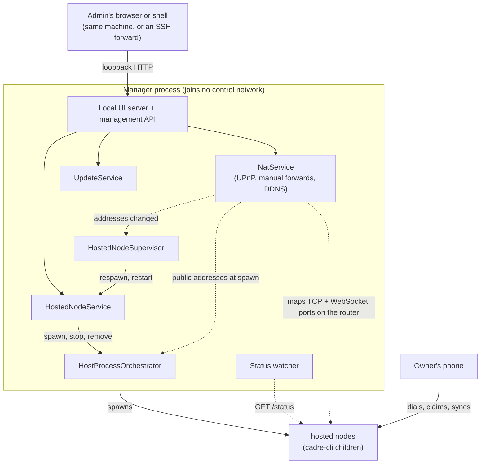

# cadre-host design

`@serfab/cadre-host` runs always-on nodes on a home machine for cadres that live on people's phones. This document describes how it is built and why: how a node joins a cadre, how the host keeps its nodes running and reachable, how it updates itself, and how its local HTTP listener is guarded. It is for maintainers. The [package README](../../packages/cadre-host/README.md) covers installing and operating it.

Related: [cadre-host management API](cadre-host-api.md) · [Provider-hosted nodes](provider.md) · [Adding and removing machines](../cadre/membership.md) · [Relays](../network/relay.md) · [The cadre node](../cadre/node.md)

## Deployment model

One machine runs the `cadre-host` service. The service is a manager: a loopback HTTP API, a web UI on the same listener, and a CLI that is a client of that API. It starts cadre nodes as child processes and reads each child's `/status` endpoint. It runs no `CadreNode` itself and joins no control network.

The host runs one kind of node, the **hosted node**: a `cadre-cli` child in the `storage` profile, started by one join, which becomes a member of the cadre that claims it or admits it by invitation. Each has its own working directory, identity, ports and cadre.

The host holds no owner key and never founds a cadre, because a machine that held an owner key could act as its owner without them present ([Owner keys](../cadre/owner-keys.md)). Every hosted node is a member of a cadre whose owner is a phone.



The phones dial the nodes and never the reverse, because a phone listens on nothing. The line from `NatService` to the nodes is a router mapping: the NAT layer never talks to a node.

### Control-plane separation

cadre-host has two planes.

- **Management plane.** The loopback API, the UI and the CLI: same-machine admin access. It carries no owner key and admits no one to a cadre.
- **Cadre control network.** Each hosted node joins the control network of the cadre that claimed or admitted it. A hosted node writes only what a member without an owner key may write: its own addresses, and rows that an owner-signed invitation or a joiner's consent authorizes.

The NAT layer exposes each hosted node's libp2p ports to the internet and never the manager's port.

### Relation to cadre-provider

cadre-host imports from `@serfab/cadre-provider` only the `Orchestrator` interface and its request, result, status and resource types. `HostProcessOrchestrator` is a second implementation of that interface, which is why a hosted node's process handle is called `dockerId` and its id `containerId` although no Docker is involved.

## Join a cadre

Joining is the host's one action: the **Join a cadre** button, `cadre-host join`, or `POST /api/hosted-nodes`. There are two ways in, and they differ in which machine dials ([Which side dials](../cadre/membership.md#which-side-dials)).

- **By QR code (claim).** The phone that owns the cadre dials the new node and claims it. This works for any cadre, including one whose only member is that phone.
- **By invitation.** The new node dials a member of the cadre and redeems a cadre invitation. This needs a member reachable from the host, so it cannot add a cadre's first always-on node.

### Join by QR code

1. **Start.** The host writes a record with status `spawning`, generates a one-time claim secret, and spawns the child with the secret in `CADRE_CLAIM_SECRET`. The child's config names the placeholder party `unclaimed`, and it joins nothing until claimed. The record becomes `unclaimed`.
2. **Show the code.** `GET /api/hosted-nodes/:id/claim` reads the child's `/status` and returns cadre-core's `encodeNodeClaimPayload` of the peer id, the addresses a phone may dial and the secret.
3. **Scan and claim.** The owner's phone dials an address from the code and presents the secret with `CadreNode.claimNode`. The node records the claimant's party and owner key and restarts in-process into that party ([Claiming a node](../cadre/membership.md#claiming-a-node)).
4. **Joined.** The host polls each unclaimed node's `/status` every 2 seconds and sets the record to `joined`, with the claimed party and owner key, when the node reports a finished claim. It polls a joined node every 15 seconds for whether it holds a control connection.

The claim response also carries the node's [reachability verdict](#reachability-verdict). A phone on the host's own network can still claim an `unreachable` node, because the code carries a LAN address.

A respawn keeps the code valid ([Respawn](#respawn-keeping-a-hosted-node-up)). The host keeps passing the secret after the claim, because with it set `cadre-cli` answers a rival claimant `already-claimed`.

### Which addresses the code carries

A phone dials each address in the code in turn, each on its own timeout, so an address it cannot reach delays the claim. cadre-core's `selectNodeClaimAddresses` therefore keeps WebSocket and relay addresses only (a phone has no TCP transport), puts public names before raw public IPs, and keeps one LAN address, leaving out Docker bridges and VPN interfaces. The `claimAddresses` setting, read on every claim request, chooses the LAN address or replaces the whole list; the package README lists its values.

### Join by invitation

The owner's app mints a cadre invitation and the admin pastes it ([Cadre invitations](../cadre/membership.md#cadre-invitations)). The host refuses one that `decodeCadreInvitation` cannot decode, before writing anything. Otherwise it writes the record under the invitation's party with status `joining` and spawns the child with the invitation in `CADRE_INVITATION`. `cadre-cli` redeems it once the node is up and reports the outcome on `/status`, which the host polls every 2 seconds.

- **Accepted.** The record becomes `joined`, with the member that admitted the node and the invitation's issuer key as `ownerKey`.
- **Refused.** The record becomes `error` with `retryable: false` and the member's reason, for example `invite-spent` or `invite-invalid`. The child is stopped and its working directory kept.
- **No member reachable.** The record becomes `error` with `retryable: true`. This is the outcome for a cadre whose only members are phones.
- **Retry.** `POST /api/hosted-nodes/:id/retry` takes a retryable `error` record back to `joining` and respawns it with its invitation, without spending a respawn attempt.

A `joining` node is respawned with its invitation, and a member answers a node it already admitted as accepted. A `joined` node is respawned without it, so that an expired invitation cannot turn a member's restart into a refusal.

### Claimed by someone else

The secret is the only check, so anyone who scans the code claims the node. The record then shows `joined` with an owner key the admin does not recognise, and the intended owner's phone is refused `already-claimed`. Reset replaces the node with a fresh one and a new code.

### Remove, reset and a lost host

- **Remove** deletes the record, then stops the child and deletes its working directory, including the identity key. The record goes first because stopping the child raises an exit event, and the supervisor must not find a record that still expects a running node. The cadre keeps the node's row until its owner removes it there.
- **Reset** removes the node and starts a fresh one waiting to be claimed, with a new id, identity and code. An invitation node is replaced the same way, because its invitation may be spent.
- **Removed by an owner.** When a node learns that an owner removed it from its cadre, `cadre-cli` stops the node, writes a removal marker in the working directory and stays up to report the removal on `/status`. The host then sets the record to `error` with `removedByOwner` and stops the child. The marker survives a respawn.
- **A host lost for good.** The nodes' identity keys are lost with the disk, and no other machine can come back as those peers. The owner removes the old node from the cadre ([Removing a machine](../cadre/removing-machines.md)) and claims a new node on the replacement machine.

### Where the credentials go

The claim secret exists in four places: the record in `hosted-nodes.json`, which every respawn replays; the child's environment; the claim route's response; and the `cadre-host join` output that prints it. A cadre invitation carries a private key and is handled the same way, except that the host sends it nowhere. Neither is passed as a process argument or written to the orchestrator's `state.json`. The wire form of a record (`HostedNodeView` in `src/hosted/types.ts`) carries only the kind of join, so the node list and the event stream contain no secret.

## Hosted nodes

A hosted node keeps a storage replica of every strand its party takes part in ([Strand filtering](../cadre/node.md#strand-filtering)).

### Records and statuses

Records live in `<dataDir>/hosted-nodes.json`. A record's id (`hn_` followed by random characters) is also the orchestrator's container id and the name of the node's working directory.

| Status | Meaning |
|---|---|
| `spawning` | The record is written and the child is not yet spawned. |
| `unclaimed` | The child is up with a claim secret and waits, with no time limit. |
| `joining` | The child is up with an invitation whose redemption has not settled. |
| `joined` | The node is in its cadre, by claim or by invitation. |
| `error` | The supervisor gave up, the stuck-`spawning` reap found it, the invitation failed (`retryable` says how), or an owner removed the node (`removedByOwner`). |

Removal deletes the record, so there is no "removed" status. An `error` record keeps its working directory, and so its identity key, until the admin removes or resets it.

### Identity and node-local state

Each node has a working directory, `<dataDir>/orchestrator/<id>/`, that holds its `identity.key`, its `cadre.json`, its storage and its log. The orchestrator generates the key on first spawn and reuses it afterwards. `cadre-cli` keeps its node-local state beside its config file, so the claim record, the trusted-owner anchor and the saved peer addresses are there too ([Node-local state](../cadre/node.md#node-local-state)).

The directory must persist: the owner's cadre admitted one specific peer id, and a node that lost its claim record would have to be claimed again.

### Child configuration

A child takes its configuration only from its own `cadre.json` and the variables the orchestrator sets for it. `cadre-cli` lets `CADRE_*` environment variables override the config file, and a child inherits the manager's environment, so one `CADRE_PARTY_ID` set on the manager would reconfigure every node. `HostProcessOrchestrator` therefore removes every `CADRE_`-prefixed variable from the inherited environment before adding the per-child ones.

### Ports

Every node holds four ports from the orchestrator's range (10000–20000): health, metrics, libp2p TCP and libp2p WebSocket. The libp2p ports listen on all IPv4 interfaces. The NAT layer maps only the TCP and WebSocket ports; the WebSocket port is the one a phone dials. The strand networks inside each child bind OS-assigned ports and are not mapped.

### Push credentials

A storage node can wake a suspended phone app through FCM or APNs when its config carries a `push` block ([Push wake](../strands/hibernation.md#push-wake)). At every spawn the orchestrator reads the credentials from the secret store and the non-secret settings from `host.config.json`, and writes the merged block into the child's `cadre.json`. A rotated key therefore takes effect on a node's next spawn.

The host rejects an incomplete set, such as an APNs key with no bundle id: it logs the error and spawns the node without push, so that a credential mistake does not take the node offline.

### Strand formation on a hosted node

Every hosted node answers strand formation for its party ([Who answers formation](../strands/formation.md#who-answers-formation)), so another party can redeem a formation invitation there while the owner's phone is offline. The node needs no owner key for this.

### Respawn (keeping a hosted node up)

A hosted node can crash or die in a reboot, and nothing else restarts it. `HostedNodeSupervisor` keeps one rule: a node whose record is `unclaimed`, `joining` or `joined` is expected to be running. It leaves a `spawning` record to the join that owns it and never respawns an `error` record. There is no Stop action, because the supervisor would start a stopped node again.

Three triggers run the same pass: host startup, a child's exit event, and a 1-minute sweep. Every pass runs on one queue, shared with Retry and with address restarts, so two respawns of one node never overlap.

- **A respawn changes nothing but the process.** It replays the record's party and claim secret, or its invitation while `joining`, and leaves the status as it was.
- **A respawned node keeps its addresses.** The identity key is in the working directory, and the new process gets the ports the previous one held. The phone knows the node by the addresses in the code it scanned, so a cadre whose only other device is that phone could not find a node whose port moved.
- **Attempts are limited.** Waits double from 10 seconds, and the supervisor gives up after 5 consecutive attempts. An attempt counts whether the spawn failed or the node started and died. A node that stays up for 10 minutes gets its budget back.
- **Giving up keeps the identity.** The record becomes `error` and the child is stopped but not removed, so the admin chooses between Remove and Reset.
- **A spawn never replaces a live child.** A node takes seconds to become ready, and one judged dead in that time would be spawned again over itself.
- **An address restart is not a crash.** `HostedNodeSupervisor.restart`, used when a node's public addresses change, does not spend the attempt budget.

A handle that no record names is logged at startup and left running, since it may be serving its cadre. `cadre-host node remove <id>` reclaims it.

### The stuck-`spawning` reap

A host that dies between writing a record and finishing the spawn leaves a `spawning` record that nothing will advance. `HostedNodeService.reapStuckSpawning` runs at startup and every 5 minutes. It sets a record that has been `spawning` for more than 5 minutes to `error` and reclaims the child, or the working directory when there is no handle.

### An ending that lands mid-operation wins

Spawning a child takes seconds, and a Remove can arrive inside that time. `hosted-nodes.json` is written a whole record at a time, so an operation that wrote back a copy it read before the wait would bring a removed node back. Every long operation (a join, a respawn, the reap) therefore reads the record again after its wait, decides against what is stored, and writes only the fields it produced.

An operation that finds its record removed stops and reclaims the child it just started, because the removal's cleanup ran before that child existed. One that finds the record in `error` stops the child and keeps the directory, because `error` preserves the identity key. The rule for each operation is in the comments of `HostedNodeService` (`src/hosted/hosted-node-service.ts`).

## Security posture

cadre-host is built for a household machine, not for mutually distrusting users.

1. **Anyone who can run code as the cadre-host user controls cadre-host.** Disk encryption, OS accounts and physical security are the admin's responsibility.
2. **The cadre's nodes decide admission, never the host.** The node checks a claim secret, and a member checks an owner-signed invitation. The host authenticates no one.
3. **Other local accounts cannot read the data directory.** It holds claim secrets, invitations and each node's copy of its cadre's data. On POSIX, `install` and `start` set it to mode 0700 and stop if they cannot. Windows has no mode bits; the default directory is under the installing user's `%LocalAppData%`.

### No login

The management API has no login. The origin policy blocks web pages ([Binding and origin policy](#binding-and-origin-policy)), and a password would not stop a process that already runs as the cadre-host user. Other accounts on the machine can call the API, because a loopback listener cannot tell one local account from another ([management API limits](cadre-host-api.md#limits-and-accepted-tradeoffs)).

### Secret storage

DDNS tokens and push credentials go to the OS keychain through the optional `keytar` module. When `keytar` cannot be loaded or fails a probe write, cadre-host falls back to `<dataDir>/nat-secrets.json` with mode 0600 and prints a warning. Secrets are never written to `host.config.json`, `nat.json` or `state.json`. Push credentials also reach each node's `cadre.json` ([Push credentials](#push-credentials)).

## NAT and DDNS

For a phone away from home to dial a hosted node, the node's TCP and WebSocket ports must be reachable from the internet and the node must announce an address that leads to them. `NatService` handles both: it maps ports on the router or records ports the admin forwarded, detects the external IP, optionally keeps a DNS name current, and computes each node's public addresses. It starts before any node is spawned, so that the first spawns see a discovered router.

### Network mode

The `network` setting in `nat.json` says where the machine sits.

- **`lan`.** Behind a router. Ports need a UPnP mapping or a manual forward.
- **`public`.** An interface holds a public IPv4 address, as on a VPS. Every port gets a `direct` route at its own number, and no UPnP runs. A manual forward still takes precedence, for a machine behind a provider's NAT that changes port numbers.
- **`auto`** (default). `public` exactly when some non-loopback interface holds a public IPv4 address, evaluated again on every probe pass. A change of mode re-routes every node, and leaving `lan` releases the UPnP mappings.

### Port mapping

`NatService` keeps one table keyed by node id, with a route for the TCP port and one for the WebSocket port.

- **UPnP by default.** The service asks the router for the same external port as the internal one. The router may grant another, and the granted port is the one recorded and announced. A refused port records an error on that port only.
- **A manual forward wins.** A port with a manual forward is not requested over UPnP, and a port that becomes manual releases its UPnP mapping.
- **Leases** last one hour and are renewed every 30 minutes. A failed renewal keeps the route until the lease runs out.
- **Which nodes.** A running node is mapped. A node stopped for more than 3 minutes is unmapped, which is long enough for a crash and respawn to keep its mapping. A removed node is unmapped at once.
- **Shutdown unmaps nothing.** Hosted children keep running across a restart of the service, so their mappings must outlive it.
- **Turning UPnP off** releases every UPnP route and keeps the manual ones.

### UPnP gateway

Router discovery listens for 10 seconds. It runs at start, when UPnP is switched on, on a change into `lan` mode and on a reachability test. While UPnP is on and no router has answered it runs again every 5 minutes, so a host that boots before its network finds the router without a restart. Mappings point at the local IPv4 address whose subnet contains the router, reported as `gateway.lanAddress`, and not at VPN or container interfaces.

### External IP detection

cadre-host reads its external IP from two sources: the WAN address the router reports, and an HTTPS request to a public echo service (the list is in `src/nat/external-ip.ts`). When both answer and disagree, it sets `cgnatDetected`, because a router whose WAN address is not the public one sits behind carrier-grade NAT. Detection repeats every 5 minutes. A pass that finds nothing, or only the router's answer, keeps the previous result, so one failed probe neither drops every node's public address nor changes the CGNAT flag.

### Reachability verdict

Each node in the NAT status has a verdict and a plain-language `reason`: for `unreachable` the failing port and the remedy, for `direct` the ports a firewall must allow. The first matching row applies.

| Condition | Verdict |
|---|---|
| No DDNS hostname and no public IPv4 is known; or either port has no route; or a port's only route is UPnP while CGNAT is detected | `unreachable` |
| Either port is forwarded by hand | `manual` |
| Either port is reached as-is (public mode) | `direct` |
| Otherwise | `mapped` |

The host-level `directReachability` summarises the running nodes' verdicts as `reachable`, `unreachable`, `cgnat` or `unknown`. Both rules are in `src/nat/reachability.ts`.

### Manual port forwarding

When the router maps nothing (UPnP is off, no router answered, or the router refused), the admin forwards the ports on the router and tells cadre-host which external ports were chosen. The [package README](../../packages/cadre-host/README.md#forward-ports-by-hand) has the steps.

- **Which ports.** The node's libp2p TCP port and its WebSocket port. Port numbers differ per node, and the NAT status lists them for each `unreachable` node.
- **Forwarded to.** `gateway.lanAddress` on the same internal port. With no router found, cadre-host cannot tell which local address the router sees and says "this machine's LAN address". The external port is the admin's choice.
- **Recorded by** `PUT /nat/nodes/:nodeId/forward`, which the CLI and the Connectivity page both call. cadre-host does not test the forward.
- **The node restarts** when the forward changes its public addresses ([Public addresses reach the node](#public-addresses-reach-the-node)).
- **A forward outlives a respawn,** because a respawned node keeps its ports. Removing a node deletes its forward.
- **Behind CGNAT** a router forward does not help. Recording one stays possible because the CGNAT check can be wrong.

### Dynamic DNS

With a DDNS hostname set, cadre-host uses the name in every node's public addresses. For a provider it knows (DuckDNS is the only one, in `src/nat/ddns/`), it also updates the record: once when configured and then every 5 minutes, skipping the request when the IP has not changed. An externally managed hostname is used in addresses and never updated.

A hostname given for a provider is stored as that provider's full name (`foo` becomes `foo.duckdns.org`), because the node announces the stored name. A hostname that is not a DNS name is ignored, because a malformed address would stop every hosted node from starting.

### Public addresses per node

`NatService.publicAddressesFor` builds the addresses through which one node is reachable from outside: `<host>/tcp/<externalPort>` and `<host>/tcp/<externalPort>/ws`, one per routed port. The host part is `/dns4/<hostname>` when a DDNS hostname is set and otherwise `/ip4/<ip>`: the interface's public address in public mode, else the detected external IP. With neither, the list is empty.

- **Under CGNAT** a UPnP route produces nothing, since the router's mapping is on a carrier-private address. A manual route still produces an address.
- **Prediction at spawn.** When UPnP is on and a router was found, a port with no route yet is assumed to map to the same external number, so a new node starts with the addresses it will most likely have.

### Public addresses reach the node

A node learns its public addresses once, at start, and is restarted when they change.

- **At spawn** the orchestrator passes the list as `CADRE_APPEND_ANNOUNCE_ADDRS`. libp2p adds these to the addresses it reports itself, so the node's `CadrePeer` row and the invitations it mints carry both. The replacing form, `CADRE_ANNOUNCE_ADDRS`, would drop the LAN addresses a phone at home dials.
- **Recorded.** The list is persisted on the node's handle, so a node re-attached after a host restart is compared against what it was started with.
- **Compared and restarted.** After every NAT pass and settings change, `NatService` compares each running node's announced addresses with the current ones. A difference restarts that node through the supervisor, with the same peer id and ports.
- **Rate-limited** to one address restart per node per 10 minutes, which bounds what an unstable router costs.

A restart is used because updating a running child would need a management channel into every hosted node, which does not exist. With a DDNS hostname a change of external IP restarts nothing; without one it restarts every node that has a public address.

## Updates

cadre-host fetches a signed manifest, an envelope `{ manifest, sig }`, from `https://releases.serfab.io/cadre-host/latest.json` at start and every 24 hours. The inner object is `UpdateManifest` in `src/update/types.ts`; an install older than its optional `minPreviousVersion` must first update to an intermediate release.

- **Notify by default.** A verified manifest with a newer version is recorded in `<dataDir>/update-state.json` and shown in the UI with an apply action. Automatic apply is opt-in (`updates.autoApply`).
- **Failures.** A signature failure is recorded as `lastError` so the UI can warn. A network failure is not recorded.
- **Apply.** The service fetches and verifies the manifest again, runs `npm install -g <package>@<version>` with a 5-minute timeout, and asks the platform's service manager to restart the service. If the install fails it reinstalls the previous version and reports the error, and the running process continues to serve. A failed restart is not an error, because the new version is already installed. Apply updates only a global npm install; the README says how to update an install kept in a folder.

### Release signing

The release-signing key is an Ed25519 key made once, offline, by the release operator. Its public half is `PROD_KEY_BASE64` in `src/update/release-key.ts`, compiled into every build. It is unrelated to the node identity keys, which are made per node and never leave the machine.

**Why sign when updates come from npm.** npm guarantees the bytes of a named package and version; the manifest decides which package and version an install moves to. Without a signature, anyone who controls the static release host could direct auto-applying installs to a different package or to an old vulnerable version. The key is compiled in because the running build is the one thing an install already trusts.

The private half is kept offline and is never committed; `.gitignore` excludes `*.key`. The procedure:

1. **Generate the key pair, once.** `node packages/cadre-host/scripts/release-keygen.mjs --write-source` writes the private key to `./cadre-host-release.key` and embeds the public key in `PROD_KEY_BASE64`. Commit the source change and move the private key offline.
2. **Sign a manifest, per release,** with the package built. The script verifies its own signature before writing.

   ```sh
   node packages/cadre-host/scripts/sign-manifest.mjs \
     --key ./cadre-host-release.key \
     --version <version> --package @serfab/cadre-host --tag latest \
     --published-at <ISO timestamp> \
     --out latest.json
   ```
3. **Publish `latest.json`** to the static host at the manifest URL.
4. **Publish the package.** `scripts/publish-package.mjs cadre-host` reads `PROD_KEY_BASE64` from source and aborts if it is the all-zeros placeholder. `CADRE_HOST_ALLOW_PLACEHOLDER_KEY=1` bypasses the check for internal test publishes.

**Rotation** repeats the procedure. Installs that trust the old key reject manifests signed with the new one, so ship the new public key in a release before signing manifests with the new private key.

`CADRE_HOST_UPDATE_DEV_KEY` replaces the embedded key with a base64 raw public key, for development and CI only.

## Local UI server

`cadre-host start` binds one HTTP listener. It serves the management API, which the CLI and the UI both use, and the Svelte single-page UI from the package's `dist/ui/`. Where the UI has not been built, `/` serves a page with build instructions and the API works as usual.

[cadre-host management API](cadre-host-api.md) is the API's reference: every route with its response shape and error codes, the Server-Sent Events stream, and the keys `PUT /api/settings` accepts.

### Binding and origin policy

- **Loopback only.** The listener binds `127.0.0.1` and never `0.0.0.0`.
- **Origin guard.** A request is refused with `403 forbidden_origin` unless its `Host` header is `127.0.0.1`, `localhost` or `[::1]`, alone or with the bound port, and its `Origin` header, when present, names the same. This stops a web page that resolves its own hostname to `127.0.0.1` from calling the API. An SSH forward must therefore use the same local port as the remote one.
- **Port in use.** If `uiPort` is taken, the server tries the next nine ports and logs the one it bound. If all ten are taken it exits and names them.

## Limits and accepted tradeoffs

- **No relay for hosted nodes.** cadre-host sets no `CADRE_RELAY_ADDRS` on its children, so no hosted node holds a relay reservation ([Which nodes can be reached through a relay](../network/relay.md#which-nodes-can-be-reached-through-a-relay)). A host behind CGNAT cannot make its nodes reachable from outside its own network. Nodes listen and announce on IPv4 only, so IPv6 is not an alternative. (ticket `feat-cadre-host-children-reserve-on-a-relay`)
- **UPnP only, and only version 2 gateways.** NAT-PMP is not implemented (ticket `feat-cadre-host-nat-pmp-mapping`). The mapping library searches for `InternetGatewayDevice:2`, so a router that implements only version 1 reads as not found.
- **Stale router mappings expire instead of being deleted.** The library deletes only mappings the current process made, and only where the external port equals the internal one. Any other unwanted mapping lasts until its one-hour lease ends.
- **The reachability verdict is a heuristic.** Nothing dials the node from outside, and a node with both ports forwarded by hand reads `manual` whether or not the router rule exists.
- **CGNAT detection can be wrong.** A dual-stack network, a split VPN or a changing IP can make the two sources disagree. Manual forwards remain as the override.
- **`auto` network mode counts any interface.** A machine behind a router with a public address on a second card or a tunnel reads as `public` until `lan` is set by hand.
- **A lost `state.json` loses the ports.** A respawn with no surviving handle gets fresh ports, and a cadre whose only other device is a phone then cannot find its node.
- **On Windows the service does not run as the installing user.** `service/install-service.ps1` sets no service account, so NSSM's default, LocalSystem, applies. "The cadre-host user" is then LocalSystem, and a keychain entry written by a command run as the user is in a different vault from the one the service reads.
- **An owner's removal is heard only if it arrives.** A node that the cadre stops talking to before the removal reaches it stays `joined` with `connected` false until the admin removes it.
- **`claimAddresses.addrs` is host-wide.** Every node's code carries the same addresses, which works only with one node or a port per node.
- **Push credentials are shared.** An FCM service account or APNs key belongs to one app's publisher, and every hosted node receives the same set, whichever app its cadre uses.
- **No storage quota per node.** A hosted node replicates every strand of its party without a limit.
- **Hosted nodes cannot enable strand change notifications.** A node's config is written before its party is known, and the setting is the party's choice. (ticket `feat-cadre-host-and-provider-nodes-carry-strand-reactivity`)
