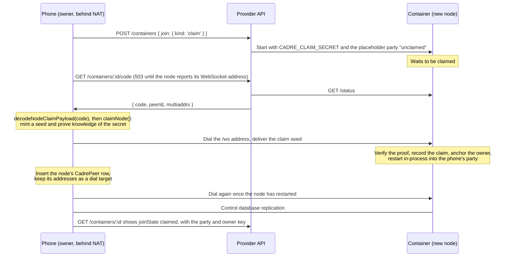
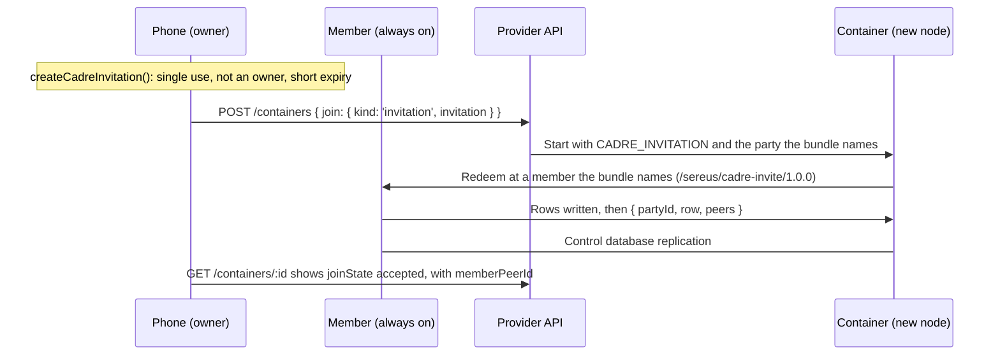

# Provider-hosted nodes

A provider is a service that rents always-on cadre nodes to people who have no machine of their own to run one on. This document describes how a rented node joins its owner's cadre, what the provider can and cannot see, how an app rents a node through cadre-core, and how the reference provider (`@serfab/cadre-provider`) keeps a container's identity and cleans up after failed provisions. App developers need [Renting a node from an app](#renting-a-node-from-an-app); provider operators and maintainers need the rest.

See also: [cadre-provider README](../../packages/cadre-provider/README.md) (running the service, HTTP and configuration reference) · [cadre-host design](cadre-host.md) (the self-hosted equivalent) · [Adding and removing machines](../cadre/membership.md) (claims and invitations in general) · [The reference apps](../platforms/reference-apps.md#renting-a-provider-node) (a rental screen built on this).

## Provider flow

The provider runs each rented node as a Docker container of the `@serfab/cadre-cli` image. The node generates its own libp2p identity inside the container and joins the customer's cadre in one of the two ways a cadre-host node does: the owner **claims** it, or it **redeems a cadre invitation** at a member that is online. The create request (`POST /containers`) must say which in its `join` field. In neither path does the provider handle an owner key or a seed.

The choice follows from which side can dial the other ([Which side dials](../cadre/membership.md#which-side-dials)). A container can dial a member that has a public or relayed address; nothing can dial a phone.

### By claim

A cadre whose only member is a phone has no member the container can reach, so the phone dials the container and claims it ([Claiming a node](../cadre/membership.md#claiming-a-node)).



- **A claim needs `docker.publicHost`.** The phone dials the container, so the provider must announce an address reachable from outside. A provider without one refuses the create with `400 INVALID_REQUEST`.
- **The code carries only the WebSocket address at the public host.** A phone has no TCP transport and cannot reach an in-container address, so `claimAddressesFor` (`packages/cadre-provider/src/service/node-code.ts`) drops every other address the node reports.
- **The provider withholds the code once the node is claimed.** `GET /containers/:id/code` answers `409 ALREADY_CLAIMED` after a live read shows an owner, so a second device is not handed a code the node would refuse.
- **A container restarted by Docker stays claimed.** Docker replays the same environment; the node starts from the claim record on its volume (`claim.json`) and, with the secret still set, refuses another claimant with `already-claimed`.
- **Until it is claimed the node admits a connection and nothing else.** Once claimed it has no member rows until the phone's rows replicate over the connection the claim opened ([The connection gate](../cadre/control-security.md#the-connection-gate)).

### By invitation

A cadre with an always-on member that the container can reach uses an invitation ([Cadre invitations](../cadre/membership.md#cadre-invitations)). The phone does not need to stay open after the create returns.



- **No public host is required.** The container dials the member. Without `docker.publicHost` a phone cannot dial that container directly afterwards.
- **A spent or expired invitation is final.** The node reports `joinState` `failed` with `invite-spent` in the error and `retryable: false`, and the container keeps running with nothing to do. The owner deletes it and rents again; the provider has no retry route.

### How the provider learns the join state

The provider runs no poller. `ContainerService.readStatus` is the one place it reads a container's `/status`, and every read copies the join state the node reports onto the container record. `GET /containers/:id` reads a running container live, so the app's own polling keeps the record current, and `GET /containers` returns each record's `partyId` and `joinState` without a read per row.

A claim is recorded as `claimed` only when the node also reports the claimed party. The node sets its claim flag before it restarts into that party, and during the restart it still reports the placeholder; recording on the flag alone would store `unclaimed` as the container's cadre.

A claim container's `partyId` is `unclaimed` until that read. An app that finds its containers in the list by party misses an unclaimed one, so it selects by `joinState`.

## What the provider sees

The provider sees the container id, the node's network traffic, and the node's `/status` report: its peer id and addresses, and how its join stands (awaiting a claim; claimed by which owner key into which party; invitation pending, accepted or failed).

The provider service is never sent an owner's signing key, a seed or strand data. The node's identity key and the data the node stores are in the container's volume on the provider's host. The provider service does not read them, but whoever operates the host can, as on any machine a cadre includes.

The two credentials the provider does hold belong to the node, not to the owner:

- **The claim secret** proves nothing without an owner's signature over a seed. Whoever learns it before the owner claims the node can claim the node for a different cadre, which the owner sees as a container that reports another party (`claimed-by-another`).
- **The invitation bundle** admits one machine to the cadre as a non-owner, once, until it expires. It contains the invitation's private key.

Both are stored on the container record so that a provider restart reproduces the container's environment, and both are visible in the container's environment on the Docker host (`docker inspect`). The API returns a container's `join` as `{ kind }` only. The secret leaves the provider only in `GET /containers/:id/code`, to the authenticated customer who owns the container; the bundle is never returned, and validation errors do not echo it.

One function builds the typed create request from the body (`packages/cadre-provider/src/server/create-request-validation.ts`), so a field reaches a container only after it has been checked, and a malformed request is answered `400` instead of producing a container that fails at boot.

## Renting a node from an app

cadre-core's `provider/` module (`packages/cadre-core/src/provider/`, exported from the package root) is the app's side: the provider descriptor, sign-in, a typed HTTP client, and `rentNode` / `finishRental`. It loads on Node, React Native and in the browser. cadre-core persists nothing about a rental; the app records which container belongs to which cadre.

```typescript
import { createProviderClient, createTokenSource, rentNode, finishRental } from '@serfab/cadre-core';

const tokens = createTokenSource({ descriptor, clientId, tokens: pair, persist: (next) => store.save(next) });
const client = createProviderClient({ apiBaseUrl: descriptor.apiBaseUrl, tokens });

const result = await rentNode(node, client, { onProgress: (step) => showStep(step) });
// result: { containerId, join: 'claim' | 'invitation', peerId? }

// After the app was killed mid-rental, or after 'node-not-ready':
const resumed = await finishRental(node, client, containerId);
```

The example is adapted from `packages/reference-app-rn/src/provider-session.ts` and `use-cadre.ts`.

### The provider descriptor and sign-in

A provider publishes a descriptor at `GET /descriptor`: its stable `id`, its `name`, the `apiBaseUrl` every route is under, its OAuth endpoints and its public plan list ([fields](../../packages/cadre-provider/README.md#provider-descriptor)). `fetchProviderDescriptor(url)` fetches and checks one. The descriptor carries no client id: each app registers its own client with the provider (an id, its exact redirect URIs, the most scopes its tokens may carry) and pairs the descriptor with that id.

The app signs a customer in with OAuth 2 authorization code and PKCE, the flow for a client that cannot keep a secret. The customer signs in and pays on the provider's own pages in the system browser, so the app never sees a password or a card.

`packages/cadre-core/src/provider/oauth.ts` has one function per step. `createPkce` and `createAuthorizationState` make the verifier, its challenge and the `state` value. `authorizationUrl` builds the URL the app opens. `readAuthorizationRedirect` reads the URL the browser returns with, and throws `ProviderAuthError` when the state does not match. `exchangeAuthorizationCode` returns the token pair. Opening the browser and storing the tokens belong to the app or its kit; on React Native, `@serfab/cadre-rn/provider` supplies both ([cadre-rn README](../../packages/cadre-rn/README.md)).

`createTokenSource` keeps the bearer valid for the client. It refreshes the pair shortly before expiry and when the provider answers `401`, calls `persist` after each refresh, and shares one refresh among concurrent callers, because a refresh spends the refresh token it presents. When the provider refuses the refresh it throws `ProviderAuthError('reauthorize')`, and the app signs the customer in again.

### Path choice

`rentNode` first requires that the node can act as an owner (`CadreNode.isOwner()`), since both paths need an owner's signature.

It then asks `CadreNode.invitationReach()` from where a machine could redeem an invitation issued now. That method judges the addresses of the members other than this machine through the same selection `createCadreInvitation` uses (`selectCadreInvitationMembers`), so the two cannot disagree.

- `anywhere` (another member has a relayed, public-name or public-IP WebSocket address): the invitation path.
- `local-network` or `issuer-only`: the claim path, because a provider's container is never on a member's local network.

A phone that is its cadre's only member therefore claims its first rented node. Once that node has joined and announces a public address, the next rental goes by invitation.

### The two paths

**Invitation.** `rentNode` creates an invitation with one use and a 15-minute lifetime (`RENTAL_INVITATION_TTL_MS`), then creates the container with it. If the create fails, it withdraws the invitation before the error reaches the app. It returns as soon as the container exists, with `join: 'invitation'`. The container joins without the app, and the app reads `client.getContainer(id)` until `join.state` is `accepted` or `failed`.

**Claim.** `rentNode` creates the container, then asks for the node code every 2 s until the provider returns it or `nodeCodeDeadlineMs` passes. The default deadline is 120 s: the provider allows a node 60 s to become healthy, and an image pull can come first. It then decodes the code and calls `claimNode`. That call is the owner's signature, so the app asks the user before calling `rentNode`.

`rentNode` adds no deadline to `claimNode`'s own, which is long when no address answers. `onProgress` reports `creating`, `waiting-for-code`, `claiming`, `inviting` and `done`; `claiming` is the step where an app shows that the wait may be slow.

### Resuming a rental

`finishRental(node, client, containerId)` continues a rental after the app was killed or the code deadline passed. It reads the container and acts on what it finds:

- **A claim container not yet claimed:** it fetches the code and claims, as `rentNode` does.
- **A claim container claimed into this node's party:** the rental is complete. The claim is not repeated, because the provider withholds the code.
- **An invitation container that is `pending` or `accepted`:** nothing to do; the app keeps reading its `join`.
- **An invitation container that `failed`:** it returns `{ outcome: 'failed', error, retryable }`. The app deletes the container and rents again; `rentNode` picks the claim path then if the member that could answer is gone.

### Errors

`rentNode` and `finishRental` throw `RentNodeError` with one of these codes.

| Code | Raised when | What the app does |
|---|---|---|
| `not-an-owner` | This node cannot sign as an owner of its cadre. | Rent from a device that holds an owner key. |
| `node-not-ready` | The node code did not arrive by the deadline. The container exists. | Call `finishRental` with the container id the error carries. |
| `container-gone` | The container is `stopped` or `error`, or the provider answered `409 CONTAINER_GONE` while the code was awaited. | Delete the container and rent again. |
| `claimed-by-another` | `finishRental` found the container claimed into a different party. | Delete the container. |
| `not-a-rental` | `finishRental` was given a container that has no `join`. | Nothing to resume. |

Other failures pass through unchanged: `ProviderApiError { status, code, message }` for a request the provider refused (a lapsed subscription is `403 QUOTA_EXCEEDED`), `ClaimRefusedError` and `PeerUnreachableError` from `claimNode`, and `ProviderAuthError` from the token source.

When a customer's subscription lapses, the provider stops that customer's containers and marks each record `stopReason: 'non-payment'`. An app reads it from `getContainer` to tell the user why the node stopped and to offer to remove the node from the cadre.

## Durable container identity

A hosted node's peer id must survive a container restart. A node that comes back with a new key is unknown to the cadre that admitted it, and its owner would have to add it again. `DockerOrchestrator` therefore mounts a named Docker volume, `cadre-<containerId>-data`, at `/data` in each container, instead of relying on the image's anonymous volume.

- **Created once, reused afterwards.** Recreating a container under the same provider container id (an image upgrade) attaches the same volume and keeps the same identity. A failed create removes only a volume that the same attempt created.
- **The node generates its key inside the volume.** The image's entrypoint (`packages/cadre-cli/docker/entrypoint.sh`) creates the key in `/data` and passes the key path and the node-state directory to the node on every start. The key is never sent to the provider.
- **Other node-local state uses the same volume.** The node-state directory defaults to `/data`, so the saved peer addresses, the trusted-owner anchor and the claim record persist with the key ([Node-local state](../cadre/node.md#node-local-state)).
- **The volume is deleted with the container.** Terminating a container removes the container and then its named volume, as cadre-host deletes a hosted node's working directory. Renewing a lapsed subscription therefore does not bring a stopped node back; the customer rents a new one.

## How the provider tracks a container

A container record moves through `pending`, `creating`, `enrolling` and `running`, and ends at `stopped` (through `stopping`) or `error`. The provider writes the record before it starts provisioning and advances it before each call to Docker, so a provider process that dies in between leaves a record that no running code will finish. The wait that follows a create and a periodic sweep resolve such records. Both are in `ContainerService` (`packages/cadre-provider/src/service/container-service.ts`), whose comments hold the per-case rules.

### Enrollment liveness

After Docker starts a container, the provider polls the node's `/status` every 2 s for up to 60 s and moves the record to `running` when the node reports healthy.

On an unhealthy poll it also asks Docker whether the container's process is alive. A process shown to be gone fails the provision immediately: the record becomes `error` and the container is removed. Without this check the record would stay `enrolling`, which occupies a plan slot and is never metered.

The provider judges that from two consecutive polls, not one. Containers run under Docker's `unless-stopped` policy, so one restart is Docker recovering from a failure at first boot and must still be allowed to enroll. A second restart, or a process that is down on two polls in a row, will not recover.

A node that is alive but still unhealthy after 60 s stays `enrolling`. It can still be claimed or redeem its invitation, so the provider does not stop it.

### Reap sweep

`ContainerService.reapStuckContainers` runs when the server starts and every 5 minutes after. It acts on records that have stayed in one status longer than that status allows, measured from `updatedAt`.

| Status | Age | Outcome |
|---|---|---|
| `pending`, `creating` | 15 min, long enough for a slow image pull | `error` |
| `stopping` | 15 min | `stopped` |
| `enrolling` | 5 min, past the 60 s wait | `running` if the node is healthy; `error` if its process is gone; otherwise unchanged |

The `enrolling` case is what makes a container that became healthy while the provider was down billable, since metering reads only `running` records.

The sweep removes the container first and writes the final status only when the container is confirmed gone. The sweep never looks at a record again after its final status, so writing one while the container may still be running would leave it running with its host ports and volume, unbilled, and with no record pointing to it. If removal fails, the next sweep retries.

A record with no Docker id, because the provider died before writing one, is still resolved: the orchestrator finds the container by its `sereus.container-id` label, which survives a provider restart.

### Which statuses consume a plan slot

`pending`, `creating`, `enrolling`, `running` and `stopping` count against a plan's container limit (`QUOTA_CONSUMING_STATUSES`). `stopped` and `error` do not. The provider never deletes a container record, so if `error` counted, a customer whose provisions had failed often enough could never create another container.

For the same reason a `DELETE` of a container that Docker no longer knows succeeds: the missing container is the state the request asked for.

## Limits and accepted tradeoffs

- **An unclaimed container is never stopped by the provider.** It stays `running`, the customer is billed for it, and the customer deletes it. A time limit is worth adding if abandoned unclaimed containers accumulate.
- **Removing a stuck container deletes its volume and so its node identity.** This is correct only because every status the sweep ends in `error` precedes enrollment. Extending the sweep to a status in which the node has joined a cadre would need a way to keep the volume.
- **A `finishRental` after a crash can leave a claimed node without a local row.** If the app dies after the node accepts the claim and before `claimNode` writes the node's row on the phone, the node belongs to the owner but that phone has no row for it, and the provider no longer returns the code. The remedy is to delete the container and rent again.
- **Two `rentNode` calls at once on one node are not serialized.** Both create a container, or both create an invitation. The app prevents the second call, as it does for two `claimNode` calls.
- **The quota is generous, not exact.** A terminate whose stop or removal fails writes `error`, which frees the plan slot while the container may still be running.
- **A lapse can leave containers running.** The provider marks the subscription lapsed before it stops the containers. If the provider dies partway, the remaining containers keep running for a lapsed customer and nothing retries.
- **The provider puts no TLS proxy in front of containers.** Containers announce plain `/ws` on published host ports. A provider that terminates `/wss` on port 443 would announce the proxy's address and need a path or port per container on it; the reference provider does not do this.
- **Where an app gets provider descriptors from is undecided.** `GET /descriptor` is what any directory would point to (ticket `decide-provider-directory`).
- **Stored bytes are not metered or limited.** The node receives its storage quota but does not enforce it, and usage records report zero storage (ticket `5-quota-enforcement`).
