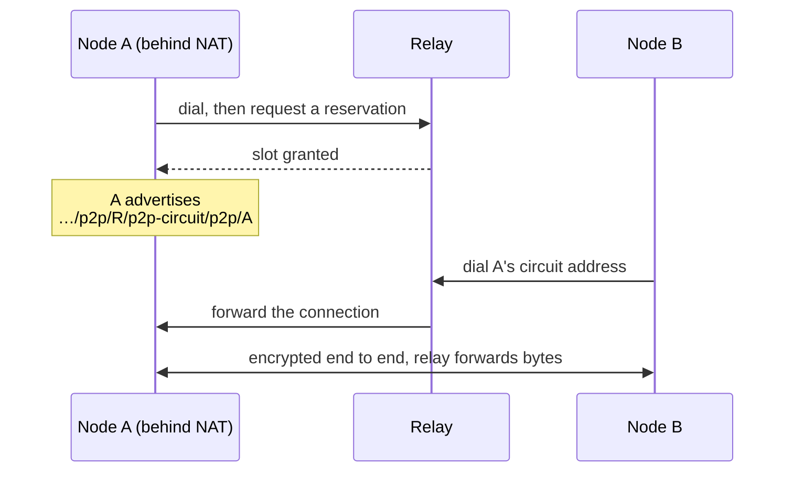

# Relays

A node behind NAT (a phone, a browser tab, a home machine with no forwarded port) cannot accept connections, so other machines reach it through a relay. This document covers which kinds of node can be reached that way, how a node obtains and keeps its slot on a relay, how a strand node's relay setup is derived from the machine's one network configuration, and whom a party's own machines relay for. Read it when you configure reachability for a node or change the reservation code.

Related: [How a strand's nodes find each other](strand-addressing.md) · [Deadlines and the link budget](deadlines.md) · [Who a node trusts and admits](../cadre/control-security.md) · [The relay container](../../ops/docker/libp2p-infra/README.md)

## Which nodes can be reached through a relay

Relay support has two halves, and only one of them makes a node reachable.

- A **relay server** forwards connections for other nodes. `network.enableRelay` turns it on. A storage-profile node runs one unless the option is `false`; a transaction-profile node does not unless it is `true`.
- A **relay reservation** is a slot a node holds on a relay server. While the node holds the slot it has a `/p2p-circuit` address, of the form `<relay address>/p2p/<relay peer id>/p2p-circuit/p2p/<node peer id>`, that other machines can dial.

A node that cannot accept connections is reachable only while it holds a reservation. Running a relay server does nothing for the node's own reachability.

Dialing needs no reservation. Any node can dial through a relay on which it holds no slot, to a peer that holds one there. Two parties can therefore each reserve on a relay of their own and still reach each other: each dials through the other's relay.

### One reservation per node, per network

A machine runs one libp2p node for the control network (its **control node**) and one more for each strand it serves (a **strand node**). Each is dialed at its own address, so each holds its own reservation. A machine behind NAT that serves three strands holds four slots on its relay, and two single-machine parties sharing one strand through one relay hold four slots between them.

A circuit relay keys reservations and forwarded connections by peer id. Each strand node therefore runs under its own transport key, derived from the machine's identity key and the strand id (`strand-transport-key.ts`). If the control node and a strand node shared one key, they would collide on a shared relay and streams meant for one would arrive at the other. The derivation is deterministic, so a strand node keeps its peer id across restarts, and it takes the private key as input, so nobody else can compute a member's strand peer ids.

### Node kinds

| Node kind | Can hold a reservation | How its relay is named |
| --- | --- | --- |
| Any `CadreNode` embedding cadre-core | yes | `network.relayAddrs`, or `CadreNode.reserveRelays()` at run time (control node only) |
| Edge node (`createEdgeNode`): the React Native, NativeScript and web reference apps | yes | `relayAddrs` in the edge node's options. The edge node sets `requireRelay: false`, so a relay that is down leaves the app running but not dialable. |
| `cadre-cli` node | yes | `network.relayAddrs` in the config file, or `CADRE_RELAY_ADDRS`. cadre-cli has no `requireRelay` setting, so a relay that grants nothing on the first attempt fails the start. |
| `cadre-host` hosted nodes | no | Host settings have no relay field, and the host passes its `cadre-cli` children no `CADRE_RELAY_ADDRS`. |
| `cadre-provider` tenant containers | no | The provider passes its containers no relay setting. A container is dialable only at the port the provider publishes for it on the Docker host. |

Each platform document says where its app reads the relay address from: [React Native](../platforms/react-native.md#transport-and-reachability), [browser](../platforms/browser.md#transport-and-reachability), [NativeScript](../platforms/nativescript.md). The `cadre-cli` settings are in its [README](../../packages/cadre-cli/README.md).

## Reservations are requested explicitly

Every node cadre-core builds reserves the same way. It listens on the bare `/p2p-circuit` address, which registers one pending reservation with libp2p and opens no connection. Cadre-core then dials the relay and asks it for a slot directly, and keeps a supervisor running that asks again whenever the slot is lost. The code is in `relay-addrs.ts` (configuration to listen entries) and `relay-reservation.ts` (the request and the supervisor).

### When the reservation is requested and what a failure costs

On the control node, `network.relayAddrs` and a call to `CadreNode.reserveRelays()` run the same request. They differ in when it runs and in what happens when the first attempt obtains nothing.

| How the relay is named | When the request runs | First attempt obtains nothing |
| --- | --- | --- |
| `network.relayAddrs`, `requireRelay` at its default (`true`) | at the end of `CadreNode.start()`, after the control database is up | `start()` throws `RelayReservationFailedError`, naming the relays |
| `network.relayAddrs` with `requireRelay: false` | same point in `start()` | logged; the node stays up and the supervisor keeps trying |
| `CadreNode.reserveRelays(addrs)` | when the app calls it | nothing throws; the node stays up and the supervisor keeps trying |

The default is strict because an operator who names a relay is saying the machine has no other way to be reached, and a node that starts but cannot be dialed is worse than one that refuses to start. `requireRelay: false` is for a node that must start with no network at all, which is why the edge node sets it. `reserveRelays()` is for a caller that learns its relay only at run time.

A malformed `relayAddrs` entry throws at configuration time whatever `requireRelay` says. An entry must name the relay's peer id: `<dial address>/p2p/<relay peer id>`.

With `requireRelay: false`, `start()` resolving does not mean the node is dialable, and `start()` still waits for the first attempt. Against an unreachable relay that is the whole request deadline: 18 s at the default declared link (four link round trips plus two admission decisions at the relay; see [Dial budgets are counted in round trips, not milliseconds](deadlines.md#dial-budgets-are-counted-in-round-trips-not-milliseconds)).

### Reading the reservation state

`CadreNode.getRelayReservationState()` reports whether the control node is dialable through a relay. It recomputes the answer from the node's live addresses on every call. A cached answer would keep saying `reserved` after the relay restarted, and a caller would then hand out invitations carrying an address that no longer routes.

Two of its statuses need telling apart. `retrying` means no reservation is held and the supervisor has the next attempt scheduled (`retryAtMs` says when). `error` means no reservation is held and nothing is going to try again: no supervisor is running, or there is no control node. The full type is `RelayReservationState` in `relay-reservation.ts`.

### Why the control node reserves only after its database is built

The control database is built while the node holds no control connection. Building it issues a long series of reads that consult every connected node of the same party. A sibling (another node of the party) that has not yet received this node's `CadrePeer` row refuses those reads, and the build fails. Retrying cannot succeed, because the row that would end the refusal is written through the database being built.

A listen address that names the relay (`<relay>/p2p-circuit`) makes libp2p dial that relay from inside its own start, before the control database exists, and a party-run relay is a sibling. The bare `/p2p-circuit` entry dials nothing, so `relayAddrs` resolves to that entry and the request is made once the database is up. The connection gate enforces the same rule from the other side by refusing every connection, in both directions, while the build is in flight ([The connection gate](../cadre/control-security.md#the-connection-gate)).

### Why libp2p's relay discovery is not used

libp2p normally fills a pending reservation through its relay discovery, which picks a connected peer once that peer's entry in the address book lists the relay protocol. Cadre-core does not rely on it, for two reasons.

**It cannot see a dedicated relay.** The protocol list is written only by libp2p's identify handshake. Optimystic gives every cadre node an identify protocol id that is specific to its network (`/optimystic/control-<partyId>/id/1.0.0`), and a dedicated relay runs the stock one (`/ipfs/id/1.0.0`). The two never complete identify with each other, so discovery never picks the relay. Relaying itself is unaffected, because the reservation request and the forwarding protocols use stock ids that the relay serves.

**It can see the wrong peer.** A member machine that runs a relay server shares the node's identify namespace, so discovery reserves on it as soon as it connects. That takes the slot meant for the configured relay. libp2p's reservation store then drops the configured relay's queued request without settling it, and the supervisor waits out its whole deadline. A reservation that discovery picked is also unmanaged: nothing re-requests it, the reservation state does not count it, and it disappears when that member hibernates the strand.

So a node with configured relays is built with relay discovery switched off (`withoutRelayDiscovery`, applied by `nodeTransportsOption` in `node-transports.ts`), and only the supervisors fill its slots. Switching it off needs the node's transport list. React Native and browser embedders already pass one as `network.transports`. A Node.js host passes `nodeDefaultTransports` from the `@serfab/cadre-core/node-default-transports` subpath as `network.defaultTransports`, as cadre-cli does. That list is injected, not built in, because it names `@libp2p/tcp`, which must stay out of React Native and browser bundles.

libp2p has no public API for reserving on one specific relay. `relay-reservation.ts` reaches the circuit-relay transport's reservation store through libp2p's internal layout. Every step of that reach returns an error instead of throwing when the layout is not what it expects, and a unit test pins the layout so that a libp2p upgrade which moves it fails the test suite.

### The supervisor

Because discovery is off, nothing in libp2p asks for a slot again after one is lost. `superviseRelayReservation` does. On each tick:

- **A reservation is held.** The supervisor checks again in 5 s and requests nothing.
- **No reservation is held.** The supervisor makes one request: it dials every relay in its list at once, asks the first that answers for a slot, and waits for the circuit address to appear, all under one deadline. If that fails it waits 2 s, doubling up to 60 s, and tries again.

Before every attempt the supervisor clears the relay's entry in the reservation store's `relayFilter`. libp2p records a relay there when a request to it fails and never clears the record, so without this step a relay that failed once would be refused for the life of the process.

Stopping a supervisor also cancels a request in flight, so a node being torn down is not dialed again and holds no timer that keeps the process alive.

### What takes a circuit address away

Three events remove a node's `/p2p-circuit` address: the relay restarts, either side closes the relay connection, and libp2p's own reservation refresh, which removes the reservation before re-creating it and needs no network event at all.

A bare `/p2p-circuit` listener republishes its address when its reservation is re-created, which covers the refresh, and the supervisor covers the other two. A listener configured with the relay's address recovers from none of the three, because it publishes its address only once, when it starts listening. For that reason no `NetworkConfig` can produce one. The control node rejects a hand-written `<relay>/p2p-circuit` entry in `network.listenAddrs` at configuration time, with a message that says to move the relay to `relayAddrs`.

## Strand nodes inherit the relay configuration

A machine's control node and all of its strand nodes are built from the same `NetworkConfig`. Some of its fields describe one endpoint on the host and cannot be given to a second node unchanged, so `strand-network-config.ts` derives a strand-node view.

| Field | Control node | Strand node |
| --- | --- | --- |
| `listenAddrs`, direct entry with a fixed port | binds as configured | same entry with the port rewritten to `0` |
| `listenAddrs`, `<relay>/p2p-circuit` entry | rejected at configuration time | treated as a relay: one bare `/p2p-circuit` listener and a supervisor for it |
| `relayAddrs` | one bare `/p2p-circuit` listener for the whole list; whichever relay answers first fills it | one bare `/p2p-circuit` listener per relay, each with its own supervisor |
| `listenAddrs: []` | binds nothing | binds nothing |
| `announceAddrs`, `appendAnnounceAddrs` | advertised | dropped |

The reasons for the two rewrites:

- **Ports.** The control node binds the configured port first. A strand node that tried the same port would fail with `EADDRINUSE`, so a machine configured with a fixed port could start no strand.
- **Announce addresses.** A configured announce entry names the control node's port. A strand node advertising it would send peers to the wrong node, and because `announceAddrs` replaces the advertised set, that would be the only address the strand node published.

Every other field (`transports`, `noiseCrypto`, `connectionMonitor`, `connectionGater`, `enableRelay`, `linkRoundTripMs`) is inherited as written. On a closed strand the node adds its refusal of revoked peers to the inherited gater.

### A strand node is not separately dialable at a published fixed address

A strand node is reached through its ephemeral direct listener and the addresses peers observe for it, or through a relay. It advertises nothing the operator configured. A deployment that wanted a strand node at its own published public port would need per-strand network configuration, which does not exist.

Peers learn a strand node's current addresses from the node itself, never from configuration: see [How a strand's nodes find each other](strand-addressing.md).

### One listener and one supervisor per relay

A bare `/p2p-circuit` listener registers exactly one pending reservation, and libp2p fills a pending reservation with exactly one relay. A strand node therefore binds one listener per configured relay, and `StrandInstanceManager` starts one supervisor per relay as soon as the strand's libp2p node exists. Each supervisor judges "held" by a circuit address through its own relay, so losing one relay re-requests only that one.

Strand reservations never fail a launch, whatever `requireRelay` says. The strand waits for every supervisor's first attempt before it becomes `active`; if a relay is down the strand's database still comes up, and the circuit address appears after the first successful retry with no relaunch. The supervisors stop before the node they serve is torn down, on stop, hibernation, a failed launch and removal. A strand waking from hibernation gets new ones.

A strand node reserves only on relays named in configuration. `CadreNode.reserveRelays()` reaches the control node alone, which is why the edge node passes its relay through `relayAddrs`: an invited party dials the inviter's control node first and its strand nodes afterwards, so both need a circuit address.

Before each retry against a relay, a strand supervisor first tells that relay which peer id the strand node runs as. A relay run by the node's own party needs that to admit the strand node: see [Delegate grants](strand-addressing.md#delegate-grants).

## Relaying for other parties

### Who a relay is willing to serve

There are two kinds of relay.

- A **dedicated relay** is the container in `ops/docker/libp2p-infra`. It has no membership check and relays for anyone who reaches it.
- A **party-run relay** is any node of a party whose relay server is on, which by default is every storage-profile machine. It is the party's own infrastructure. It relays for the party's nodes: the control nodes of the party's machines and the strand nodes those machines run.

A phone, a browser tab or any other machine behind NAT can therefore hold its reservations on its party's own always-on machine, by naming that machine in `relayAddrs`, and the party's other machines can reach it through that relay. A party-run relay does not replace a dedicated one, for two reasons:

- **Other parties cannot stay connected through it.** The relay closes the connection of a peer it cannot place, which is what another party's node is ([Limits and accepted tradeoffs](#limits-and-accepted-tradeoffs)).
- **Nothing selects it.** A node reads `relayAddrs` when it is built, so the app or operator supplies the always-on machine's address by hand. No node takes a relay from its party's `CadrePeer` rows.

A node behind NAT that other parties must be able to dial therefore needs a dedicated relay (ticket `feat-phone-relays-through-its-own-always-on-node`).

### How a party-run relay admits a reservation

The control node's relay server decides each reservation request separately from the connection that carries it. The rule, the cap on peers the relay cannot place and the reasons for both are in [Relay reservations from non-members](../cadre/control-security.md#relay-reservations-from-non-members). What the node asking for a slot sees depends on what the relay knows about it at that moment:

- **A relay that is still waiting to be claimed refuses every request.**
- **A machine the relay knows as a member gets a slot,** as does a relay or bootstrap peer named in the relay's own configuration.
- **A strand node the relay has been told about gets a slot.** The relay learns a strand node's peer id from a [delegate grant](strand-addressing.md#delegate-grants).
- **Any other peer gets a slot only while the cap has room.** The cap is `network.unauthorizedRelayReservationCap` concurrent peers, 8 by default, and `0` refuses them all. A peer from another party is in this group whether or not it holds an invitation.

Two kinds of the party's own nodes are unknown to the relay for a short time. A member that has just started asks for its slot before its `CadrePeer` row has replicated to the relay. A strand node whose announcement has not reached the relay, or reached it before a relay restart, is an unknown peer id. Both get a slot from the cap, and the relay stops counting them at their first reservation refresh after the row or the grant arrives.

A request refused because the cap is full looks to the asking node like any failed attempt: its supervisor retries on its backoff, and a control node with `requireRelay` at its default fails `start()`. A request the relay cannot decide, because its membership read failed or took longer than 2 s, is granted.

### What a party-run relay forwards

libp2p's relay server by default stamps every reservation with a limit of 128 KiB or two minutes, marks each connection relayed under it as limited, and resets the connection when either limit is reached. Optimystic's database protocols run over a limited connection, but one of their frames can be larger than 128 KiB, so a sync through such a relay is cut off part-way. Seed delivery opens no stream on a limited connection at all. A party-run relay therefore turns the limit off. Its reservation store holds 128 slots where libp2p's default is 15, sized as NAT'd machines × (1 + strands each) for one party, and a reservation that is not refreshed lasts 2 h.

`network.relayServerInit` overrides these. It is merged over the defaults key by key under `reservations`, so setting only `maxReservations` keeps the limit off, and `reservations: { applyDefaultLimit: true }` restores libp2p's limit. `resolveRelayServer` in `relay-server.ts` resolves the settings once for the control node and every strand node.

The dedicated relay container follows the same policy with its own values. Its settings are documented in [`ops/docker/libp2p-infra/README.md`](../../ops/docker/libp2p-infra/README.md).

### Relay servers on strand nodes

A storage-profile machine's strand nodes run a relay server with the same settings. They have no budget for unknown peers, because a strand's peers come from other parties by design, so any peer that reaches a strand node's relay server is bounded only by `maxReservations`. A closed strand's node refuses a reservation from a peer whose membership was revoked (`strand-revocation-enforcer.ts`).

## Direct connections over WebRTC

A node that listens on `/webrtc` is reachable two ways through each relay it holds a slot on: at the plain relayed address, and at a WebRTC one whose signalling the same relay carries (`<relay address>/p2p/<relay peer id>/p2p-circuit/webrtc/p2p/<node peer id>`). A WebRTC connection opens only if ICE — WebRTC's connectivity check, run over each side's own interface addresses plus whatever a [STUN server](../../ops/docs/ice-servers.md) reports as its address outside its NAT — finds a path between the two networks. Sereus runs no TURN server, so between two networks that allow no direct path there is no path to find, and the attempt answers nothing until the WebRTC stack gives up, about 23 s later.

**A dial whose result something is waiting for goes through the relay. WebRTC is an extra, attempted separately.** That holds at the sites that choose the order of a peer's whole address list; a site that keeps the order its caller gave still tries a WebRTC address on the same terms as a relayed one (see the limits below).

- **Dials by address** (the control-cohort reconcile pass, seed delivery, a strand peer redial) try every direct address, then every relayed one, then every WebRTC one. A WebRTC address stays in the list, so a peer whose only address is a WebRTC one is still dialed; it just no longer takes the time the relayed address needed. The order is applied one address per dial in `peer-dial.ts`, because libp2p re-sorts any list given to a single dial, and its own sorter puts a `/p2p-circuit/webrtc` address *before* the plain relayed one.
- **Formation** (a joiner's dial of an inviting machine) leaves WebRTC addresses out whenever that machine published any other address. Formation needs one short-lived stream, so a direct connection would make nothing faster. Reordering is not an option here: the whole list goes to libp2p as one dial, which re-sorts it.
- **Dials by peer id** cannot be ordered from here — libp2p's sorter picks, and it picks the WebRTC address first. Three paths dial that way: the once-per-start dial of configured bootstrap peers, which nothing waits for, `@optimystic/db-p2p`'s strand-peer dials, which forward no address sorter, and a sibling's strand-address request, which asks by peer id before it falls back to addresses.

An open relayed connection is never handed back to a dial of a WebRTC address, so an attempt to replace it can go ahead. This is the rule libp2p applies as well.

## Limits and accepted tradeoffs

- **Where a caller fixes the dial order, a WebRTC address is still tried on the same terms as a relayed one.** A wake sent to a hibernating machine, a cadre-invitation or owner-grant redemption, and a sibling's strand-address request each dial the list in the order they were given, and an invitation's address selection ranks a WebRTC address level with the plain relayed address beside it — so under the cap that keeps an invitation inside one QR code it can take a working address's place. The cost is one dial attempt, paid only once an earlier relayed address has failed (ticket `webrtc-address-can-displace-a-working-one`).
- **A `cadre-host` node behind carrier-grade NAT cannot be reached from outside its network.** The host gives its nodes no relay, and neither UPnP nor a port forward helps under carrier-grade NAT. See [NAT and DDNS](../hosting/cadre-host.md#nat-and-ddns) (ticket `feat-cadre-host-children-reserve-on-a-relay`).
- **Provider containers hold no reservation.** They are expected to be directly dialable at a published port, so the provider has no relay setting to pass.
- **A party-run relay closes an outsider's connection through it.** A peer that dials through a party's relay to reach a member is unknown to the relay. Unless the relay holds an outstanding invitation, it closes that connection at its provisional admission deadline (28.5 s at the default declared link), and the relayed connection ends with it. A party's own machine therefore cannot yet stand in for a dedicated relay towards other parties (ticket `bug-party-run-relay-drops-a-stranger-dialing-through-it`).
- **A granted slot has no traffic limit.** Once a party-run relay grants a reservation, nothing caps what is forwarded through it, and a holder that keeps refreshing keeps the slot. Unknown peers are bounded only by count. The alternative, libp2p's limit, cuts off the party's own database traffic.
- **The cap for unknown peers and the store size are kept apart by hand.** Both draw on the relay server's one reservation store. An embedder that raises `unauthorizedRelayReservationCap` or shrinks `maxReservations` must keep the first well below the second, or unknown peers can crowd members out.
- **Each strand costs a NAT'd machine one more relay slot.** Reservations are per node per network, so a relay serving many parties must be sized for machines × (1 + strands).
- **A freed slot refills in up to 5 s, not at once.** With discovery off, a slot lost while the relay stays up is noticed at the supervisor's next check.
- **A Node.js host that passes no `defaultTransports` keeps relay discovery on.** Its configured relays still work, but a relay-capable member can take one of their slots.
- **A node that names its relay only through `reserveRelays()` keeps relay discovery on**, because discovery is the only other thing that could fill its hand-written `/p2p-circuit` listener. Such a node can lose its one slot to a relay-capable member it is connected to. Configure `relayAddrs` to avoid this.
- **A retry against a relay that is down can take 75 s at the default declared link.** The strand supervisor's announcement to the relay is tried by peer id and then by address before the request starts. The relay is unreachable for that whole time anyway; revisit if recovery time after a relay returns matters.
- **A strand node has no way to publish a fixed public address.** Announce configuration is dropped for strand nodes as a whole. Revisit if a hosted or reverse-proxied deployment needs strand nodes that are dialed directly.
