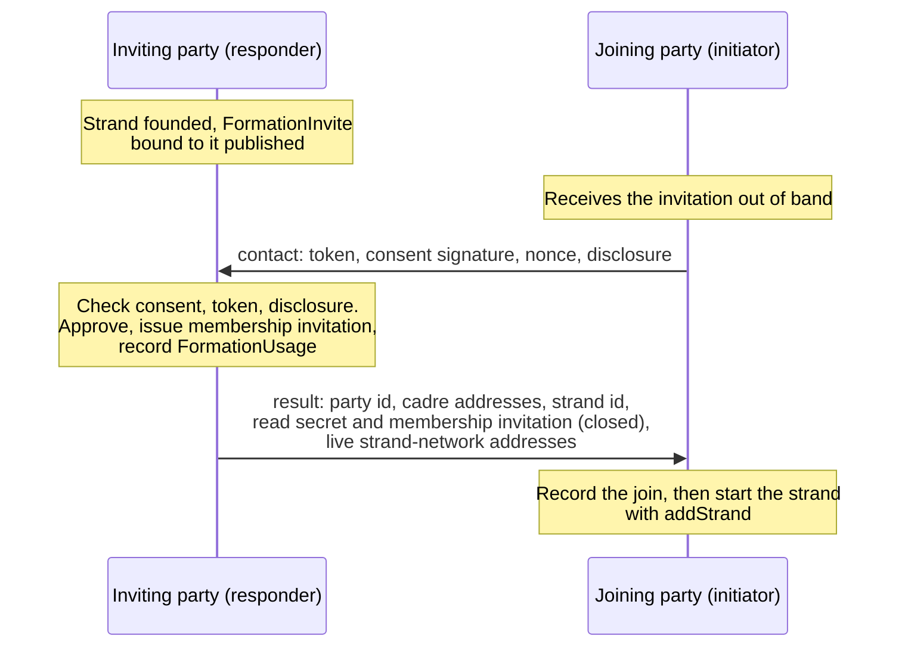

# Inviting and joining

How one party invites another into a strand and how the invited party joins: invitations, the formation protocol that redeems them, which machines answer and under what deadlines, the refusals a joiner can receive, the rule that a joining machine writes nothing before its first sync, and how a join is retried while the inviter is offline. For app developers who build invite and join flows and for maintainers of the formation code.

Related: [strands: model and lifecycle](lifecycle.md) · [closed-strand membership](membership.md) · [closed-strand keys](keys.md) · [how a strand's nodes find each other](../network/strand-addressing.md) · [formation approval hook](../formation-approval-hook.md) · [cadre-core API guide](../api.md)

## Formation invitations

A formation invitation lets a party that holds it join one strand of the inviting party. It has two halves, made by two calls.

- **The envelope** (`OpenInvitation`): a token, the sApp id, an expiration, and a bootstrap list of addresses of the inviting party's machines. The inviter gives it to the other party out of band, as text or a link. `CadreNode.createOpenInvitation(sAppId, expirationMs)` mints it; the default lifetime is 24 hours. `encodeInvitation` and `decodeInvitation` convert it to and from a base64url string.
- **The row** (`CadreControl.FormationInvite`): the owner-signed record, in the inviter's control database, that makes the token redeemable. It replicates to every machine of the inviting party, so any of them can check the token.

Minting the envelope writes no row, and a token with no row is refused as `token-unknown`.

### Publishing the row

An app publishes the row in one of two ways, both owner-signed:

- **With the founding.** `foundStrand({ …, formationInvite })` writes the invitation in the same control transaction as the strand it is bound to, so a machine that holds the strand row also holds the invitation.
- **Separately.** `publishFormationInvite(token, sAppId, options)` writes the row alone, for a strand that already exists.

The row's options:

| Option | Effect | When omitted |
| --- | --- | --- |
| `strandId` | Binds the invitation to that strand of the inviting party. | Unbound: each redemption creates a new open strand. |
| `expiresAtMs` | Time after which the token is refused as `token-spent`. | Never expires. |
| `totalUses` | Number of redemptions allowed. | Unlimited. |
| `validationUrl` | An outside approval hook that must sign off each redemption. | No outside approval. |

An invitation to a new closed strand (adapted from `createInvitation` in `packages/reference-app-web/src/lib/cadre-web.ts`):

```ts
const invitation = await cadre.createOpenInvitation(CHAT_SAPP_ID, expirationMs);
const { strandRow, ready } = await cadre.foundStrand({
	strandId: crypto.randomUUID(),
	type: 'c',
	memberPrivateKey: await generateStrandMemberKey(),
	sAppConfig: getChatSAppConfig(),
	formationInvite: { token: invitation.token, expiresAtMs: invitation.expiration.getTime() },
}, { background: true });
const encoded = cadre.encodeInvitation(invitation);
```

`createOpenInvitation` throws when no machine of the party has an address for the bootstrap list. The example mints the invitation before founding so that a node that cannot be reached founds no strand.

### Bound and unbound invitations

- **A bound invitation** names a strand the inviter already founded. A redemption records the joiner's consent against that strand and creates nothing. The joiner receives the strand id and, for a closed strand, its read secret and a single-use membership invitation ([the invite-to-join handshake](membership.md#the-invite-to-join-handshake)).
- **An unbound invitation** names no strand. Each redemption makes the responder mint a strand id and write an open `Strand` row and the consent row in one transaction (`ControlDatabase.redeemInvitation`). The joiner's consent authorizes that row with no owner signature ([Three layers of consent](lifecycle.md#three-layers-of-consent)). The strand appears on the inviter's machines as `strand:discovered`, and its row names no founder, so the inviting app starts it with `addStrand({ …, founder: true })`.

The reference apps publish only bound invitations.

### Outside approval

An invitation with a `validationUrl` is redeemable only when the service at that URL signs an approval with a key the inviting party enrolled through `CadreNode.enrollValidationKey`. The approval covers the token, the joiner's nonce, the strand id, the joiner's key and the disclosure, so it approves exactly one join. Enrollment is replicated state, so a party enrolls the key before it hands out invitations that depend on it. [Formation approval hook](../formation-approval-hook.md) specifies the HTTP contract.

## The formation protocol

Formation is one request and one answer over a libp2p stream between the two parties' control nodes, under the protocol id `/sereus/formation/1.0.0` (`strand-formation-protocol.ts`). The joining side is the **initiator** and the inviting side the **responder**.



### What the joiner sends

`CadreNode.formStrand(invitation, disclosure)` runs one formation. For each attempt it generates a new key pair and a single-use nonce (`usageStampId`), then signs a consent digest over the token, the nonce, its public key and the canonical text of the disclosure. The contact message carries all of these and the joiner's own addresses.

The **disclosure** (`StrandFormationDisclosure`) is what the joiner tells the inviter about itself: optionally a purpose, an identity bundle and app metadata. cadre-core sets the disclosure's `partyId` field to the peer id of the key generated for this formation, replacing any value the app passed. The responder refuses a disclosure whose canonical JSON exceeds 8 KiB, because that text is stored in a replicated table and signed by the approval hook.

The responder stores the joiner's key and signature in the `FormationUsage` row, so any later reader of the inviter's control database can verify the consent (`verifyFormationConsent`) without trusting the machine that answered.

### What the responder checks, in order

1. **Capacity.** A responder at its limit of 100 concurrent sessions answers `busy`.
2. **Consent.** The signature must verify, and the peer id the joiner claims must be the id of the presented key. This precedes the token check because it needs no database read.
3. **Token.** The invitation row must exist on this machine, be unexpired, and have uses left.
4. **Disclosure.** An embedder-supplied validator may refuse it; without one every disclosure passes.
5. **Provisioning.** For a bound invitation the responder obtains the outside approval if the invitation names one, re-checks that a use remains, issues the joiner's membership invitation into a closed host strand, and only then writes the `FormationUsage` row. For an unbound invitation it obtains the approval and writes the new `Strand` row with the usage row.

In that order, a refused approval writes nothing into the host strand, a membership invitation that cannot be issued is reported before the token is spent, and a closed-strand join is never approved without a membership invitation.

### What a refusal and an approval disclose

A refusal carries a fixed code and a human-readable reason, and nothing else. Only an approving result reveals the responder's party id, its cadre addresses, a closed strand's read secret, the membership invitation and its live strand-network addresses.

The joiner validates an approval before accepting it. The built-in validator refuses a result that omits the responder's identity or cadre addresses, or that names no strand. An empty list of strand-network addresses passes, because the responder's strand may not be running yet.

### What the joiner does with an approval

`formStrand` then completes three steps before it returns:

1. It records the responder's strand-network addresses, the only addresses of the other party's strand nodes the joiner is given ([strand-address resolution](../network/strand-addressing.md#strand-address-resolution)).
2. For a closed strand, it creates or reuses this party's membership key and keeps the membership invitation, which the strand's membership loop redeems once the strand is running ([How the runtime completes a join](membership.md#how-the-runtime-completes-a-join)).
3. It remembers the join, so the strand is offered again after a restart ([what a joiner's node remembers](keys.md#what-a-joiners-node-remembers)).

If the second or third step fails, `formStrand` throws `FormationPostApprovalError`. The token is already spent, so the user fixes the local cause, usually the key store or a missing owner signer, and asks for a new invitation.

The app then starts the strand with `addStrand`, passing a strand row built from the result (adapted from `joinViaInvitation` in the same file):

```ts
const invitation = cadre.decodeInvitation(encoded.trim());
const result = await cadre.formStrand(invitation, disclosure);
await cadre.addStrand({
	strandRow: {
		Id: result.strandId,
		MemberPrivateKey: result.memberPrivateKey ?? null,
		Type: result.memberPrivateKey ? 'c' : 'o',
		FounderOwnerKey: null,
		FounderPeerId: null,
	},
	sAppConfig: getChatSAppConfig(),
});
```

`result.memberPrivateKey` is the closed strand's read secret; the result carries no type field, so its presence is how the joiner knows the strand is closed. `result.invitePrivateKey` is the key the joiner generated for this formation. It is neither the read secret nor the party's membership key.

### One redemption, one row

The joiner's nonce, `UsageStampId`, is the primary key of `FormationUsage`. Concurrent redemptions of one invitation therefore never compete for a row key, and no approved join is discarded because another committed first. The use limit is enforced by counting committed usage rows, which has a [limit](#limits-and-accepted-tradeoffs) of its own.

## Who answers formation

Every `CadreNode` answers formation for its party from `start()` on, whatever kind of machine it runs on. Every machine of a party holds the replicated `FormationInvite` and `FormationUsage` rows, so an always-on machine can admit a joiner while the phone that minted the invitation is offline.

- **A node with no owner key can answer**, such as a cadre-host node or a provider container. The responder writes only the `FormationUsage` row and, for an unbound invitation, the `Strand` row, and the joiner's consent authorizes both.
- **A machine that does not run the host strand refuses retryably.** Issuing a closed strand's membership invitation needs the strand running on the answering machine, which wakes it if it hibernates. A machine that does not run it answers `host-strand-unavailable`, and the joiner tries the next machine.
- **Addresses are read per formation**, because a relay-only node has no address until its relay reservation completes, which is after the responder is installed.
- **Strangers are admitted only while an invitation is outstanding.** [The connection gate](../cadre/control-security.md#the-connection-gate) keeps an exemption open for formation only while the node holds an unexpired invitation with uses left. A token this node minted counts from the moment it is minted, before its row is published.

### Replacing the responder

`CadreNode.initializeStrandSolicitation(options)` replaces the installed responder, for an embedder that needs its own disclosure validator, usage recorder or deadlines. The replacement takes over the tokens the previous responder registered, so the connection gate stays open for invitations already handed out, and without a recorder in `options` it still checks tokens against the control database.

### Formation deadlines

Every formation deadline is derived from the node's declared link round trip, `NetworkConfig.linkRoundTripMs` (`L` in the table, 3.5 s when not declared), because each waits on work that crosses the link between the two parties ([Deadlines and the link budget](../network/deadlines.md)). `formationDeadlines` in `strand-formation-deadlines.ts` holds the derivation.

| Deadline | Role | Value | At the default |
| --- | --- | --- | --- |
| Dial and protocol negotiation | Joiner | `6L + 4 s` | 25 s |
| Wait for the contact message | Responder | `2L` | 7 s |
| Outside approval hook | Responder | flat | 10 s |
| Provisioning work | Responder | `10 s + 24L` | 94 s |
| Settle grace | Responder | `22L` | 77 s |
| Wait for the result | Joiner | work + grace + `5L` | 188.5 s |
| Whole session | Both | dial + wait | 213.5 s |

**The nesting rule.** Each layer can fail and report before the layer that waits on it gives up: approval hook, provisioning work, work plus grace, the joiner's wait, the session. A caller sets `provisionTimeoutMs` on the responder only and the joiner's wait is derived from it, so no setting can make a joiner time out while the message explaining the failure is in transit.

**Abort leaves the invitation unspent.** When the work budget expires, the responder aborts provisioning. The recorder checks the abort before it writes the `FormationUsage` row, so the joiner, told `provisioning-timeout`, can retry with the same invitation.

**A late write is adopted.** A write that had already passed the abort check cannot be withdrawn, because `FormationUsage` is append-only. A redemption that completes inside the settle grace is therefore reported as an approval, not as a timeout.

## Which machines an invitation names

An invitation's bootstrap list names several machines, so that a joiner can form through an always-on machine while the inviting phone is offline.

### What the inviter puts in the list

`createOpenInvitation` puts the minting machine's own addresses first, because that machine is the most likely to run the host strand, then up to three other machines of the party with at most four addresses each (`invitation-bootstrap.ts`).

- **Source.** Another machine's addresses come from its signed `CadrePeer` address record, which must pass the signature, 15-minute freshness and trust checks. A machine whose record fails them is left out.
- **Order.** Machines this node is connected to on the control network come first, because a live connection is better evidence that a machine is up than a recent record. Within each group, the newest record comes first.
- **No address of its own.** A phone whose relay is down can still mint an invitation that names an always-on machine of its party.
- **Disclosure.** Whoever holds the invitation learns the peer ids and addresses of the machines it names, before any token check. The party id and the rest of the cadre are disclosed only on approval.

### How the joiner uses the list

The joiner groups the list by the peer id each address ends in and runs one formation session per machine, in the order each machine first appears (`dialFormationByMachine`). It drops an address that names no machine.

- **Addresses of one machine share one dial.** The joiner tries every address of that machine under the single dial deadline, so a machine with reservations on two relays is reachable while either relay is up.
- **Next machine.** When a machine cannot be reached, or refuses with a retryable code, the joiner tries the next.
- **Stop.** A refusal that is not retryable ends the formation at once, because every machine of the party would answer the same. An approval that fails the joiner's validation also ends it, because it may already have spent the invitation.
- **All machines failed.** If any machine answered, the joiner throws the last retryable refusal, because "reachable but not ready" tells the caller more than "unreachable". Otherwise it throws one `FormationUnreachableError` that names each machine's failure.
- **One redemption across machines.** Every session sends the same contact message with the same nonce, so at most one machine can record the redemption.

An invitation minted with `foundStrand`'s background form can reach the joiner before the closed host strand is running. The responder then answers `host-strand-unavailable`, which leaves the token unspent; `formStrand` throws it and `requestJoin` retries it.

## Formation rejection codes

Every refusal carries a code from `FormationRejectionCode` (`strand-formation-rejection.ts`). `FORMATION_REJECTION_RETRYABLE` in the same file says which codes are worth retrying.

| Code | Retry | Sent when |
| --- | --- | --- |
| `token-unknown` | yes | This machine has no row for the token; it may not have replicated here yet, so the joiner asks another machine. |
| `token-spent` | no | The invitation expired or every allowed use is recorded. The loser of a redemption race receives the same code. |
| `consent-invalid` | no | The consent signature does not verify, or the claimed peer id does not match the key. |
| `disclosure-invalid` | no | The disclosure validator refused the disclosure. |
| `disclosure-too-large` | no | The disclosure is over 8 KiB. |
| `approval-refused` | no | The approval hook answered no. |
| `approval-unavailable` | yes | The approval hook could not be reached or did not answer in time. |
| `approval-invalid` | no | The approval was malformed, its key is not enrolled, or the hook is misconfigured. |
| `host-strand-unavailable` | yes | The host strand's row is absent on this machine, the strand is not running here, or issuing the membership invitation failed. |
| `host-strand-must-be-recreated` | no | The host strand's founder is the read-secret key ([keys.md](keys.md#a-strand-whose-founder-is-the-read-secret-key-is-refused)). |
| `busy` | yes | The responder is at its limit of concurrent sessions. |
| `provisioning-timeout` | yes | Provisioning exceeded its work budget. The invitation is unspent. |
| `conflict` | yes | The consent write failed for a reason other than a spent invitation. |
| `internal` | yes | An unexpected failure on the responder. |

A missing code, or one this build does not know, is read as `'unrecognized'` and retried: the two parties may run different versions, and retrying an unknown answer is safe, while giving up on a join that would have succeeded is not.

### What the joiner's call throws

After it has tried the invitation's machines in turn, `formStrand` throws one of four errors. `FormationRejectedError` means a responder refused; its `retryable` follows its `code`. `FormationUnreachableError` means no answer was read, and is always retryable. `FormationPostApprovalError` means the responder approved and a step on the joining machine then failed, and is never retryable. A plain `Error` means an approval failed the joiner's validation, which is a misbehaving responder and not a refusal. The [API guide](../api.md) lists the fields of each.

## Joining: no writes before the first sync

**Invariant: a machine that has never held this strand's `Strand.Header` row, and has not read every `Strand` and `App` table once, must not commit to the strand.**

### Why

A machine that stores blocks and has no strand peer connected is the whole cluster for every block, so a write to a table it does not hold creates that table's collection, as a founder's does. When the joiner then connects, two independently created histories share one collection id. Optimystic keeps one or never reconciles them, and the joiner's rows are lost although each write reported success.

Optimystic cannot tell a founder from a joiner, but a cadre-core launch knows whether it is founding. The founder writes the `Header`; every other machine can only receive it from a peer, so "no local Header" means "never synced". The `Header` alone is not enough, because it is one collection and reaches a joiner ahead of the others. The rule covers the membership tables too, since the node itself writes membership rows as soon as the database is available.

### What the node does

The first-sync gate (`strand-first-sync-gate.ts`) enforces the rule on every launch that is not founding.

- **The database is withheld.** The strand's network node starts, but `StrandInstance.database` stays unset and the instance reports status `'syncing'`. The node reads one row from every `Strand` and `App` table, and repeats the probe whenever data arrives in the strand's store.
- **The database is published when every read has settled.** The status becomes `'active'` and the node emits `strand:writable`. An empty table counts as settled; a read that fails counts as "not yet".
- **A machine that already holds the tables is not gated.** A founder, and normally a restart or a wake from hibernation, passes the first probe, so a machine that has synced before keeps writing while offline. A machine that left soon after its first sync can hold less than it read, and is gated again.
- **The founder supplies every table**, including the ones its founding transaction does not write ([Empty collections for every other table](membership.md#empty-collections-for-every-other-table)). A joiner's first write to a table then appends to the founder's collection.
- **An unreachable seed defers the database, not the launch.** Optimystic will not rule a block absent while any configured seed peer is unanswered, so a joiner in that state cannot build its database. The launch stays up as `'syncing'` and retries the build every 5 seconds.
- **A machine that holds no strand blocks is not gated.** It is in no cluster, so a write with no serving machine reachable resolves no coordinator and fails instead of creating a collection; there is no fork to prevent. Gating it would also be wrong in itself: its probe reads would be remote reads repeated on the backstop, and a withheld database keeps the app from queuing. Its database is published as soon as it opens ([A node that holds no strand blocks](../cadre/node.md#a-node-that-holds-no-strand-blocks)).

### What the app sees

- **`addStrand` resolves once the strand is writable,** so an app can write as soon as the call returns. The wait is bounded by `CadreNodeConfig.strandFirstSync.timeoutMs`, 6 minutes by default. On a machine that holds no strand blocks it resolves as soon as the database is open, which does not mean a member has been reached: the first read or write fails, retryably, until a serving machine is reachable.
- **On timeout it rejects with `StrandAwaitingFirstSyncError` and the launch stays up.** Calling `addStrand` again, awaiting `CadreNode.whenStrandWritable(strandId)`, or listening for `strand:writable` continues the wait.
- **`addStrand({ …, awaitFirstSync: false })` returns the `'syncing'` instance at once,** for a caller that connects its own peers first.
- **The gate cannot be disabled.** A machine whose store already holds the tables is never gated, so the gate blocks nothing that would work without it.

### What the gate does not cover

- **A table added by a later app schema version has no collection until its first write.** Every member applies the app schema itself and none is privileged to create the table. Two machines that each write to it before reading the other's rows create two histories, with the same silent loss. The founder's empty-collection step cannot be extended to upgrades: a member that upgrades while cut off would commit an empty collection beside one another member had already written (ticket `feat-strand-tables-added-by-a-later-schema-get-their-collection`).
- **The schema catalog is written before any sync.** That is safe only because every machine derives identical catalog content from the same schema text.
- **Writable does not mean connected.** Once past the gate, a machine with no strand peer connected commits alone and reports success, because a machine that has synced must be able to write offline ([A commit's durability](writes.md#a-commits-durability)).

## Joining while the inviter is offline

`formStrand` makes one attempt from one machine and records nothing for the party. `CadreNode.requestJoin(invitation, disclosure)` keeps trying until the join succeeds, the invitation is used up or expires, or the user dismisses the request. The request survives restarts, and any **owner machine** of the party (a machine that holds an enrolled owner key) can complete it. An app uses one of the two calls per invitation: nothing coordinates them, and using both gets one of them `token-spent`.

### The request

`requestJoin` writes a `CadreControl.JoinRequest` row to the joining party's control database: one row per invitation, holding the encoded invitation, the disclosure, and the time at which trying stops. That time is the invitation's expiration or 30 days from the request (`MAX_PENDING_JOIN_MS`), whichever is earlier. The call then runs one attempt and returns the status after it, so a join whose inviter is online is as fast as `formStrand`.

The row is owner-signed, so `requestJoin` throws on a machine that is not an owner machine. It also throws on an invitation past its expiration. Asking again for an invitation whose request is still pending returns that request; asking again after it finished starts a new one.

### Who retries, and when

Every owner machine of the party runs the retry loop (`pending-join-runner.ts`). Each reads the requests at start, whenever one of the join tables changes, and at the latest 10 minutes after its last read (`PENDING_JOIN_BACKSTOP_MS`).

- **Base delay:** twice the formation dial deadline, 50 seconds at the default link declaration.
- **First attempt on a machine that did not make the request:** after a delay between zero and the base delay, fixed by the machine's peer id and the request id, so that two machines rarely dial at the same moment.
- **After a retryable failure:** the base delay doubled per failure, up to 10 minutes, moved by up to 20 % either way.
- **Concurrency:** at most two background attempts run at once on one machine. A `requestJoin` call does not wait for a slot.

Every attempt is a new `formStrand`. The schedule is kept in memory, so a restarted machine starts over from the row.

### How an attempt's result is read

| Result of the attempt | Outcome |
| --- | --- |
| Approved | The request becomes `joined`, with the strand id and, for a closed strand, the membership invitation. |
| `FormationUnreachableError`, a retryable rejection, or an unexpected error | Retry later. |
| A rejection that is not retryable, other than `token-spent` | The request becomes `failed` with that code. |
| `FormationPostApprovalError` | `failed` with code `local`. |
| The attempt falls due at or after the request's expiry | No attempt is made; `failed` with code `expired`. |
| `token-spent` | `failed` with that code, after the check for the party's own success. |

**A spent token may be this party's own success.** `token-spent` can mean that another owner machine of the same party has just redeemed the invitation. The machine re-reads the request and adopts an outcome it finds. Otherwise it tries once more after twice the formation session deadline, long enough for the other machine's `joined` outcome to replicate, and fails the request only if that attempt is also refused as spent.

**Two machines recording outcomes.** An outcome write is refused if another write changed or removed the request since the writer read it; the writer then decides again. A `joined` outcome always wins over a `failed` one, and a request dismissed while an attempt was running is not recreated.

### Status and clean-up

`listPendingJoins()` returns every request not dismissed, and the `pendingJoin:changed` event reports each change this machine sees. In `PendingJoinStatus.state`, the values `pending`, `joined` and `failed` come from the replicated rows and read the same on every machine. `trying` (an attempt is running here) and `waiting` (this machine's last attempt failed retryably) are the machine's own view of a pending request. A joined strand is offered through `strand:discovered` like any other join, and the app starts it with `addStrand`.

A finished request stays until `dismissPendingJoin(id)`, or until an owner machine removes it 7 days after its outcome, when the membership invitation it carries has expired. Dismissing a pending request cancels it on each machine at its next read.

### The membership invitation on other machines

A closed strand joined in the background on one owner machine may be started first on another, typically the phone. The membership invitation is therefore stored in the `JoinSuccess` row, and each owner machine takes it from there when it holds none for that strand. Whichever machine starts the strand redeems it for the party's `Member` seat.

### While cut off from the party

A machine that reaches none of its party's other machines still writes a request and the outcome of an attempt it already made, because both exist only in its memory until written. It writes them again, unchanged, when another machine of the party becomes reachable ([writes made while alone](../cadre/control-convergence.md#writes-made-while-alone)).

Other writes are deferred. While a machine reaches no other machine of a party that has several, it makes no background attempt, records no `expired` outcome and removes no finished request, because another owner machine writing the same tables then would create a second history of them. A direct `requestJoin` call still attempts at once.

## Limits and accepted tradeoffs

- **The token is the only credential, and it is not minted from a cryptographic random source.** A joiner signs its consent with a key it made for the purpose, so whoever presents a token that has a row is admitted unless a disclosure validator or an approval hook refuses, and for a closed strand receives a membership invitation. `createOpenInvitation` builds the token from the clock and `Math.random` (`strand-solicitation.ts`), which a party that has seen other tokens from the same node may be able to predict. Send invitations over a trusted channel, and bound them with `totalUses` and an expiry.
- **A use limit can be exceeded by concurrent redemptions on different machines.** Redemptions that arrive together on separate machines, or on machines that have not converged, can each read the same count of usage rows and all commit, exceeding the limit by at most the number of concurrent joiners. A strict per-token sequence number was rejected: under last-write-wins merging the loser's consented join would be dropped with no trace, whereas an extra admission is visible in the usage record and an owner can remove it.
- **A stalled responder is reported slowly.** Each machine that accepts the contact and then stalls costs the joiner up to one session deadline, about three and a half minutes at the default link declaration. One that cannot be dialled costs one dial deadline, 25 seconds. A party on a fast link lowers `linkRoundTripMs` and every deadline shrinks with it.
- **A commit slower than the settle grace leaves a spent invitation reported as a timeout.** If the consent write outlasts the grace, the joiner is told `provisioning-timeout` and its retry gets `token-spent`. The remedy is to raise the declared link round trip.
- **A membership invitation can be issued and never delivered.** If the consent write fails or is aborted after the responder issued the membership invitation, the `Strand.Invite` row remains with no holder until its 7-day expiry. Nothing can remove a strand-database row and write the control row atomically.
- **Addresses in an invitation go stale.** The bootstrap list is fixed when the invitation is minted; trying the next machine is the only mitigation.
- **An address that never answers can use up a machine's dial deadline.** All addresses of one machine share one dial deadline, so an address that neither connects nor fails holds the dial until libp2p's per-address timeout or the whole deadline.
- **Formation invitations are sized for text, not QR codes.** An invitation can name up to twelve addresses of other machines; a QR code would need lower limits, as cadre invitations have.
- **One invitee can hold many responder sessions.** A session keeps its slot for its whole provisioning budget. Only a caller with a valid token reaches provisioning, so this matters only if tokens are published to untrusted parties; the fix then is a per-token session limit.
- **The first-sync gate cannot tell "no peer" from "slow peer".** It judges only what the local store holds, so an `addStrand` timeout can mean either.
- **Only owner machines complete a pending join.** Every pending-join write is owner-signed, so a cadre-host node or a provider container neither retries nor records outcomes, and `requestJoin` throws there (ticket `decide-non-owner-machine-completes-a-pending-join`).
- **Stopping the node during an attempt can lose an approved join.** `formStrand` takes no abort signal, so `stop()` does not wait for an attempt in flight. An approval that arrives while the node stops can lose its local records, and the next start's attempt is then refused as `token-spent`.
- **A large cadre hears of a dismissal late.** In a cadre of more than 16 machines, a machine outside the cluster that holds the join tables learns of a dismissal or another machine's outcome up to 10 minutes late, which costs at most one extra attempt.
