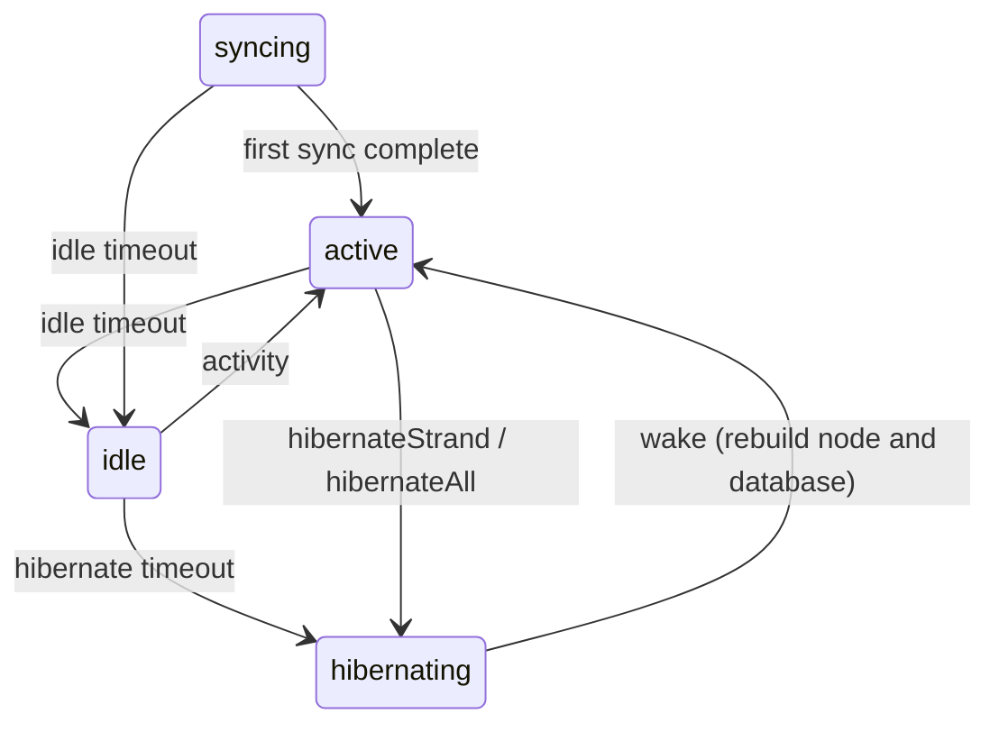

# Strand hibernation and wake

A party can take part in hundreds of strands, and most of them are unused at any moment. Hibernation stops the network instance of a strand that nobody is using on this node and starts it again when something needs it. This document covers when a node hibernates strands at all, the states a strand instance moves through, every path that wakes a hibernating strand, and how an always-on node wakes the party's phones. It is for app developers who drive strand lifecycle and for maintainers of the hibernation code.

Related: [strand lifecycle](lifecycle.md) · [offline writes](writes.md) · [deadlines](../network/deadlines.md) · [running a node in a React Native app](../platforms/react-native.md) · [the unbuilt push network design](../design/push-network.md)

## When hibernation applies

A strand hibernates only where something asks for it. There are two ways.

- **Timers.** A node whose configuration sets `hibernation.enabled` to `true` moves each strand to `idle` and then to `hibernating` after periods without activity, and wakes each hibernating strand periodically to look for activity ([Check-in wake](#check-in-wake)). The setting is off by default. Of this repo's programs only cadre-cli exposes it ([Configuration](#configuration)); nodes started by cadre-host and cadre-provider run without it, so their strands stay up.
- **Direct calls.** An app calls `hibernateStrand`, `hibernateAll`, `wakeStrand` and `serviceWake` itself ([Hibernating and waking on request](#hibernating-and-waking-on-request)). These work with the timers on or off.

The edge node always runs with the timers off, so a phone or browser app hibernates and wakes strands only through the direct calls and [push wake](#push-wake). With the timers off, reported activity has no effect: `recordStrandActivity` restarts no timer and does not wake a hibernating strand. Only a wake brings the strand back up.

## States

Each strand a node runs has a `StrandInstance` with a `status`. Hibernation moves it between four values. The other values of `StrandStatus` (`starting`, `stopping`, `stopped`, `error`, in `packages/cadre-core/src/types.ts`) belong to launch and shutdown.

| State | Meaning | Strand-network resources |
|-------|---------|--------------------------|
| `syncing` | A joining machine that has not finished its first sync ([Joining: no writes before the first sync](formation.md#joining-no-writes-before-the-first-sync)) | The libp2p node and background loops run. The database exists but is withheld from the app (`StrandInstance.database` is unset) |
| `active` | In use | libp2p node and `StrandDatabase` running |
| `idle` | No activity for the idle timeout | Unchanged. The node and database keep running; `idle` is a status flag only |
| `hibernating` | No activity for a further hibernate timeout, or hibernated on request | Released. The libp2p node is stopped and the database closed, so the strand holds no connections, transports or database handles. The instance record and its launch configuration are kept |

`CadreNode` emits `strand:idle`, `strand:hibernating` and `strand:waking` on these transitions, and `strand:writable` when a joiner leaves `syncing`.

A joiner that never reaches another member takes the same path from `syncing` to `hibernating`, because nothing records activity on it. Each later wake resumes the first-sync probe over the same store.

A node keeps its control network connected while its strands hibernate. That connection is how another machine of the party can ask it to wake a strand.

### What counts as activity

Under the timers, activity restarts the idle timer of an `active` strand and wakes an `idle` or `hibernating` one. In a check-in or `serviceWake` window, activity that arrived after the window's wake began keeps the strand up when the window ends. cadre-core does not observe SQL reads and writes, so the app reports its own use of a strand.

- **`CadreNode.recordStrandActivity(strandId)`** is the app's call. It counts only while the timers are on. With the timers on or off it also triggers the [server fan-out](#server-fan-out) on a node that has one, which wakes the party's other machines for this strand.
- **`CadreNode.wakeStrand(strandId)`** counts with the timers on or off, so a strand woken on request is not hibernated again by a window that happens to hold it. A wake request from another machine of the party runs the same call.
- **The offline queue sending a transaction** counts while the timers are on. A queue that is only waiting to reach other machines does not, or an offline phone would never hibernate. See [Sending is activity](writes.md#sending-is-activity).
- **A joiner's first sync completing** counts with the timers on or off, so the idle timer that ran while it was `syncing` does not hibernate a strand the app has just been handed.
- **An authorized closed-strand formation redemption** counts on the host strand while the timers are on, which keeps the host up for the joiner's first sync. It wakes a hibernating host strand in either case ([Local wake](#local-wake)).

Rebuilding a strand's runtime is not activity.

### What hibernating releases and what a wake rebuilds

`CadreNode` hibernates a strand through `StrandInstanceManager.quiesceStrand`, which stops the strand's libp2p node, closes its `StrandDatabase` and then marks the instance `hibernating`. The instance record survives: strand id, sApp information, member key and latency hint.

A wake calls `StrandInstanceManager.resumeStrand`, which builds a new libp2p node and database from the launch configuration the manager kept. Two inputs are read again first, because they can change while the strand is down: the addresses used to find the strand's cohort, and the party's membership key for the strand, which a key rotation may have replaced.

The rebuilt strand node has the same peer ID as before, so relay reservations and peer-store entries recorded under that ID stay valid. Only `CadreNode.stopStrand` discards the kept configuration.

A rebuild that fails puts the strand back to `hibernating`, so the next activity, wake or check-in tries again; the caller that asked for the wake still receives the error. The exception is a rebuild refused because of the strand's app schema, which stops the strand ([A schema that can never apply here is not retried](app-schema.md#a-schema-that-can-never-apply-here-is-not-retried)).

### Hibernate and wake requests run in order

Releasing a strand takes time, and until it finishes the instance still holds its handles and reads as live. `StrandInstanceManager` therefore runs the hibernate and wake requests of one strand one at a time, in the order they were made. A request of the same kind as the latest one joins it, and a hibernate requested during a rebuild waits for the rebuild and then releases what it built.

While a hibernate is pending (`StrandInstanceManager.isQuiescing`), no caller treats the strand as live: a wake, or activity recorded on the strand, rebuilds it after the release finishes. Without this rule a wake could report a closing strand as up, or formation could write to a database that is being closed.

### Latency hints

How long a strand waits before each transition depends on its latency hint. The app sets it per strand as `SAppConfig.latencyHint` when it calls `addStrand`; otherwise the node's `hibernation.defaultLatencyHint` applies, which defaults to `interactive`.

| Hint | Idle timeout | Hibernate timeout (after idle) | Check-in, first → longest | Intended use |
|------|--------------|--------------------------------|---------------------------|--------------|
| `realtime` | never | never | none | Messaging, live collaboration |
| `interactive` | 5 minutes | 15 minutes | 30 seconds → 1 hour | Apps in active use |
| `background` | 1 minute | 5 minutes | 5 minutes → 6 hours | Feeds, notifications |
| `archive` | 10 seconds | 30 seconds | 1 hour → 3 days | Rarely read data |

The values are `HIBERNATION_TIMEOUTS` in `packages/cadre-core/src/types.ts`.

### Configuration

`CadreNodeConfig.hibernation` (`HibernationConfig`) has four settings:

- **`enabled`** turns the idle, hibernate and check-in timers on. It is required when the block is present, and the timers are off when the block is absent ([When hibernation applies](#when-hibernation-applies)).
- **`defaultLatencyHint`** is the hint for a strand whose app gave none.
- **`customTimeouts`** replaces individual values of [the latency hint table](#latency-hints), per hint.
- **`checkInWindowMs`** is how long a check-in holds a strand up, and the default window of `serviceWake`. The default is 15 seconds.

cadre-cli takes `hibernation.enabled` and `hibernation.defaultLatencyHint` from its configuration file and offers no key for the other two settings; see [Configuration](../../packages/cadre-cli/README.md#configuration) in its README.

## Wake paths

Every path ends in the same rebuild. `HibernationManager` combines wake requests that overlap, and `resumeStrand` joins a rebuild already running, so two triggers for one strand build one runtime.

When a wake settles, the manager arms the timers the strand's resulting state needs. A strand that is up gets its idle timer, so a strand woken on request hibernates again if nothing uses it. A strand that reads `hibernating` again gets back the check-in schedule the wake cancelled.

### Local wake

`wakeStrand` wakes a hibernating strand and resolves when the strand is up, or rejects with the rebuild's error. It resolves without doing anything for a strand this node does not run.

Under the timers, activity on a hibernating strand also wakes it, without waiting for the result: `recordStrandActivity` returns at once and a failure is logged.

An authorized closed-strand formation redemption also wakes a hibernating host strand, because issuing the joiner's membership invitation needs the strand's database. The wake is bounded by the formation's provisioning budget. If the budget runs out first, the host rejects the redemption as retryable with the invitation unspent and lets the wake continue, so the joiner's retry finds the strand up. See [The formation protocol](formation.md#the-formation-protocol).

### Check-in wake

While a strand hibernates under the timers, the manager wakes it periodically to find out whether other members have activity for it. One check-in resumes the strand, holds it up for `checkInWindowMs` so the strand network can reach the cohort and the app can read, and then hibernates it again if no activity was recorded. If activity was recorded, the strand stays `active`.

The interval starts at the hint's first check-in value and doubles after each check-in that found nothing, up to the hint's longest value. It returns to the first value the next time the strand hibernates. The manager waits for a check-in to finish before it schedules the next one, so two never overlap.

A check-in is a full resume because Optimystic fetches data when it is read and offers no cheaper way to ask a cohort whether anything is pending. A check-in whose rebuild fails hibernates the strand again and lengthens the interval like one that found nothing.

### Hibernating and waking on request

A mobile app cannot rely on timers, because the operating system suspends it. `CadreNode` therefore exposes the same state machine as direct calls.

- **`hibernateStrand(strandId)` and `hibernateAll()`** hibernate now, without waiting for the idle and hibernate timeouts. They cancel the strand's idle, hibernate and check-in timers, so nothing brings the strand back until the caller wakes it. `realtime` strands are skipped. `hibernateAll` returns the ids it hibernated.
- **`wakeStrand(strandId)`** brings a strand back up ([Local wake](#local-wake)).
- **`serviceWake(strandId, { windowMs })`** runs one check-in on demand: wake, hold for the window, hibernate again unless activity arrived ([What counts as activity](#what-counts-as-activity)). Its own wake does not count as activity. It returns a `ServiceWakeResult` and never throws, so a background task can branch on the result. A strand it hibernates again gets back a check-in schedule only if it had one before, so a strand that was hibernated on request stays down until the next wake.

On an edge node the timers are off, so the only activity a `serviceWake` window sees is a `wakeStrand` call, a wake request from another machine, or a first sync completing. A read, a write, `recordStrandActivity` or the offline queue sending during the window does not keep the strand up.

`@serfab/cadre-rn/lifecycle` provides a `BackgroundRunner` (`createBackgroundRunner` in `packages/cadre-rn/src/lifecycle/background-runner.ts`). It calls `hibernateAll` when the app goes to the background. When the app returns to the foreground it starts the node again if the operating system stopped it and waits a bounded time for the control network. It does not wake the strands it hibernated: the app calls `wakeStrand` for each strand it needs.

## Push wake

A push wake is one machine of a party asking another to bring a strand up. It has two transports. A machine whose control network is connected receives the request over the control network. A suspended phone has no network connection, so its request arrives as an FCM or APNs push message.

### Wake over the control network

The protocol is `/sereus/strand-wake/1.0.0` on the control node (`packages/cadre-core/src/strand-wake-protocol.ts`): one length-prefixed JSON request naming the strand, answered by one acknowledgement on the same stream.

**Authorization.** Only an authorized member of the party reaches the handler. The [per-stream protocol guard](../cadre/control-security.md#per-stream-protocol-guard) checks the sender before the handler runs and resets the stream of anyone else. The request carries no signature of its own: a wake only makes the receiver come online for a strand it already takes part in.

**The acknowledgement comes before the wake.** The receiver replies as soon as it has decided, with the strand's status at that moment, and then starts the wake. A status of `hibernating` or `idle` in the acknowledgement therefore means a wake was started. Waiting for the wake would put a whole strand rebuild, including a relay reservation, inside the sender's deadline. The receiver refuses a strand it does not take part in, and treats a wake for a strand that is already up as done.

**Receiver bounds.** A member can still misbehave, so the receiver aborts a request that does not arrive within 10 seconds and answers with a refusal while 100 wake streams are already open.

**Sender.** `CadreNode.pushWake(targetPeerId, strandId, reason?)` looks up the target's signed control-network addresses and tries them one at a time, relay addresses first, so a machine behind NAT is reached through its relay. Each attempt and the whole call have deadlines derived from the declared link: 28.5 seconds and 57 seconds at the default ([Dial budgets are counted in round trips, not milliseconds](../network/deadlines.md#dial-budgets-are-counted-in-round-trips-not-milliseconds)). The whole-call deadline exists because an address behind a dropped NAT mapping uses its entire attempt deadline, and without it a wake would cost that much per address. `pushWake` rejects when no attempt got an acknowledgement, and the error names every address and why it failed.

### Server fan-out

`PushFanoutService` (`packages/cadre-core/src/push-fanout.ts`) decides which machines to wake and when. A node builds it only when `CadreNodeConfig.push` is set, so it runs on always-on nodes that were given push credentials.

The trigger is explicit. `CadreNode.notifyStrandActivity(strandId, reason?)` is the call an always-on host or app makes when it sees activity on a strand, and `recordStrandActivity` makes it too. Both return at once and never throw.

For one trigger the service does the following:

1. It ignores a strand this node does not take part in.
2. It drops a trigger that arrives within `debounceMs` of the last pass for the strand (default 10 seconds), and joins a pass already running.
3. It lists the party's member machines, leaves out this node, and leaves out any machine it woke for this strand within `cooldownMs` (default 5 minutes).
4. For each remaining machine it calls `pushWake`. Any acknowledgement, a refusal included, means the control network reached the machine, and no platform push is sent.
5. Only when `pushWake` rejects does it look up the machine's device token and send a platform push. A machine with no token is skipped.

When FCM or APNs reports a token as permanently invalid, the service stops sending to it and calls `CadreNode.expireDeviceToken`. A node that holds an owner key deletes the `DeviceToken` row; any other node logs that the phone must register again.

### Platform push credentials

The platform message is data-only: `{ type: 'strand-wake', strandId, reason }`, defined in `packages/cadre-core/src/strand-wake-payload.ts` for both sender and receiver.

Sending it needs the app's push credentials on the always-on node: a Firebase service account for Android, an APNs auth key with the app's bundle id for iOS, or both. Creating those credentials at Google and Apple is the operator's task. APNs credentials are for either the sandbox or the production host and must match the app build.

- **cadre-host** stores the credentials with its `cadre-host push` commands and gives them to each node it starts: [Push credentials](../../packages/cadre-host/README.md#push-credentials) in its README.
- **cadre-cli** reads them from the `push` block of its configuration file or the `CADRE_PUSH` environment variable: [Push credentials](../../packages/cadre-cli/README.md#push-credentials) in its README.
- **cadre-provider** reads them from the `push` block of its configuration file and passes them to every container it creates as `CADRE_PUSH`: [Push credentials](../../packages/cadre-provider/README.md#push-credentials) in its README.
- **An embedder of cadre-core** builds a notifier with `createPushNotifier(credentials)` from `@serfab/cadre-core/push-node` and passes it as `CadreNodeConfig.push.notifier`. The node then owns the notifier and closes it in `stop`.

The FCM and APNs senders use Node-only modules. They are behind the `push-node` subpath so that a phone or browser bundle, which imports the main entry, never includes them.

### Device tokens

A phone publishes its push token with `CadreNode.registerDeviceToken(platform, token)`, which writes a self-signed `DeviceToken` row to the control database. The row replicates to the party's machines, and a server finds the token from the phone's peer ID with `resolveDeviceToken`. The phone publishes again when the platform rotates the token and calls `clearDeviceToken` on logout.

`resolveDeviceToken` returns a token only for a current member, and never one whose stamp has been retired, so a cleared token cannot be used again from a stale copy of the row. A token has no expiry by default, because a phone that has been suspended for weeks must stay reachable.

### Receiving a push on the phone

When a push arrives while the app is in the background, a background task parses the message, starts the node if the operating system had stopped it, waits a bounded time for the control network, and calls `serviceWake` with a short window. The strand hibernates again when the window ends without activity.

When a push arrives while the app is in the foreground, the app calls `wakeStrand` instead, so the strand the user is looking at comes up and stays up.

The reference implementation is `packages/reference-app-rn/src/push-wake.ts`; [Running a node in a React Native app](../platforms/react-native.md) covers the native setup.

## Limits and accepted tradeoffs

- **`idle` releases nothing.** An idle strand keeps its libp2p node, connections and database. Only `hibernating` frees resources.
- **A check-in is a full resume.** There is no cheap way to ask a cohort whether a strand has pending activity, so each check-in rebuilds the strand's runtime and holds it for the window. A lighter check over the control network would avoid the rebuild (ticket `hibernation-control-network-pending-precheck`).
- **Activity is reported, not detected.** Neither the idle timer nor the fan-out sees a transaction arrive; the app or host calls `recordStrandActivity` or `notifyStrandActivity`. Optimystic exposes no hook for a committed or received block. A missed report delays a wake until the next check-in (ticket `passive-strand-activity-fanout-detector`).
- **None of this repo's always-on programs reports activity.** cadre-cli, cadre-host and cadre-provider accept push credentials and build the fan-out, but nothing in them calls `notifyStrandActivity` or `recordStrandActivity`. Their nodes send a wake only when an embedder's own code makes the call (same ticket).
- **Reported activity is ignored while the timers are off.** On an edge node a `serviceWake` window is not extended by reads, writes or the offline queue sending, and a strand hibernated by `hibernateAll` stays down after the app returns to the foreground until the app calls `wakeStrand`.
- **A wake acknowledgement does not report the result.** The sender learns that a wake started. A wake that fails afterwards is logged on the receiver only.
- **Any authorized member can wake any other.** The wake carries no signature beyond membership. This is accepted because a wake only costs the receiver the resources of running a strand it already takes part in.
- **The platform push waits for the direct dial to fail.** That can take the whole wake budget, 57 seconds at the default declared link. If the delay matters, the fan-out should start the platform push alongside the dial or after its first attempt.
- **A receiver that does not yet list the sender as a member is sent a platform push.** Its guard resets the stream, which the sender cannot tell from an unreachable machine. The platform push then wakes the phone by its own path.
- **Platform delivery is best-effort.** iOS drops or merges background pushes in low-power mode, and Android defers data messages in Doze unless the app is exempt from battery optimization. Under the timers the check-in is the fallback. A strand hibernated on request has no check-in schedule, so a phone that misses a push stays down for that strand until the next push or until the app calls `wakeStrand`.
- **Fan-out state is in memory.** The debounce, cooldown and invalid-token records are lost on restart. The cost is at most one duplicate wake, and `serviceWake` on a strand that is up does nothing.
- **One push per strand.** Activity on several strands sends one platform message for each; they are not merged.
- **A phone needs an owner signature for its first token row.** Inserting or deleting a `DeviceToken` row requires an owner signature; only later updates are self-signed. A node without an owner key cannot publish its first token or clear it.
- **Raw push credentials sit on every configured node.** A platform push credential lets its holder wake every install of the app, so this model fits only while the node's operator is the app's developer. Removing that assumption is the subject of [the push network design](../design/push-network.md), none of which is built.
