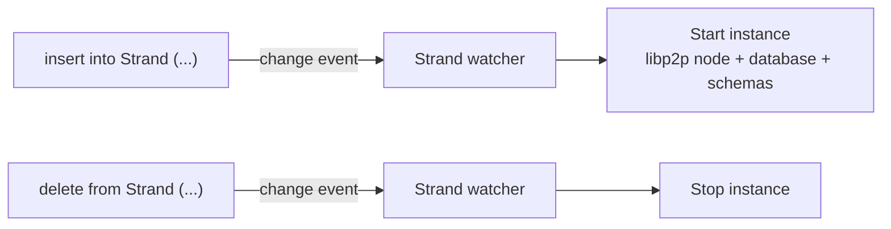

# Strands: model and lifecycle

This is the entry document for strands. It says what a strand is, which three layers decide who may do what in one, how a party founds a strand, how each node starts and stops strand instances by watching its control database, and what keeps one strand's network apart from another's. Read it before any other document in `docs/strands/`.

Related: [concepts and glossary](../concepts.md) · [inviting and joining](formation.md) · [the cadre node](../cadre/node.md) · [cadre-core API guide](../api.md)

## What a strand is

A strand is an invitation-only SQL database shared among parties. No server holds it: each member party serves it from its own cadre nodes, and the nodes of all member parties together are the strand's cohort. A strand consists of three things.

- **A strand id.** A text key that names the strand in every party's control database, and that each node turns into a storage name and a network name.
- **Two schemas in one database.** Every strand carries the `Strand` membership schema (`schemas/strand.qsql`) and the sApp's own schema, declared as `declare schema App { … }`. One function, `composeStrand` in `@serfab/quereus-plugin-sereus`, applies both.
- **Its own libp2p network.** Each node that serves the strand runs a separate libp2p node for it; see [Network isolation](#network-isolation).

### Strand ids

A strand id is 1 to 128 characters from `[a-z0-9._-]`, is not `.` or `..`, and does not begin `control-`. Every node uses the id as a file, directory or database name and as part of a protocol prefix, and a `Strand` row replicated from another machine carries whatever id that machine wrote, so each node checks the id before it launches the strand (`InvalidStrandIdError`; `storage-scope.ts` gives the reason for each rule).

The founding app chooses the id; the reference apps use a random UUID. cadre-core mints an id in one case, when a responder provisions a strand for an unbound invitation: `strand-` followed by 32 hex characters, 128 random bits (`mintStrandId` in `strand-id.ts`).

### Open and closed strands

A strand's type is fixed at founding and stored in `Strand.Header.Type` and in the founding party's control row.

- **Open** (`'o'`). The strand has no read secret and no membership rows: the `Member`, `Manager` and `Invite` tables are confined to closed strands by their `OnlyClosed` constraints. Any node that can reach the strand's network can read it. The sApp schema's own constraints decide who may write what.
- **Closed** (`'c'`). The strand has per-party membership: each party is seated as a `Member` under its own membership key, some members are managers, and the machines of a removed party are refused at the network. It also has a read secret (`MemberPrivateKey`), a shared key that formation hands to each joining party. Nothing uses the read secret to encrypt data or to admit a peer, so a closed strand restricts reads only by refusing the recorded machines of removed members. See [closed-strand membership](membership.md) and [closed-strand keys](keys.md).

### Where a party records its strands

A strand the party founded is a `CadreControl.Strand` row in its control database. A strand joined from another party has no such row, because that row belongs to the founding party; the joining party records it as a `CadreControl.JoinedStrand` row, or as a machine-local record until an owner machine publishes that row. [What a joiner's node remembers](keys.md#what-a-joiners-node-remembers) describes both records.

## Three layers of consent

Three independent layers decide who may do what. They live in different databases and are signed by different keys.

1. **The control layer** (`CadreControl.*`, in each party's control database). It records which strands this party takes part in and whom it has invited: `Strand`, `JoinedStrand`, `FormationInvite`, `FormationUsage`. The party's owner keys sign these rows. The one exception is narrow: an unbound invitation lets a joiner's signed consent seat an open, keyless `Strand` row with no owner signature, once per strand id and never after that id has been removed. The comments on `Strand.AuthorizedInsert` in `schemas/control.qsql` state each condition and the attack it closes.
2. **The strand membership layer** (`Strand.*`, inside each strand's database). It records what the strand is and, for a closed strand, who belongs to it: `Header`, `Invite`, `ConsumedInvite`, `CancelledInvite`, `Member`, `MemberPeer`, `Manager`, `Revocation` and `AppSchemaVersion`. Each party's membership identity key signs its own rows, and a manager's key signs administrative ones.
3. **The sApp layer** (`App.*`, in the same strand database). The app schema's constraints decide what each member may write. See [Writing an app schema](../schema-guide.md).

Two keys in the control layer belong to a closed strand and do different jobs. `Strand.MemberPrivateKey` is the strand-wide read secret; every joining party receives it, so it identifies nobody. `StrandPartyKey` is this party's own membership identity for the strand and never leaves the party. An identity derived from the shared secret could be recomputed by any joiner, who could then sign as the founding manager; that is why the two are separate.

Invitation tokens are stored in plaintext in the replicated control database, so every machine of the inviting party can read them. What a machine may write there is decided by the constraints on `FormationInvite`, `FormationUsage` and `Strand`, not by knowledge of a token. Toward another party the token is the credential: whoever presents it can redeem the invitation ([limits in formation.md](formation.md#limits-and-accepted-tradeoffs)).

## Founding a strand

`CadreNode.foundStrand(config)` founds a strand: it publishes the strand's control row for the whole party and starts the strand on this machine as its founder. The reference apps found an open strand like this (`packages/reference-app-rn/src/chat-strand.ts`):

```ts
const { instance } = await cadreNode.foundStrand({
	strandId,
	type: 'o',
	sAppConfig: getChatSAppConfig(),
});
```

A closed strand adds `type: 'c'` and a `memberPrivateKey` minted with `generateStrandMemberKey()`. `FoundStrandConfig` in `packages/cadre-core/src/types.ts` lists every field.

### What the publish writes

The publish is one control transaction under one owner approval (`ControlDatabase.insertFoundingRows`). It writes the `Strand` row, a closed strand's `StrandPartyKey` row, and, when `formationInvite` is given, a `FormationInvite` bound to the strand. Because the rows commit together, a machine that finds the strand row also finds the key and the invitation. The node needs an owner signer whose key is enrolled, or the control database rejects the write.

### Founding is safe to repeat

An app can be killed between the publish and the start, so `foundStrand` can be re-run from any point. Over a row that is already published it adopts the stored row and starts the strand; over an instance that is already running it returns that instance, running the founder bootstrap on it if it was first started as a joiner. A stored row of the other type throws.

For a closed strand the stored `MemberPrivateKey` replaces the one in the config, because the membership already written into the strand matches the stored key. A caller that mints a key per attempt therefore reads the key from the returned `strandRow`, not from its own input.

### Which machine founds

The `Strand` row names its founding machine in `FounderPeerId`, the peer id of the publishing node, and the owner signature covers it. A launch that passes no explicit `founder` flag derives the answer from the row: this machine founds if `FounderPeerId` is its own peer id. The column holds a peer id, not an owner key, because one owner key can be held on several machines and only one of them may found.

Exactly one machine must found, because two machines that each write the strand's `Header` on separate replicas create two histories of one table. When two machines race to found one id, the control database keeps one row; the losing machine adopts it and attaches as a joiner. `FoundStrandResult.founded` reports which happened.

### What the founder writes into the strand

On its first start the founder writes the strand's `Header` row and, for a closed strand, its own `Member`, `Manager` and `MemberPeer` rows, in one strand transaction. Before that transaction it commits an empty collection for every other table the two schemas declare, so that joiners receive every table from the founder. [Strand membership bootstrap](membership.md#strand-membership-bootstrap) describes the rows, and [Joining: no writes before the first sync](formation.md#joining-no-writes-before-the-first-sync) explains why joiners must receive them before writing.

### Returning before the start finishes

`foundStrand(config, { background: true })` resolves once the row is published and continues the local start in the returned `ready` promise. An app that founds a strand in order to hand out an invitation needs only the row's id and read secret, while the start can take seconds on a phone. If the start fails, `ready` rejects, the strand stays published, and the strand watcher retries the start.

### Publishing without starting

`CadreNode.publishStrand(strandId, type, memberPrivateKey)` writes the `Strand` row and a closed strand's `StrandPartyKey` row, and starts nothing. It is idempotent for identical content and never overwrites a row. `addStrand` is the other half: it starts a strand whose row already exists, and it is the call a joiner uses.

### Stopping, removing and leaving

| Call | Scope | Effect |
| --- | --- | --- |
| `stopStrand(strandId)` | This machine, this session | Stops the local instance and stops offering the strand until the node restarts or the app calls `addStrand` again. Control rows are untouched. |
| `unpublishStrand(strandId)` | The whole party, owner-signed | Deletes this party's `Strand` row and, for a closed strand, its `StrandPartyKey`. Every node of the party stops its instance when its watcher sees the row gone. Other parties keep running the strand. |
| `forgetJoinedStrand(strandId)` | The whole party, for a strand joined from another party | Removes the `JoinedStrand` row and this machine's records of the join. See [What a joiner's node remembers](keys.md#what-a-joiners-node-remembers). |

Unpublishing a closed strand cannot be undone: the party's membership key is stored nowhere else, so the party can never again sign as the member it was ([Unpublishing a closed strand destroys both keys](keys.md#unpublishing-a-closed-strand-destroys-both-keys)).

`unpublishStrand` and `forgetJoinedStrand` refuse while the strand's offline queue on this machine holds transactions, unless the caller passes `discardQueued` ([Offline mode](writes.md#offline-mode)).

## Reactive strand management

A node keeps no list of its own of the strands to run. It watches its control database and makes its running strand instances match what the database names.



### What the watcher offers

On each run `StrandWatcher` reads the party's own `Strand` rows, the party's `JoinedStrand` rows, and this machine's joins that are not yet published, and offers one row per strand id. The node's [strand filter](../cadre/node.md#strand-filtering) decides which of them this node considers at all. For each admitted strand:

- **The app has registered an sApp config for it** (through `addStrand` or `foundStrand`): the node launches the strand.
- **No config is registered:** the node emits `strand:discovered` once, so the app can decide whether to claim the strand with `addStrand`.
- **No config, on a node that hosts unclaimed strands** (`hostUnclaimedStrands`, the default for the `server` node class): the node also launches the strand as a **storage replica**. A replica runs the strand's network node, storage and `Strand` schema without the app's schema, so an always-on machine keeps a copy of every strand its party runs.

When a row disappears, the node stops that strand's instance and emits `strand:stopped`.

`strand:discovered` can fire before the app attaches a listener, so an app subscribes first and then reads `getDiscoveredStrands()`; the [API guide](../api.md) states the contract.

### When the watcher runs

The watcher runs 100 ms after it starts and then whenever `CadreControl.Strand` or `CadreControl.JoinedStrand` changes, through a [table change subscription](../cadre/control-convergence.md#table-change-subscriptions). When it hears no change it re-reads after a backstop interval, `CadreNodeConfig.strandWatchInterval`, 5 minutes by default. A change to this machine's unpublished joins also starts a run.

### Retries

- **A failed launch** is retried after a delay that starts at 5 seconds, doubles per failure, and stops growing at 5 minutes. Each failed attempt emits `strand:error`. Attempts never stop, because the usual cause is a network or storage fault that can last a long time.
- **A failed read** of the control tables is retried after a delay that grows from 5 to 60 seconds. A table's change subscription starts at its first successful read, so without this retry a machine whose first read failed would hear nothing until the backstop.
- **A launch with nobody to answer for the strand's blocks** keeps its runtime up and retries only the database phase, rather than failing ([A launch with nobody to answer waits](#a-launch-with-nobody-to-answer-waits)).
- **A launch that can never succeed** is not retried: an invalid strand id, or an app schema that cannot apply to the tables the strand holds ([A schema that can never apply here is not retried](app-schema.md#a-schema-that-can-never-apply-here-is-not-retried)).

#### A launch with nobody to answer waits

A launch whose database cannot be built because no machine that can answer for the strand's blocks is reachable does not fail. The strand's network node, its connections and its background loops stay up, the instance reports `'syncing'` with no database, and the database phase alone is retried every 5 seconds on that same node. Failing instead would drop the strand until the watcher rebuilt the whole runtime on the doubling delay above, and `addStrand` would reject with a raw Optimystic error rather than the retryable one below.

Three launches reach this state, for the same reason in three shapes:

- **A joining machine whose seed peer has not answered.** Optimystic will not rule a block absent while a configured seed peer is unanswered, so such a machine cannot build even the schema catalog ([Joining: no writes before the first sync](formation.md#joining-no-writes-before-the-first-sync)).
- **A founder whose cluster is unreachable.** Its membership writes run inside the same database open, and fail the same way. Normally a founder has no seed peer and commits alone, so this is a founder that was given one.
- **A machine that holds no strand blocks, with no serving machine reachable.** Its own cluster is empty, so every block its launch touches resolves no coordinator at all — the schema catalog it opens first, and a founding machine's membership rows ([A node that holds no strand blocks](../cadre/node.md#a-node-that-holds-no-strand-blocks)).

Founding waits rather than being refused, because [founding is safe to repeat](#founding-is-safe-to-repeat): each attempt opens a fresh database and re-runs the bootstrap, which skips the rows already written. A party whose only machine holds no strand blocks therefore retries for as long as it has no serving machine. That is what the state means — one appearing fixes it — and refusing would be a per-machine rule a party works around by founding from a different machine, which is the better deployment anyway: the always-on machine founds the strand and the phones run it as clients.

What the app sees is the contract a gated joiner gets. `addStrand` waits, because the instance has no database, and rejects with the retryable `StrandAwaitingFirstSyncError` after `CadreNodeConfig.strandFirstSync.timeoutMs`. Nothing is torn down, and the same call made again once a machine is reachable completes the attach.

### What a launch does

A launch performs these steps in order (`CadreNode.launchStrand`, `StrandInstanceManager.buildStrandRuntime`):

1. Derives the strand node's transport key, and resolves the addresses of this party's other machines that run the strand ([strand-address resolution](../network/strand-addressing.md#strand-address-resolution)).
2. Creates the strand's libp2p node under the network name `strand-<strand id>`: a node that stores the strand's blocks, or a client that stores none of them on a machine whose `strandCohortMember` role is off ([A node that holds no strand blocks](../cadre/node.md#a-node-that-holds-no-strand-blocks)).
3. Opens the strand database and applies the `Strand` schema, then the app schema if the app supplied one. On a client every one of those writes goes to a serving machine.
4. Runs the founder bootstrap on the founding machine. On any other machine it withholds the database from the app until the first sync completes ([Joining: no writes before the first sync](formation.md#joining-no-writes-before-the-first-sync)), except on a client, whose database is published as soon as it opens.
5. Registers the instance for [hibernation](hibernation.md) and emits `strand:started`.

Launch and teardown each emit one event per instance. A launch for a strand that is already running returns the instance without a second `strand:started`, so founding emits one event even though the node's own watcher then finds the row it just published. A teardown for a strand this node never ran emits nothing.

## One transactor per strand

Every strand database commits through Optimystic's network transactor, which commits a transaction to the cluster of nodes that hold the affected blocks. There is no separate local mode for a party that is alone, and the control database works the same way.

A machine that is alone needs no second mode, because the storage engine already handles that case: on a machine that knows of no other member, the cluster for every block is the machine itself, so schema apply, reads, writes and the founder bootstrap commit with no network round trip. When other members connect, the same code path commits to the wider cluster. Being alone is a state of the cohort, handled in storage, and not a property of the strand that the application layer has to track and later change.

The one machine this does not hold for is a [client that holds no strand blocks](../cadre/node.md#a-node-that-holds-no-strand-blocks): it is in no cluster, its own included, so none of those four commit on it until a serving machine is reachable.

Two consequences of writing alone remain. A joining machine must not write before it has received the strand's tables ([Joining: no writes before the first sync](formation.md#joining-no-writes-before-the-first-sync)), and a commit made with no other member connected is held by one machine until it reaches another ([A commit's durability](writes.md#a-commits-durability)).

## Network isolation

Each strand a node serves runs as its own libp2p network, separate from the party's control network and from every other strand. Four mechanisms provide the separation.

- **Network name.** A strand node is built with the network name `strand-<strand id>`, and `@optimystic/db-p2p` registers every protocol of that node under the prefix `/optimystic/strand-<strand id>`. A stream opened for one network's protocol is not handled by any other network's node.
- **Separate libp2p node.** Each strand instance has its own libp2p node, with its own listening port, connections and FRET routing table. Stopping or hibernating one strand does not touch another.
- **Separate transport identity.** A strand node's peer id is derived from the node's identity key and the strand id (`strand-transport-key.ts`), so the control node and each strand node have different peer ids.
- **Separate storage.** The node calls its storage provider once per network, with the strand id as the key for a strand, so each strand's blocks are stored apart ([Storage](../cadre/node.md#storage)).

| Network | Protocol prefix | Peers | Data |
| --- | --- | --- | --- |
| Control | `/optimystic/control-<party id>` | This party's nodes only | `CadreControl` schema |
| Strand A | `/optimystic/strand-<id of A>` | Nodes of every party in A that serve it | `Strand` and `App` schemas of A |
| Strand B | `/optimystic/strand-<id of B>` | Nodes of every party in B that serve it | `Strand` and `App` schemas of B |

No network carries another network's traffic. The Optimystic node has no pubsub service, so there is no shared message mesh either.

### Why a strand node has its own peer id

A circuit relay identifies each client by peer id. If a control node and its strand nodes shared one key, they would share one reservation at a relay, and a relayed stream meant for one would arrive at another.

The derivation is deterministic, so a strand node keeps its peer id across restarts and the records other members hold of it stay valid. It takes the private identity seed as input, so nobody else can compute a member's strand peer ids from public data. The derived key carries no authority: signatures that authorize control-database writes are made with the control node's identity key or an owner key.

### Isolation is separation, not admission control

These four mechanisms keep networks from mixing. They do not decide who may connect. The control node admits only the party's own machines and the strangers it expects ([the connection gate](../cadre/control-security.md#the-connection-gate)); a strand node cannot apply that rule, because its peers legitimately belong to other parties. A closed strand's node refuses the machines recorded for removed members and serves every other peer, including one it has no record of ([Removing members](membership.md#removing-members)); an open strand's node refuses nobody.

## Limits and accepted tradeoffs

- **A large cadre learns of a new strand late.** In a cadre of more than 16 machines (`CONTROL_REPLICATION_BREADTH`), a machine outside the cluster that holds the `Strand` table hears no change event. It sees a strand founded elsewhere only at its backstop read, up to 5 minutes later. If that matters, shorten the backstop on such machines.
- **A node whose strand filter excludes a strand never sees its removal.** A node that runs a strand its filter does not admit keeps running it after another machine calls `unpublishStrand`, because its watcher never considers that row. That node stops the strand with its own `stopStrand`.
- **Unpublishing does not erase data.** `unpublishStrand` and `stopStrand` close the strand's database and network node and keep its local storage. A closed strand's content stays readable to anyone who holds the data directory. No purge step exists.
- **A consent-seated strand records no founder.** A `Strand` row seated by a joiner's consent carries no owner signature, so there is nothing trustworthy to put in `FounderPeerId`. The machine that should found such a strand must pass `founder: true` to `addStrand`, and the app must make sure only one machine does.
- **No strand admits peers by membership.** An open strand's node accepts any peer that reaches it. A closed strand's node refuses only the machines recorded for removed members, and the read secret is not checked, so a peer that knows the strand id and reaches a serving machine can read either kind ([limits in keys.md](keys.md#limits-and-accepted-tradeoffs), [limits in membership.md](membership.md#limits-and-accepted-tradeoffs)).
- **Without an identity key, a strand node's peer id changes at every restart.** A node configured with neither a `keyStore` nor a `privateKey` gives each strand node a random key.
- **A client that can reach no serving machine never becomes writable, and cannot found a strand at all.** Its schema apply and founder bootstrap need a coordinator, and only a serving machine can be one, so such a launch waits instead of opening a database ([A launch with nobody to answer waits](#a-launch-with-nobody-to-answer-waits)). A party whose only machine holds no strand blocks therefore has no way to found a strand; the always-on machine founds it and the phones run it as clients.
- **A strand whose members are all clients has no cluster anywhere**, so nothing commits and nothing can be read. FRET still seats a client in the ring, and a ring that is mostly clients leaves clusters short, so a client serves a strand with a minority of clients; a strand of tens of thousands of phones waits on Optimystic's `clients-in-the-ring-crowd-out-serving-peers`.
- **A serving member on an older release still seats clients in its clusters.** A machine running a Sereus release before Optimystic 1.28.0 classifies a peer by the requests it sends rather than by its identify list. A strand whose members all run this release is safe; a cross-party strand with a member on an older release is not.

## Where to read next

- [Inviting and joining](formation.md): invitations, the formation protocol, the first-sync rule.
- [Closed-strand membership](membership.md): members, managers, removal.
- [Closed-strand keys and what a joiner keeps](keys.md): the read secret, party keys, records of a join.
- [Writing to a strand](writes.md): commit durability and offline mode.
- [App schemas](app-schema.md): schema versions, upgrades, change notifications.
- [Strand hibernation and wake](hibernation.md): stopping idle strands and waking them.
- [How a strand's nodes find each other](../network/strand-addressing.md): address resolution, saved network state, redial.
- [Relays](../network/relay.md): reaching nodes that cannot be dialled directly.
- [Deadlines and the link budget](../network/deadlines.md): how network deadlines derive from one declared round trip.
