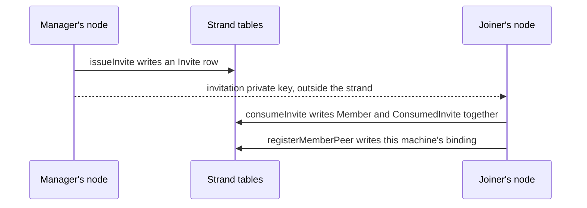

# Closed-strand membership

A closed strand records who belongs to it in tables inside its own database. This document covers how the founder writes the first rows, how another party joins with a single-use invitation, how each party's machines are recorded, what a manager may do, and what removing a member does and does not achieve. It is for app developers who manage a closed strand's members and for maintainers of the membership code.

Related: [Strands: model and lifecycle](lifecycle.md) · [Inviting and joining](formation.md) · [Closed-strand keys and what a joiner keeps](keys.md) · [Adding and removing machines](../cadre/membership.md)

## The membership tables

Every strand's database has a `Strand` schema beside the app's `App` schema. [`schemas/strand.qsql`](../../schemas/strand.qsql) declares it and states each constraint with its reason; this document describes the model. These tables are the second of the [three layers of consent](lifecycle.md#three-layers-of-consent).

An open strand holds only `Header` and `AppSchemaVersion` (see [app schema versions](app-schema.md#app-schema-versions-across-a-strands-members)). The other tables refuse every write unless the header says the strand is closed.

| Table | A row means | Written by |
|---|---|---|
| `Header` | The strand's id, type, sApp and schema. One row, never changed. | The founder, once |
| `Member` | A party belongs to the strand. The key is the public half of that party's membership key. | The founder (first row), a manager, or a joiner redeeming an invitation |
| `Manager` | This member may administer membership. | The founder (first row), then an existing manager |
| `MemberPeer` | A machine, named by its peer id in the strand's network, acts for a member. This document calls the row a **binding**. | The member's own key |
| `Invite` | A manager issued a single-use invitation. | A manager |
| `ConsumedInvite` | An invitation was used, and for which member key. | The holder of the invitation's private key |
| `CancelledInvite` | A manager cancelled an invitation. | A manager |
| `Revocation` | The stamp of a deleted `Member`, `Manager` or `MemberPeer` row is retired. | Whoever signs the delete |

A party's **membership key** is its own signing key for one strand, kept in its control database. It is not the strand's read secret, which every member party holds; [keys.md](keys.md#closed-strand-member-key-handling) explains the two keys.

A member is a key. Nothing in these tables says which person or organisation a `Member` row belongs to. An app that shows names keeps that mapping in its own `App` tables.

A machine's peer id in a strand's network differs from its control peer id. A binding names the strand one, called the **strand peer id** here.

## Calling the membership writers

Every write to these tables goes through a function in [`strand-membership-writer.ts`](../../packages/cadre-core/src/strand-membership-writer.ts), exported from `@serfab/cadre-core`. Each takes the strand's Quereus database and the key pair that signs. The runtime calls the writers for a join and for machine bindings. Manager actions have no `CadreNode` method: the app calls the writer.

```ts
import { revokeMember, strandMemberKeyPair } from '@serfab/cadre-core';

// `instance` is the StrandInstance that foundStrand or addStrand returned.
const db = instance.database!.getDatabase();

// This party's membership key for the strand, as a signing key pair.
const partyKey = await node.getControlDatabase()!.queryStrandPartyKey(strandId);
const managerKeyPair = strandMemberKeyPair(partyKey!);

await revokeMember(db, { managerKeyPair, memberKey });
```

What a caller can rely on:

- **One call is one transaction.** A writer reads and signs first, then sends its statements to Quereus as one batch that commits or rolls back whole.
- **A writer joins a transaction the caller already has open.** The caller then owns the commit, and the constraints are checked once, at that commit. An app composes two writers that must commit together this way, such as a resignation and a departure. With `{ joinOpenTransaction: false }` the writer instead throws `StrandTransactionBusyError` and writes nothing.
- **A writer refuses while the strand's offline queue holds transactions.** It throws `StrandOfflineQueueBusyError`, because a membership commit is never queued and would wait behind the queued transactions while holding the database. Retry after the queue drains ([Offline mode](writes.md#offline-mode)).
- **Repeating a completed removal, binding, cancellation or seal is quiet.** The writer returns without writing when the rows are already in the state asked for, so a retry after a restart does not throw.
- **The schema decides what is allowed.** Checks in the writers exist for clear error messages, and a caller that writes these tables with raw SQL meets the same constraints.
- **Reads answer from the rows this node can see.** `isStrandMember`, `isStrandManager`, `isStrandSealed`, `listMemberPeers` and `listOutstandingInvites` can lag a write made elsewhere, so `false` can mean "not replicated here yet".

## Strand membership bootstrap

The first rows are written by the **founder**: the machine that the party's control `Strand` row names as the founding machine ([Founding a strand](lifecycle.md#founding-a-strand)). A joiner writes nothing at launch. It receives the founder's rows by replication, and its own membership arrives through [the invite-to-join handshake](#the-invite-to-join-handshake).

The founder bootstrap (`bootstrapFounderMembership`) runs when the strand database initializes on the founder. It writes the founding rows that are missing, in one strand transaction:

- **Open strand:** the `Header` row.
- **Closed strand:** the `Header`, the founding `Member`, the founding `Manager` at generation 0, and this machine's own binding.

The founding member and manager key is the public half of the founder party's membership key. A closed founder launch that finds no membership key throws, because a closed strand with no founding manager could never admit anyone.

### The founding rows are the only unsigned ones

The founding `Member` and `Manager` rows carry no signature, because no earlier key exists to sign them. The schema accepts them only in the founding state, which requires among other things that no manager stamp has ever been retired; the founding branch of `Manager.Authorized` lists the conditions. Every later row needs a signature from a key already seated.

On every machine but the founder, the member row and the binding are separate commits, member first, and [the deny set](#what-removal-does-to-the-network) depends on that order. The founder writes both in one transaction, which is acceptable because it commits before any other party has joined.

### Repeating the bootstrap

Each founding row is written only if its table does not already hold it. A restart, a repeated `addStrand` or a wake from hibernation therefore writes nothing, and a run after a founding commit that was saved in part writes what is missing. Three cases differ:

- **A sealed strand gets no manager.** The schema would refuse a new founding seat, so the bootstrap does not attempt one.
- **A strand that already has a member gets no binding from the bootstrap**, because the founder may since have left or been removed. The [membership loop](#how-the-runtime-completes-a-join) writes the binding.
- **A strand whose member rows hold the read-secret key is refused.** The launch fails with `PreSplitStrandIdentityError` ([keys.md](keys.md#a-strand-whose-founder-is-the-read-secret-key-is-refused)).

### Empty collections for every other table

On the run that finds no `Header`, the bootstrap first commits an empty collection for every table the two schemas declare and the founding transaction does not write. A read of a table nobody has written is then answered from the machine's own store, including while the other members are offline, and a joiner receives every table from the founder ([Joining: no writes before the first sync](formation.md#joining-no-writes-before-the-first-sync)). The step runs only while the header is absent, when no other machine can have written to the strand.

## Single-use approvals: stamps and tombstones

A signature over "admit key K" that stayed valid could be presented again after K was removed. The membership tables prevent that with stamps and tombstones, as the control database does ([control schema](../cadre/control-schema.md#stamps-and-tombstones)).

Every `Member`, `Manager` and `MemberPeer` row carries a `StampId`: 256 random bits minted when the row is created. Every signed approval over such a row covers the table, the action, the row's key and the row's stamp. An approval therefore authorizes one action on one incarnation of one row:

- **It cannot be used for another action.** Admission, removal by a manager, a member's own departure, resignation and sealing each sign a different action tag.
- **It cannot be used after the row is gone.** A delete must insert a `Revocation` tombstone naming the row's stamp in the same transaction, and no insert may carry a tombstoned stamp. Adding the same key again mints a new stamp, which the old approval does not cover.
- **A tombstone is permanent.** `Revocation` rows cannot be updated or deleted, and a stamp can be tombstoned only once its row is gone.

A tombstone must be signed by a key that was a member before the transaction. This is why a manager must also be a member: a manager with no member row could not revoke anyone, clear a binding, or resign.

The invitation tables do not use stamps. `Invite`, `ConsumedInvite` and `CancelledInvite` are insert-only and their primary key is the invitation's own key, so an insert presented a second time collides on the primary key.

The schema lists the fields each approval signs beside its constraint. One detail matters to anyone signing outside the writers: a manager's `Generation` is signed as a number. The digest encodes a value's type, so the integer `1` and the text `'1'` produce different signatures.

## The invite-to-join handshake

A party that did not found a closed strand becomes a member by redeeming a **membership invitation** that a manager issued. It is not the formation invitation ([Formation invitations](formation.md#formation-invitations)), which records a party's consent in the inviter's control database; the membership invitation seats a member in the strand's own tables.



**Issuing.** `issueInvite` generates a new key pair for the invitation, and the public key becomes the `Invite` row's key. The row needs two signatures over the key and the expiry: one by a manager, and one by the invitation's own private key, which shows that the issuer holds it. The private key is returned to the caller and never stored in the strand. Whoever holds it can redeem the invitation once.

**Redeeming.** `consumeInvite` inserts the joiner's `Member` row and a `ConsumedInvite` row in one transaction. The member row is admitted because of the consumption row, and the consumption row is accepted because the invitation's private key signed it over the invitation and the joiner's key. Neither row can be committed without the other.

Four rules bound a redemption:

- **Once.** `ConsumedInvite`'s primary key is the invitation key, so a second redemption is refused and admits nobody.
- **Before expiry**, when the invitation has one.
- **Not after cancellation.** A `CancelledInvite` row for the invitation refuses the redemption.
- **Not after sealing**, even for an invitation issued before the seal ([Sealing a strand](#sealing-a-strand)).

### How the runtime completes a join

An app does not call `issueInvite` or `consumeInvite` for an ordinary join. Redeeming a formation invitation for a closed strand does both:

1. The inviting party's node issues a membership invitation under its own membership key and returns the private key in the formation result ([What the responder checks, in order](formation.md#what-the-responder-checks-in-order)). The invitation expires after 7 days (`MEMBERSHIP_INVITE_TTL_MS`).
2. The joining node makes sure its party has a membership key for the strand ([keys.md](keys.md#where-each-key-comes-from)) and keeps the invitation in memory.
3. When the strand starts on a machine of the joining party, a background **membership loop** (`strand-membership-reconciler.ts`) redeems the invitation under the party's key and then writes that machine's binding.

The loop runs on every machine that launches a closed strand with a membership key, at launch and at every wake from hibernation, and never delays or fails the launch. Its rules:

- **It retries until the join is complete.** A joiner's first attempts usually fail because the `Invite` row has not replicated to it yet. Retries start at 1 second and double up to the poll interval.
- **It waits at the poll interval when it has nothing to redeem.** A machine whose party has no member row and no invitation can only wait to be admitted, and logs one warning after 10 such passes.
- **It spends an invitation it no longer needs.** If the member row is already there (another machine of the party redeemed first, or a manager admitted the party), the loop writes the `ConsumedInvite` row alone, so that nobody else can use the invitation.
- **It drops a dead invitation and keeps waiting.** An expired, cancelled or already-used invitation cannot be redeemed; a manager's direct admission or a new formation can still seat the party.
- **It stops when nothing is left to do:** the party is seated, every known machine of the party is bound, and no invitation is waiting. It also stops when the node finds its party removed and holds no invitation, and on a sealed strand that refuses the redemption. A new invitation or a change to the party's machines starts it again.

`CadreNodeConfig.strandMembershipReconciliation` sets `pollIntervalMs` (default 30 seconds) and `enabled`. `enabled: false` is for test fixtures that call the writers by hand: a node with the loop off never seats a joiner and never binds a machine.

### Admitting a party without an invitation

A manager can seat a member directly with `addMemberByManager`, signing over the new member's key. This is the path for a party whose public membership key the manager already has, and the only way to re-admit a removed party ([What removal still does not do](#what-removal-still-does-not-do)).

`admitManager` admits a key as a member and promotes it to manager in one transaction, so the key is never a manager without a member row.

### Cancelling an invitation

`listOutstandingInvites` returns the invitations that can still be redeemed. `cancelInvite` cancels one, permanently; to invite the same party again, issue a new invitation.

A cancellation is a new row, never a delete of the `Invite` row: a deleted invitation could be re-created by presenting its original signatures again. It is accepted even on a node that does not hold the `Invite` row yet, because refusing it there would leave the invitation usable.

### The `EnrollmentService` adapters

`StrandMemberVerifier` and `StrandMemberRegistry` (`strand-member-registry.ts`) implement `EnrollmentService`'s member-registration interfaces over a strand's tables. No runtime path uses them; the membership loop performs joins.

## Binding the party's machines

A binding is a signed, replicated record that one machine acts for one member. The remaining members' machines use bindings to recognise a removed party's machines ([What removal does to the network](#what-removal-does-to-the-network)), so every machine of every member party needs one. Nothing reads bindings to decide which peers to admit; [Limits and accepted tradeoffs](#limits-and-accepted-tradeoffs) says why.

A binding is signed by the member's key and needs no manager. Every machine of a party holds the party's membership key, so any machine of the party can bind any machine of the party. The membership loop does this:

- **Each machine publishes its strand peer id to its own party.** At every launch and wake, the machine writes a `StrandPeer` row to its control database, in the background: the strand, its control peer id and its strand peer id, signed by its identity key. These rows are never updated or deleted, so a removed machine's bindings can still be attributed to it.
- **Each machine binds itself.** After the party's member row is visible locally, the loop writes the machine's own binding.
- **Each machine that holds the membership key binds every live sibling.** On each pass the loop reads the strand's `StrandPeer` rows and the party's current machines, and writes a binding for every live machine that lacks one under the party's current key. A machine that was offline while the party's key changed is already bound when it returns, and a machine that holds no membership key is bound by its siblings.
- **A removed machine's binding under the current key is cleared**, unless the party is replacing its key in this strand. During a replacement that binding is the evidence that will get the removed machine refused, and clearing it would let the machine back in as an unknown peer ([Replacing the party's key](keys.md#replacing-the-partys-key)).

A machine whose only binding is under a key that has left the strand is refused by every other machine and cannot write its own new binding. A sibling binds it under the current key, the other machines stop refusing it, and its own loop starts again.

A pass runs at launch and wake, when an invitation arrives, when the party's `StrandPeer`, `CadrePeer` or `Revocation` table changes, and on the loop's own retry timer.

Bindings are added and deleted, never edited, because an update would let any member point another member's binding at its own key.

## Who may administer a closed strand

A closed strand's administrators are its managers: the rows of the `Manager` table. Issuing or cancelling an invitation, admitting a member directly, promoting a manager and removing a member all require the signer to hold a manager row. Managers are equal: any manager can remove any other.

- **A manager is also a member.** Promoting a key with no member row is refused, and a member row cannot be deleted while its key still holds a manager row. A manager resigns first, or does both in one transaction.
- **Every promotion is signed by a manager with a strictly smaller generation.** The founder is generation 0, and `addManager` seats a new manager one above the manager who signed. Two keys therefore cannot promote each other in one transaction, and a key cannot promote itself; the comment on `Manager.Authorized` in the schema gives the argument.
- **Generation is not rank.** It records who appointed whom, and a later-generation manager can remove an earlier one.
- **A manager leaves by resigning or by being removed by another manager.** The two sign different approvals, so neither can be presented as the other.
- **A manager row is added or deleted, never edited.** A resignation proves only that the outgoing key consented, and an edit would let that signature point the seat at another key.
- **Handing over sole control is promote, then resign.** One transaction that deletes the only manager and inserts a replacement is refused.

### Sealing a strand

The last manager cannot resign. `removeManager` refuses and names `sealStrand`, which deletes the last manager row under its own action tag, so that emptying the manager table is always a deliberate signed act and a collected resignation can never be used for it.

A sealed strand's membership can never grow: with no manager, nobody can be invited, admitted or promoted. That is the purpose: no key remains that could admit a new member.

Sealing cannot be undone. The unsigned founding seat is refused once any manager stamp has been retired, so a remaining member cannot seat itself as a new founder.

Members of a sealed strand can still leave until one remains, and can still add and clear their own bindings. A binding left behind by a member who was removed before the seal can be cleared only by a manager, so it stays.

`isStrandSealed` requires a retired manager stamp as well as an empty manager table, which separates a sealed strand from a replica that has not yet received the manager rows.

## Removing members

Removal follows the same rules as admission:

- **Any manager can remove any member** with `revokeMember`.
- **A member can leave** with `leaveStrand`, signed by its own key. The signature is checked against the row being deleted, so one member cannot remove another this way.
- **The last member cannot be removed and cannot leave.** A closed strand always keeps at least one member, sealed or not.
- **A removed member cannot return on the invitation it joined with.** Admission through an invitation requires a consumption written in the same transaction, and that invitation's consumption row was committed long before.

### What removal does to the network

Deleting a member's row does not by itself stop that party's machines from using the connections they hold. Each machine of a closed strand therefore keeps a **deny set**: every strand peer id that has a binding under a key with no member row, and no binding under a key that has one. Such a binding can only mean that the member existed and was removed, because a binding is accepted only when its member row exists and every writer commits the member row first.

- **Remaining machines refuse the removed party's machines.** A machine refuses inbound connections, request streams and relay reservations from a peer in its deny set, does not dial it, and closes the connections it already has to it.
- **The leftover bindings are the record.** The `Revocation` tombstone keeps only a stamp, so the removed member's bindings are the only replicated record of which machines belonged to it. Removal therefore leaves them in place.
- **Each machine acts when the removal reaches it.** A machine that has not yet received the removal keeps serving the removed party. A machine denies only on rows it holds, because refusing on an incomplete view would cut off a legitimate member for a reason that member can neither see nor fix.
- **The first write after a removal may need a retry.** The remaining machines must first detect that the removed machines are unreachable, and a write made seconds after the removal can fail.
- **The removed party's machines also refuse each other.** Their bindings are orphaned on their own replicas too. A machine never refuses itself, but it refuses its siblings, so an app that keeps a removed strand as a read-only archive has one archive per machine, each as of the moment the removal reached it.
- **A machine removed from its own cadre is refused the same way.** Its party replaces its membership key in the strand, which leaves that machine's binding under a key that is no longer a member ([Replacing the party's key](keys.md#replacing-the-partys-key)).
- **A delegate grant does not get around the deny set.** A grant ([Delegate grants](../network/strand-addressing.md#delegate-grants)) admits a connection and a relay slot on the granting party's own machine only, and each strand node the removed machine reaches still refuses its requests.

An open strand has no member rows, so its deny set is empty and the mechanism is not started.

### What the app has to call, and what the removed party is told

A manager's app removes a party with three steps. Only the first is required.

```ts
import { cancelInvite, listOutstandingInvites, revokeMember } from '@serfab/cadre-core';

await revokeMember(db, { managerKeyPair, memberKey });

// Optional: resolves once this node has closed its connections to the removed party.
await node.refreshRevocationEnforcement(strandId);

// Cancel any unused invitation the removed party may hold. The strand cannot tell
// which invitations those are, so the app or its user chooses.
for (const { inviteKey } of await listOutstandingInvites(db)) {
	if (wasIssuedToRemovedParty(inviteKey)) {
		await cancelInvite(db, { managerKeyPair, inviteKey });
	}
}
```

`wasIssuedToRemovedParty` stands for the app's own record of whom it gave each invitation to.

**When each machine acts.** A machine rebuilds its deny set when a change to `Member` or `MemberPeer` reaches its storage, which is immediate on the machine that wrote the removal. It also rebuilds at least every 5 minutes. On a strand with more bound machines than its cluster size, a machine may store none of the membership data and so see no change; there it rebuilds every 30 seconds. `CadreNodeConfig.strandRevocationEnforcement` sets `backstopMs`, and `enabled: false` turns the deny set off for the node's strands.

**What the removed party is told.** A node that finds its own strand peer id in its deny set emits `strand:revoked`, for a party that left as well as for one that was removed. The node stops nothing: the strand keeps running against its local data and its writes no longer reach anyone. Whether to stop the strand, warn the user or keep a read-only copy is the app's decision.

`strand:revoked` is best-effort in two ways:

- **It can be missed.** The node learns of the removal only if it replicated there before the other machines stopped talking to it, so a node that was offline at the time never receives it.
- **It can be wrong for a short time.** While a party replaces its membership key, a machine whose only binding is under the old key is refused until a sibling binds it under the new one. The event has already fired, and no event reports that the machine is served again.

**Do not clear a removed member's bindings as routine cleanup.** A manager can list them with `listMemberPeers` and delete each with `removeMemberPeer`, but deleting a binding also removes that machine from every deny set. Clear a binding only for a machine that is gone for good. Code that reads bindings must join to `Member`: a binding alone does not prove membership.

### What removal still does not do

- **It does not let the removed party return by itself.** A new formation invitation still reaches a removed party, because formation runs between control networks. The party's node then fails to redeem the membership invitation: redeeming is a write into the strand, and the remaining machines refuse the machines that would carry it. A remaining manager re-admits the party with `addMemberByManager`; the party's loop then sees its member row and spends the leftover invitation.
- **It reports the failed return, without certainty.** The removed party's node logs one warning and emits `strand:rejoin-blocked`, either when it knows it was removed and holds an invitation, or after 10 attempts that left the invitation unredeemed. In the second case the invitation may only be slow to replicate.
- **It does not take back what the party already has.** The removed party keeps the data its machines replicated and keeps the strand's read secret. What keeps new data from it is the refusal of its recorded machines; the read secret is not checked ([keys.md](keys.md#limits-and-accepted-tradeoffs)).
- **It does not cancel an unused invitation.** A removed party that holds one redeems it as soon as any of its writes is accepted. Only the refusal of its machines prevents that, and the refusal is not a rule of the schema. Cancel the invitation when removing the party.

## Limits and accepted tradeoffs

- **Membership rules are checked against the rows one node can see.** No rule is checked across nodes, and none is planned; the replayed approval, the manager without a member row, the broken last-member rule and the late seal in this list follow from that. On a strand with more machines than its cluster size, the time a machine outside a block's cluster takes to receive a change is not bounded (ticket `debt-replication-proof-above-cohort-size`).
- **An approval can be used again on a node that has not seen the tombstone.** Such a node accepts a captured admission or promotion for a row that was deleted elsewhere, and after the nodes merge the re-created row exists beside its tombstone. Nothing on the read side removes it.
- **A manager can end up without a member row.** If one node promotes a key while another node, out of contact, removes that key's member row, each write passes locally and the merged strand has a manager seat with no member row behind it. That manager cannot sign any tombstone.
- **The last-member rule can be broken by concurrent removals.** Two nodes out of contact that each remove a different member can both see a remaining member and converge on none. Two that each remove the other's manager row can likewise converge on no manager, which `isStrandSealed` then reports as sealed although nobody signed a seal.
- **A seal takes effect on a node only when it arrives there.** Until then that node still sees a manager and still admits, so a party that holds an invitation issued before the seal can redeem it there and stay a member after the seal arrives. An invitation can likewise be redeemed on a node that has not received its cancellation.
- **An invitation names no invitee.** The strand keeps no record of whom it was meant for, so removal cannot cancel a departing member's invitations (ticket `feat-strand-invitee-bound-invites`).
- **Admission to the strand's network is a deny list.** A peer with no binding is served. A peer that was never a member can therefore read a closed strand, and a modified client on a removed machine can present a new peer id and be treated as a stranger. Admitting only bound peers is not built: a joiner's first membership writes must travel through the machines that would refuse it, and a machine that has not yet received a new binding would refuse a legitimate member (ticket `feat-strand-member-allowlist-admission`).
- **The network refusal fails open.** A failed read of the membership tables leaves a machine's previous deny set in place.
- **Leaving at the control layer does not leave the membership.** `unpublishStrand` and `forgetJoinedStrand` remove the party's control rows. They do not delete the party's `Member` or `Manager` row, and `unpublishStrand` deletes only the calling machine's binding, if the strand is reachable. `unpublishStrand` also destroys the party's membership key, so nobody can sign for those seats again. A party that is the strand's only manager should promote a successor, resign and call `leaveStrand` before it unpublishes.
- **A join can be saved in part.** Optimystic commits `Member` and `ConsumedInvite` as separate collections and can save only one. If the consumption is saved without the member row, the invitation is spent and cannot seat the party. The membership loop logs one warning and drops the invitation; a manager admits the party with `addMemberByManager` (ticket `strand-half-committed-join-recovery`).
- **A founding commit can be saved in part.** If the founder's binding is saved without its member row, every machine reads the founder as removed until a later bootstrap run seats the member.
- **Only the founding party can issue invitations through formation.** A formation invitation is bound to a strand through the host party's control `Strand` row, which only the founding party has. A manager from another party invites by calling `issueInvite` or `addMemberByManager` itself.
- **A membership invitation waiting to be redeemed is held in memory.** If the joining node restarts before its membership loop redeems it, the party needs a new formation invitation. A join made through `requestJoin` is not affected, because it stores the invitation in the party's control database ([Joining while the inviter is offline](formation.md#joining-while-the-inviter-is-offline)).
- **`Revocation` and `CancelledInvite` only grow.** They are never pruned. A member can also add tombstones for stamps that never existed, which have no effect beyond their size.
- **A lookup by full primary key can miss on a networked strand.** The writers and readers in `strand-membership-writer.ts` scan and compare in JavaScript for this reason, which costs a full table read per call. App code that reads these tables should do the same (ticket `debt-composite-pk-point-lookup-unreliable-untracked`).
